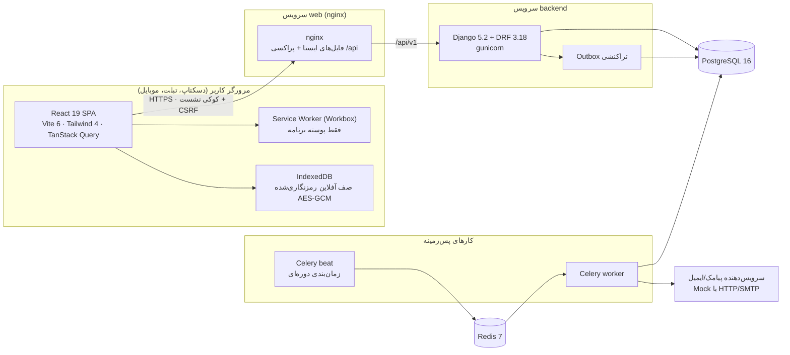

# ۲. مستند فنی و معماری

**مبنا:** شاخه `qa/audit-c6a1c88` · کد محصول ممیزی‌شده: `e661188` و `d478da7` (اصلاح دسترس‌پذیری) · خط پایه: `c6a1c88`

**برچسب‌های اعتبار ادعا** — هر بند یکی از این برچسب‌ها را دارد:

- **[موجود در کد]**: مستقیماً در فایل، تنظیمات، مهاجرت یا آزمون دیده شده است؛ مسیر منبع کنار آن آمده است.
- **[استنباط از معماری]**: نتیجه‌گیری از کنار هم گذاشتن چند منبع؛ صریحاً در کد نوشته نشده است.
- **[پیشنهاد توسعه]**: پیشنهاد برای فاز بعد؛ هنوز وجود ندارد.

---

## ۱. نمای کلی معماری

سامانه یک برنامه وب تک‌صفحه‌ای (SPA) فارسی و راست‌به‌چپ است که روی یک API از نوع REST و یک پایگاه داده رابطه‌ای کار می‌کند. کارهای پس‌زمینه (اعلان، پیامک، ایمیل، پاک‌سازی خروجی‌ها) از مسیر جداگانه Celery و Redis انجام می‌شوند. **[موجود در کد]** `infra/docker-compose.yml`، `backend/config/settings.py`، `frontend/vite.config.ts`



## ۲. فناوری‌ها

| لایه | فناوری و نسخه | منبع |
|---|---|---|
| Frontend | React 19، React Router 7، TanStack Query 5، TanStack Table 8، react-hook-form + zod، Tailwind CSS 4، Radix (Dialog، Popover، Dropdown)، Recharts 2، lucide-react، jalaali-js، idb | `frontend/package.json` |
| Build و PWA | Vite 6، vite-plugin-pwa (Workbox)، TypeScript 5.8 | `frontend/package.json`، `frontend/vite.config.ts` |
| Backend | Python 3، Django 5.2.18، Django REST Framework 3.18.3، drf-spectacular 0.30 (OpenAPI)، gunicorn 26، whitenoise | `backend/requirements.txt` |
| داده | PostgreSQL 16 (psycopg 3)، `dj-database-url` | `infra/docker-compose.yml`، `backend/requirements.txt` |
| پس‌زمینه | Celery 5.6 و Redis 7 | `backend/config/celery.py`، `backend/config/settings.py` |
| فایل و رمزنگاری | openpyxl (XLSX)، Pillow (لوگو)، `cryptography` (Fernet برای راز سرویس‌دهنده‌ها) | `backend/requirements.txt`، `FIELD_ENCRYPTION_KEY` |
| آزمون | pytest + pytest-django، vitest + fake-indexeddb + jsdom، Playwright 1.56 و `@axe-core/playwright` 4.10 | `backend/pytest.ini`، `frontend/package.json` |

همه موارد این جدول **[موجود در کد]** هستند.

## ۳. ساختار پوشه‌ها

**[موجود در کد]**

```text
backend/
  config/           settings.py · urls.py · celery.py · wsgi.py
  apps/
    common/         مدل پایه، ممیزی (audit.py)، Outbox، احراز هویت 401، تاریخ تهران (dates.py)
    iam/            کاربر، نقش، قابلیت‌ها (capabilities.py)، authz.py، ورود و رمز
    catalog/        طرح، محصول، رویداد، عضویت تیم
    crm/            مخاطب، سازمان، ثبت (لید)، فرصت، ارجاع، وظیفه، برچسب، تکراری، قرنطینه
    notify/         قاعده، قالب، کمپین، درخواست اقدام، کار ارسال، آداپتورهای Mock/HTTP/SMTP
    reports/        داشبورد، خروجی CSV/XLSX، گزارش ممیزی
    branding/       لوگو و تنظیمات هویت بصری
  tests/            آزمون‌های pytest (از جمله test_qa_audit.py)
frontend/
  src/pages/        Login، Capture، Leads، LeadDetail، Inbox، Notifications، Dashboard، Reports، Messages، Profile
  src/pages/admin/  Events، Users، Catalog، DataQuality، Notify، Settings
  src/lib/          api.ts، auth.tsx، offline.ts (+ تست)، hooks.ts، labels.ts، format.ts
  src/layout/       AppShell.tsx (منوی نقش‌محور، نوار پایین موبایل)
  e2e/ · qa-e2e/    آزمون‌های Playwright (مجموعه اصلی و مجموعه QA)
infra/              docker-compose.yml، backup.sh، restore.sh
docs/               ADRها، openapi.yaml، data-dictionary.md، permissions-matrix.md، domain-state-machines.md
qa/                 گزارش‌ها، CSVها، اسکرین‌شات‌ها و شواهد ممیزی
```

## ۴. اجرای محلی و تولیدی

- **[موجود در کد] اجرای محلی** (`README.md` بخش Run locally):
  - Backend: `python manage.py migrate`، سپس `seed_demo --reset` (داده نمونه ساختگی)، سپس `runserver 127.0.0.1:8000`.
  - Frontend: `npm ci && npm run dev` روی پورت 5173؛ مسیر `/api` به 8000 پراکسی می‌شود.
- **[موجود در کد] پشته جدا برای QA:** `qa/scripts/qa-stack.sh` روی پایگاه داده `expo_leads_qa` اجرا می‌شود؛ API روی 8001 و UI روی 5174.
- **[موجود در کد] تولید:** `docker compose up -d --build` و سپس `python manage.py sync_roles`.
  - Compose شامل این سرویس‌هاست: `db` (postgres:16-alpine)، `redis` (redis:7-alpine)، `backend`، `worker` (`celery -A config worker`)، `beat` (`celery -A config beat`) و `web` (nginx).
  - منبع: `infra/docker-compose.yml`
- **[موجود در کد] پشتیبان‌گیری:** `infra/backup.sh` و `infra/restore.sh` (نیازمند Docker).
- **[موجود در کد] محدودیت ممیزی:** در محیط ممیزی ساخت Docker اجرا نشد (BLOCKED؛ `qa/RELEASE-GATES.fa.md` دروازه G15). فقط `docker compose config` اعتبارسنجی شد.

## ۵. متغیرهای محیطی

**[موجود در کد]** — فهرست از `backend/config/settings.py` استخراج شده است.

| متغیر | کاربرد | پیش‌فرض یا رفتار |
|---|---|---|
| `DJANGO_SECRET_KEY`، `DJANGO_DEBUG`، `DJANGO_ALLOWED_HOSTS`، `DJANGO_CSRF_TRUSTED_ORIGINS` | پایه Django | CSRF پیش‌فرض: `localhost:5173` |
| `DATABASE_URL` | اتصال PostgreSQL | — |
| `FIELD_ENCRYPTION_KEY` | کلید Fernet برای رمزنگاری راز سرویس‌دهنده‌های پیامک/ایمیل (`apps/common/crypto.py`)؛ موبایل و ایمیل مخاطب رمزنگاری نمی‌شوند | در توسعه از `SECRET_KEY` مشتق می‌شود؛ در تولید باید تنظیم شود |
| `SESSION_COOKIE_AGE` | عمر نشست | ۱۲ ساعت (۴۳۲۰۰ ثانیه) |
| `SECURE_COOKIES`، `SECURE_SSL_REDIRECT`، `SECURE_HSTS_SECONDS`، `SECURE_HSTS_INCLUDE_SUBDOMAINS` | کوکی امن، HTTPS و HSTS | HSTS: ۳۱۵۳۶۰۰۰ ثانیه |
| `DJANGO_NUM_PROXIES` | تعداد پراکسی معتمد برای تشخیص IP | در Compose برابر `1` |
| `LOGIN_THROTTLE`، `PASSWORD_FORGOT_THROTTLE`، `PASSWORD_RESET_IP_THROTTLE`، `PASSWORD_RESET_TOKEN_HOURS` | محدودیت نرخ و اعتبار توکن | ۱۰ در دقیقه، ۱۰ در ساعت، ۳۰۰ در ساعت |
| `CELERY_ENABLED`، `CELERY_BROKER_URL` | پردازش ناهمگام | اگر `false` باشد، اجرای درون‌فرایندی (eager) |
| `DISPLAY_TIME_ZONE` | منطقه زمانی نمایش و «امروز» | `Asia/Tehran`؛ ذخیره‌سازی در UTC |
| `EXPORT_ROOT`، `EXPORT_SYNC_ROW_LIMIT`، `EXPORT_TTL_HOURS` | خروجی داده | — |
| `MEDIA_ROOT`، `BRAND_MAX_UPLOAD_BYTES` | فایل‌های بارگذاری‌شده | — |
| `APP_BASE_URL`، `LOG_LEVEL`، `DEMO_MODE` | پیوندها، سطح لاگ، برچسب داده نمونه | `LOG_LEVEL=INFO` |
| `GUNICORN_WORKERS` | تعداد worker در gunicorn | ۳ (`backend/Dockerfile`) |

## ۶. فرایند Build و استقرار

- **[موجود در کد] Frontend:** `npm run build` ابتدا `tsc -b` و سپس `vite build` را اجرا می‌کند و خروجی در `dist/` قرار می‌گیرد. Service worker با `registerType: autoUpdate` ساخته می‌شود. منبع: `frontend/package.json`، `frontend/vite.config.ts`
- **[موجود در کد] Backend:**
  - تصویر Docker از `backend/Dockerfile` ساخته می‌شود و gunicorn آن را اجرا می‌کند.
  - فایل‌های ایستا با whitenoise سرو می‌شوند.
  - مهاجرت‌ها: یک مهاجرت اولیه برای هر اپ، به‌علاوه `iam/0002_system_roles`.
  - ممیزی بازگشت همه مهاجرت‌ها به zero و اعمال دوباره را آزمود (`qa/SECURITY-RELIABILITY-REPORT.fa.md` §۷).
- **[استنباط از معماری] نبود CI:** هیچ pipeline CI در مخزن دیده نشد؛ build و آزمون‌ها دستی یا با اسکریپت‌های `qa/scripts` اجرا می‌شوند.

## ۷. احراز هویت و نشست

- **[موجود در کد] ورود و نشست:** ورود با نام کاربری و رمز (`POST /api/v1/auth/login`) و نشست مبتنی بر کوکی Django.
  - کوکی‌ها: `SESSION_COOKIE_HTTPONLY=True` و `SameSite=Lax`.
  - CSRF برای همه درخواست‌های تغییردهنده اجباری است؛ توکن از `GET /auth/csrf` گرفته می‌شود.
  - منبع: `backend/config/settings.py` سطرهای ۱۰۴ تا ۱۰۹، `apps/iam/views.py`
- **[موجود در کد] پاسخ ۴۰۱ برای نبود نشست:** کلاس `SessionAuthentication401` با سرآیند `WWW-Authenticate` به‌جای ۴۰۳ پاسخ ۴۰۱ می‌دهد (اصلاح QA-D-04).
  - رویداد سراسری `expo:session-expired` در `frontend/src/lib/api.ts` کاربر را به صفحه ورود می‌برد.
  - منبع: `apps/common/authentication.py`؛ آزمون‌ها: `test_qa_unauthenticated_api_returns_401` و TC-AUTH-05
- **[موجود در کد] فعال‌سازی و بازنشانی رمز:**
  - توکن یک‌بارمصرف است و فقط هش آن ذخیره می‌شود (`PasswordResetToken.token_hash`).
  - پاسخ «فراموشی رمز» برای حساب موجود و ناموجود یکسان است.
  - منبع: `apps/iam/views.py`، `apps/iam/models.py`؛ آزمون: TC-AUTH-06
- **[موجود در کد] هویت آفلاین:**
  - آخرین پاسخ `/auth/me` رمزنگاری‌شده در IndexedDB نگه داشته می‌شود و پس از ۱۲ ساعت منقضی می‌شود (QA-D-16).
  - هنگام خروج، صف آفلاین و کلیدها پاک می‌شوند.
  - منبع: `frontend/src/lib/offline.ts` (`cachedContext`، `clearAll`)

## ۸. معماری RBAC

- **[موجود در کد] قابلیت‌ها:** مرجع واحد مجوز، فهرست ۲۴ قابلیت در `apps/iam/capabilities.py` (`CAPABILITIES`) است.
- **[موجود در کد] نقش‌ها و قاعده افزایشی:**
  - نقش فقط بسته‌ای از قابلیت‌هاست، با دامنه `GLOBAL` یا `EVENT`.
  - قابلیت مؤثر کاربر = اجتماع قابلیت‌های نقش‌های سراسری و نقش‌های عضویت‌های فعال در رویدادهای فعال.
- **[موجود در کد] ثبت لید همگانی:** قابلیت `interaction.create` برای هر عضویت فعال در رویداد فعال ضمنی است (اصل §21 طرح).
- **[موجود در کد] قابلیت‌های فقط‌سراسری:** ۱۳ قابلیت فقط سراسری‌اند (`GLOBAL_ONLY`)، مانند `user.manage`، `role.manage` و `audit.view`.
- **[موجود در کد] نقش‌های سیستمی:** ۸ نقش سیستمی با مهاجرت `iam/0002_system_roles` و دستور `sync_roles` ساخته می‌شوند. جزئیات در [سند ۵](05-user-roles-flows-and-permissions.fa.md).
- **[موجود در کد] محدوده دید ردیف‌ها:** در `apps/crm/scoping.py` (`visible_interactions`) اعمال می‌شود.
  - قاعده: همه لیدها با `lead.view.all`؛ در غیر این صورت ثبت‌های خود کاربر، به‌علاوه لیدهای رویداد، طرح یا محصول مجاز.
- **[موجود در کد] مجوز در سرور:** ماتریس API (۲۰ عملیات × ۹ پرسونا = ۱۸۰ مورد) همه مطابق انتظار بود. منبع: `qa/results/API-AUTHZ-MATRIX.csv`، `backend/tests/test_qa_audit.py::test_api_authorization_matrix`

## ۹. Routeها و ماژول‌های Frontend

**[موجود در کد]** — منبع: `frontend/src/App.tsx` و `frontend/src/layout/AppShell.tsx`

| Route | صفحه | نگهبان سمت کلاینت |
|---|---|---|
| `/login`، `/reset-password` | ورود و تعیین رمز | عمومی |
| `/` | خانه نقش‌محور | نشست |
| `/capture`، `/capture/queue` | ثبت لید و صف آفلاین | نشست؛ دکمه ثبت فقط با عضویت فعال (`capture_events`) |
| `/leads`، `/leads/:id` | فهرست و جزئیات لید | نشست؛ محدوده ردیف‌ها در سرور |
| `/inbox`، `/notifications`، `/profile` | کارتابل، اعلان‌ها، پروفایل | نشست |
| `/dashboard` | داشبورد تحلیلی | `dashboard.view` |
| `/reports` | گزارش و خروجی | `export.run` |
| `/messages` | پیام و درخواست اقدام | `notification.send` |
| `/admin/events`، `/admin/events/:id` | رویدادها و تیم‌ها | `event.manage` یا `event.team.manage` |
| `/admin/users` | کاربران | `user.manage` |
| `/admin/catalog` | طرح‌ها و محصولات | `catalog.manage` |
| `/admin/accounts` | سازمان‌ها و مخاطبان | `contact.merge` یا `lead.view.all` |
| `/admin/duplicates` | بازبینی تکراری‌ها | `contact.merge` |
| `/admin/quarantine` | ثبت‌های آفلاین معلق | `sync.review` |
| `/admin/tags` | برچسب‌ها | `tags.manage` |
| `/admin/branding` | هویت بصری | `branding.manage` |
| `/admin/notify` | اعلان، پیامک و ایمیل | `notification.configure` یا `provider.manage` |
| `/admin/roles` | نقش‌ها و مجوزها | `role.manage` |
| `/admin/audit` | گزارش ممیزی | `audit.view` |

- **[موجود در کد] نگهبان کلاینت فقط ظاهری است:** نگهبان `<Guard>` و پنهان‌سازی منو فقط تجربه کاربری‌اند. هر مسیر ممنوع، اگر مستقیم باز شود، پیام «دسترسی مجاز نیست» نشان می‌دهد و سرور ۴۰۳ برمی‌گرداند.
  - ماتریس نقش × مسیر × نما: ۱۴۴۰ PASS، ۰ FAIL و ۱۲ N/A. منبع: `qa/ROLE-DEVICE-MATRIX.csv`

## ۱۰. APIها و سرویس‌های Backend

- **[موجود در کد] تعداد و مستندات:** ۹۲ الگوی URL زیر `api/v1` از resolver خود Django استخراج شد. مستندات OpenAPI در `/api/v1/schema` و `/api/v1/docs` در دسترس است و نسخه ثبت‌شده آن `docs/openapi.yaml` است.

| گروه | نمونه endpointها (متدها) | ماژول |
|---|---|---|
| احراز هویت | `auth/csrf` (GET)، `auth/login`، `auth/logout`، `auth/me`، `auth/password/change`، `auth/password/forgot`، `auth/password/reset` | `apps/iam/views.py` |
| کاربر و نقش | `users`، `users/<id>`، `users/<id>/reset-password`، `roles`، `capabilities` | `apps/iam/views.py` |
| کاتالوگ و رویداد | `plans`، `products`، `events`، `events/mine`، `events/<id>/transition`، `events/<id>/clone`، `events/<id>/products`، `events/<id>/members` | `apps/catalog/views.py` |
| لید و فروش | `interactions` (GET/POST)، `interactions/sync`، `interactions/bulk-refer`، `interactions/<id>/{activities,qualify,refer,enrichment,tasks}`، `opportunities/<id>/stage`، `opportunities/<id>/tags` | `apps/crm/views.py` |
| کارتابل | `referrals`، `referrals/<id>/<action>`، `tasks`، `tasks/<id>/<action>`، `work-queue/counts` | `apps/crm/views.py` |
| داده پایه | `accounts`، `accounts/search`، `accounts/merge`، `contacts`، `contacts/search`، `duplicates`، `merges`، `sync-quarantine` | `apps/crm/views.py` |
| برچسب | `tags`، `tags/<id>`، `tags/<id>/<action>` | `apps/crm/views.py` |
| اعلان | `notifications`، `notifications/read-all`، `notifications/preferences`، `action-requests`، `campaigns`، `notify/providers`، `notify/templates`، `notify/rules`، `notify/jobs`، `notify/webhooks/sms/<id>` | `apps/notify/views.py` |
| گزارش | `dashboard`، `exports`، `exports/schema`، `exports/<id>/download`، `audit` | `apps/reports/views.py` |
| هویت بصری | `branding`، `branding/logo`، `branding/assets` | `apps/branding/views.py` |

## ۱۱. چرخه عمر لید و ارجاع

- **[موجود در کد] ثبت (Interaction):**
  - با `client_record_id` یکتا برای هر کاربر ساخته می‌شود (محدودیت `uniq_interaction_idempotency`). تلاش دوباره یا ارسال آفلاین هرگز ثبت تکراری نمی‌سازد.
  - داده خام غرفه در فیلدهای `captured_*` تغییرناپذیر می‌ماند.
  - وضعیت‌ها: `CAPTURED`، `REVIEWED`، `ARCHIVED`.
  - منبع: `apps/crm/models.py`، `interactions/sync`
- **[موجود در کد] فرصت (Opportunity):** فقط با ارزیابی صریح ساخته می‌شود (`POST interactions/<id>/qualify`). انتقال مرحله‌ها با `Opportunity.TRANSITIONS` کنترل می‌شود؛ جزئیات در [سند ۳](03-data-model.fa.md).
- **[موجود در کد] ارجاع (Referral):**
  - وضعیت‌ها: `PENDING`، `ACCEPTED`، `RETURNED`، `CANCELED`.
  - ارجاع جدید جایگزین ارجاع در انتظار قبلی می‌شود (`replaced_by`) و تاریخچه حفظ می‌شود.
  - بازگرداندن نیازمند دلیل است. مهلت از `Event.referral_sla_hours` می‌آید.
  - منبع: `apps/crm/models.py`، `apps/crm/views.py` (`ReferralActionView`)؛ آزمون‌ها: TC-REF-01..08
- **[موجود در کد] قرنطینه:**
  - ثبت آفلاینی که پس از پایان رویداد و مهلت `sync_grace_hours` برسد، در `SyncQuarantine` نگه داشته می‌شود و حذف نمی‌شود.
  - آزمون: TC-OFF-05

## ۱۲. محدودیت نرخ

**[موجود در کد]** — DRF throttle در `settings.py` و `apps/iam/views.py`.

| حوزه | محدودیت |
|---|---|
| ورود (`login`) | ۱۰ در دقیقه |
| «فراموشی رمز» | ۱۰ در ساعت برای هر IP |
| تعیین رمز با توکن | ۱۰ در ساعت برای هر توکن، به‌علاوه سقف ۳۰۰ در ساعت برای هر IP |

این طراحی اصلاح QA-D-02 است: پیش از آن، چند فعال‌سازی پشت یک NAT اداری، فعال‌سازی همه کاربران را مسدود می‌کرد.

**[پیشنهاد توسعه]** محدودیت نرخ برای ساخت خروجی (QA-R-04).

## ۱۳. مدیریت IP و پراکسی

**[موجود در کد]** `REST_FRAMEWORK["NUM_PROXIES"]` از `DJANGO_NUM_PROXIES` خوانده می‌شود و تابع `apps/common/audit.py::client_ip` از `X-Forwarded-For` به همان تعداد هاپ اعتماد می‌کند.

- **پیش از اصلاح (QA-D-03):** پشت nginx همه کاربران با IP پراکسی دیده می‌شدند.
- **آزمون‌ها:** `test_qa_proxy_*` و `test_qa_deployment_declares_trusted_proxy_hop`.

## ۱۴. Service Worker و کش

- **[موجود در کد] کش service worker:** Workbox فقط «پوسته برنامه» را پیش‌کش می‌کند (`globPatterns` شامل js، css، html، woff2، png و svg).
  - پاسخ‌های API هرگز در service worker کش نمی‌شوند (`runtimeCaching: []`).
  - مسیرهای `/api/` از navigateFallback مستثنا هستند.
  - منبع: `frontend/vite.config.ts`
- **[موجود در کد] داده آفلاین در IndexedDB:** داده آفلاین (صف ثبت، هویت و رویدادهای کاربر) با AES-GCM و کلید غیرقابل‌استخراج در IndexedDB رمزنگاری می‌شود.
  - برای هر کاربر فقط یک درخواست کلید هم‌زمان مجاز است (QA-D-22).
  - کوئری رویدادها با `networkMode: "always"` حتی آفلاین به کش رمزنگاری‌شده می‌رسد (QA-D-19).
  - منبع: `frontend/src/lib/offline.ts`، `frontend/src/pages/Capture.tsx`

## ۱۵. مدیریت خطا

- **[موجود در کد] کلاینت:**
  - `ApiError` در `frontend/src/lib/api.ts` خطای شبکه (`isNetwork`) را از خطای سرور جدا می‌کند.
  - پاسخ ۴۰۱ رویداد انقضای نشست را فعال می‌کند.
  - صفحات حالت‌های صادقانه دارند: «بارگذاری ناموفق بود»، «دسترسی مجاز نیست» و «اطلاعات رویداد بارگذاری نشد» (به‌جای «عضو نیستید»).
  - تصاویر این حالت‌ها در [سند ۷](07-screenshot-catalog.fa.md) آمده است.
- **[موجود در کد] سرور:**
  - خطاهای اعتبارسنجی DRF با پیام فارسی برمی‌گردند.
  - تعارض نسخه با `version` (optimistic locking) پاسخ ۴۰۹ می‌دهد؛ ماتریس API پاسخ ۴۰۹ را «مجاز ولی متعارض» شمرده است.
  - منبع: `apps/common/concurrency.py`، `apps/common/exceptions.py::Conflict`

## ۱۶. Logging و ردپای ممیزی

- **[موجود در کد] Logging:** لاگ متنی ساده به stdout با سطح `LOG_LEVEL`. منبع: `settings.py` سطر ۱۶۶
- **[موجود در کد] ردپای ممیزی:**
  - تابع `audit()` در `apps/common/audit.py` رکورد `AuditLog` می‌سازد: انجام‌دهنده، عمل، نوع و شناسه موجودیت، `before`، `after`، `metadata` و `ip_address`.
  - مقدارهای حساس پیش از ذخیره پاک‌سازی می‌شوند (`_scrub`).
  - نمونه عمل‌های ثبت‌شده:
    - `interaction.created`، `interaction.corrected`
    - `lead.enriched`، `opportunity.qualified`، `opportunity.stage_changed`، `opportunity.owner_changed`
    - `referral.created`، `referral.accepted`، `referral.returned`، `referral.reassigned`
    - `task.created`، `task.assigned`
    - `export.requested`، `export.downloaded`، `export.download_denied`
    - `user.created`، `user.password_reset_issued`، `role.updated`، `tag.created`، `sync.quarantined`
  - مشاهده از طریق `/api/v1/audit` با قابلیت `audit.view`.
- **[موجود در کد] تاریخچه کسب‌وکاری:** مدل `Activity` نوع فعالیت را ثبت می‌کند: `CAPTURED`، `CORRECTED`، `QUALIFIED`، `STAGE_CHANGED`، `OWNER_CHANGED`، `REFERRAL_*`، `TASK_*`، `TAG_*`، `MERGED` و غیره. همین داده در تاریخچه جزئیات لید نمایش داده می‌شود.

## ۱۷. پردازش پس‌زمینه و Outbox

- **[موجود در کد] زمان‌بندی Beat:** `CELERY_BEAT_SCHEDULE` در `settings.py`.

| کار دوره‌ای | فاصله اجرا |
|---|---|
| `process_outbox_task` | ۳۰ ثانیه |
| `process_jobs_task` | ۳۰ ثانیه |
| `dispatch_campaigns_task` | ۶۰ ثانیه |
| `scan_due_task` (مهلت‌ها و معوق‌ها) | ۳۰۰ ثانیه |
| `purge_expired_exports_task` | ۳۶۰۰ ثانیه |

- **[موجود در کد] Outbox و ارسال:**
  - رویدادهای دامنه (`interaction.captured`، `referral.accepted`، `referral.overdue`، `opportunity.qualified`، `action_request.created` و غیره) در همان تراکنش در `OutboxEvent` ثبت می‌شوند.
  - سپس به `NotificationJob` تبدیل می‌شوند؛ کلید `dedup_key` از ارسال تکراری جلوگیری می‌کند.
  - تحویل Mock هرگز `DELIVERED` گزارش نمی‌شود و وضعیت آن `SIMULATED` است.
  - آزمون با Celery و Redis واقعی: `qa/results/celery-check.json`

## ۱۸. آزمون‌ها

**[موجود در کد]** — اعداد از `qa/after/` و `qa/results/` آمده‌اند.

| نوع | ابزار | نتیجه نهایی |
|---|---|---|
| Unit و integration بک‌اند | pytest | ۱۵۷ از ۱۵۷ (`qa/after/pytest.txt`) |
| Unit فرانت‌اند (صف آفلاین) | vitest + fake-indexeddb | ۷ از ۷ (`qa/after/vitest.txt`) |
| Typecheck و build | tsc، vite | ۰ خطا، build موفق |
| E2E و ماتریس | Playwright، ۶ پروژه Chromium | ۳۹۰ PASS، ۰ FAIL، ۱۲ SKIP محدوده‌ای، ۳ BLOCKED |
| دسترس‌پذیری | axe-core (WCAG 2.2 AA) | ۰ نقض در ۶۶ اسکن (`d478da7`) |

## ۱۹. دسترس‌پذیری

**[موجود در کد]** — جزئیات در `qa/UX-ACCESSIBILITY-REPORT.fa.md`.

- **پیش از اصلاح:** ۸ قاعده نقض‌شده در ۲۱۴۵ گره.
- **پس از `e661188`:** ۳ قاعده در ۲۵ گره.
- **پس از `d478da7`:** صفر.
- **اصلاحات اصلی:**
  - رنگ متن کم‌رنگ از `#718198` (کنتراست ۳٫۵ تا ۳٫۹ به ۱) به `#5d6b81` (دست‌کم ۴٫۷ به ۱).
  - اتصال برچسب به کنترل و نقش‌های listbox.
  - `role=img` برای نمادهای دارای `aria-label`.
  - padding پایین برای جلوگیری از پوشیده شدن تمرکز در تبلت (QA-D-21).

## ۲۰. کارایی

اندازه‌گیری محلی و آزمایشگاهی؛ نه داده تولید. منبع: `qa/results/perf-api.json` و `qa/results/perf-ui.json`.

- **[موجود در کد] API:** P95 سریالی همه عملیات در بودجه بود؛ برای نمونه `GET /interactions` ۱۳۶ میلی‌ثانیه در برابر بودجه ۴۰۰. با ۱۰ کلاینت هم‌زمان روی سرور تک‌فرایندی، P95 به ۶۱۷ میلی‌ثانیه رسید.
- **[موجود در کد] LCP موبایل:**
  - بار گرم: ۰٫۶ تا ۱٫۰ ثانیه.
  - بار سرد `/login`: حدود ۳٫۷ ثانیه با شبکه ۱٫۶Mbps و CPU کندشده ۴ برابر (شبیه‌سازی).

## ۲۱. علت حجم بزرگ bundle و ریسک cold-load

- **[موجود در کد] حجم:** کل برنامه در یک بسته JS واحد حدود ۱٫۲۳ مگابایت است (۳۵۷ کیلوبایت gzip). Code-splitting مسیرها وجود ندارد: `frontend/src/App.tsx` همه صفحه‌ها را مستقیم import می‌کند. منبع: `qa/after/build.txt`
- **[استنباط از معماری] سهم کتابخانه‌ها:** Recharts، Radix، react-hook-form و zod برای صفحه‌هایی که کارشناس غرفه هرگز باز نمی‌کند (داشبورد، مدیریت) هم در بار اول دانلود می‌شوند.
- **[پیشنهاد توسعه] کاهش بار اول:** `React.lazy` برای `/dashboard`، `/reports` و `/admin/*`، و جداسازی Recharts در یک chunk مستقل (ریسک QA-R-07).

## ۲۲. محدودیت‌های مرورگر و محیط آزمون

**[موجود در کد]** — `qa/RELEASE-GATES.fa.md`، دروازه‌های G13 تا G15.

- **فقط Chromium 1194:** آزمون‌ها با شبیه‌سازی ابعاد، DPR و لمس اجرا شدند.
- **مسدود (BLOCKED):** WebKit (Safari و iOS) و Firefox، چون باینری در محیط نبود و نصب ممنوع بود. دستگاه فیزیکی و ساخت Docker هم اجرا نشدند.

## ۲۳. ملاحظات امنیتی

**[موجود در کد]** — `qa/SECURITY-RELIABILITY-REPORT.fa.md`.

- **CSRF:** اجباری است.
- **XSS:** محتوا به‌صورت متن رندر می‌شود (TC-SEC-01).
- **فایل بارگذاری:** SVG، XML و polyglot رد می‌شوند.
- **تزریق فرمول در خروجی:** CSV با پیشوند `'` و XLSX بدون سلول فرمول.
- **هش رمز:** هرگز در API نیست.
- **سرآیندها:** `nosniff` و `X-Frame-Options: DENY`.
- **نشت مخاطب بین رویدادها (QA-D-01):** اصلاح شد؛ پیشنهاد مخاطب فقط از لیدهای قابل‌مشاهده کاربر.

**ریسک‌های باز (QA-R-01..R-06):**

| شناسه | ریسک |
|---|---|
| R-01 | جست‌وجوی سازمان بین رویدادها |
| R-02 | امکان replay در webhook پیامک |
| R-03 | توکن دانلود در querystring |
| R-04 | نبود محدودیت نرخ برای خروجی |
| R-05 | نبود قفل عدم‌فعالیت |
| R-06 | ۱۱۳ عملیات OpenAPI بدون طرح‌واره بدنه |

## ۲۴. بدهی فنی

- **[موجود در کد] ریسک‌های فهرست‌شده:** R-06 (طرح‌واره OpenAPI ناقص) و R-07 (bundle واحد).
- **[استنباط از معماری] آزمون و استقرار:** CI خودکار در مخزن دیده نشد. آزمون‌های E2E به پشته محلی و `seed_qa` وابسته‌اند.
- **[استنباط از معماری] شمارش داشبورد:** داشبورد شمارش‌ها را در هر درخواست از جدول‌های عملیاتی محاسبه می‌کند. با رشد داده، به view یا جدول تجمیعی نیاز خواهد بود.
- **[موجود در کد] ثبت «اولین اقدام»:** زمان «اولین اقدام» فقط به‌صورت غیرمستقیم ثبت می‌شود (از `Activity.created_at` یا `Referral.responded_at`)؛ فیلد صریحی وجود ندارد. جزئیات در [سند ۴](04-data-analysis-and-kpis.fa.md).

## ۲۵. پیشنهادهای فاز دوم

همه موارد **[پیشنهاد توسعه]** هستند.

1. Code-splitting مسیرها و هدف LCP سرد کمتر از ۲٫۵ ثانیه.
2. Pipeline CI شامل pytest، vitest، tsc و یک زیرمجموعه Playwright روی Chromium، WebKit و Firefox.
3. آزمون روی دستگاه واقعی iOS و Android.
4. طرح‌واره کامل OpenAPI (R-06).
5. قفل عدم‌فعالیت برای دستگاه مشترک (R-05).
6. timestamp و nonce در webhook پیامک (R-02).
7. محدودیت نرخ برای خروجی (R-04).
8. جدول یا view تجمیعی برای KPIها و ثبت صریح رویداد «اولین تماس».
9. تصمیم مالک محصول درباره جست‌وجوی سازمان بین رویدادها (R-01).
