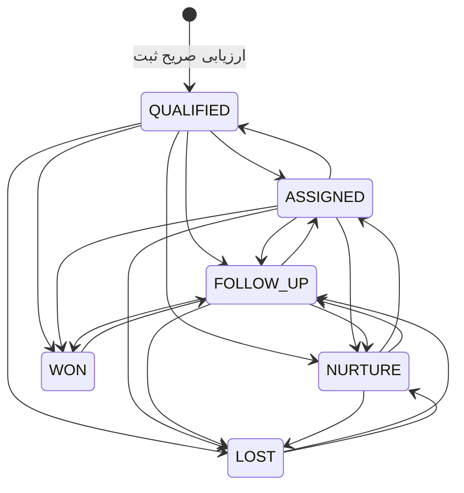
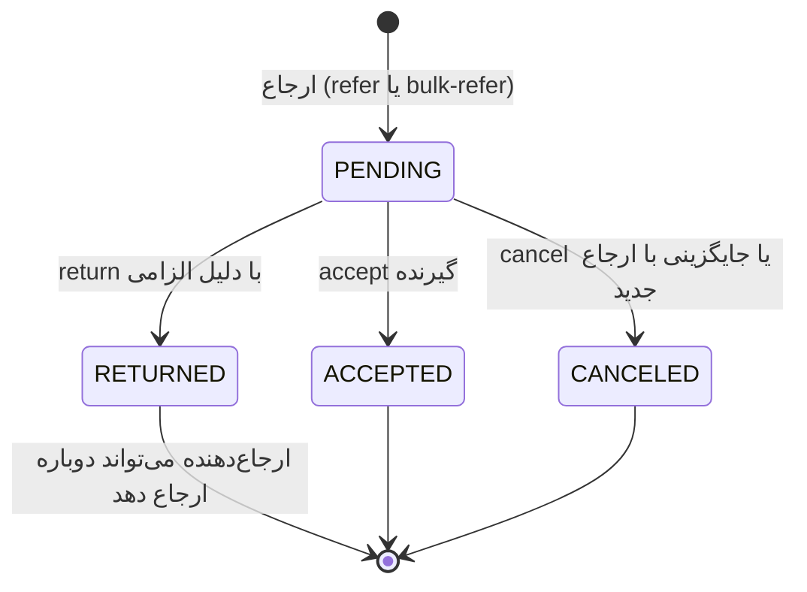
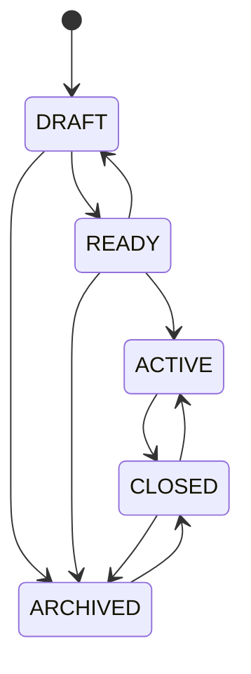
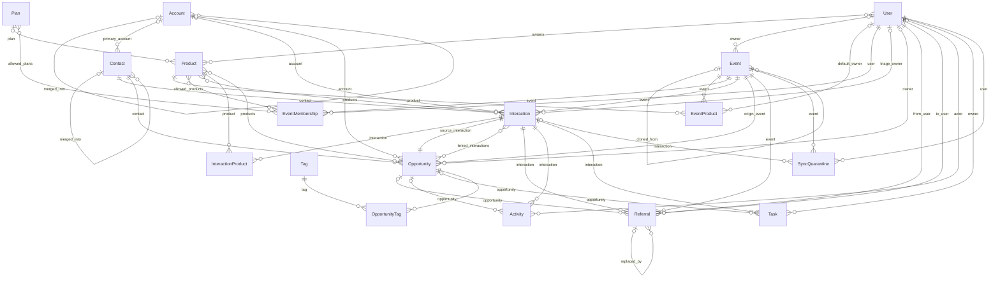
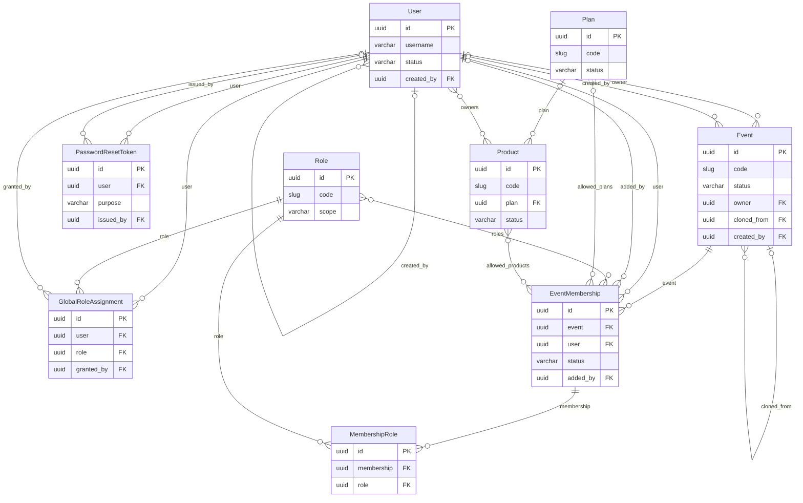
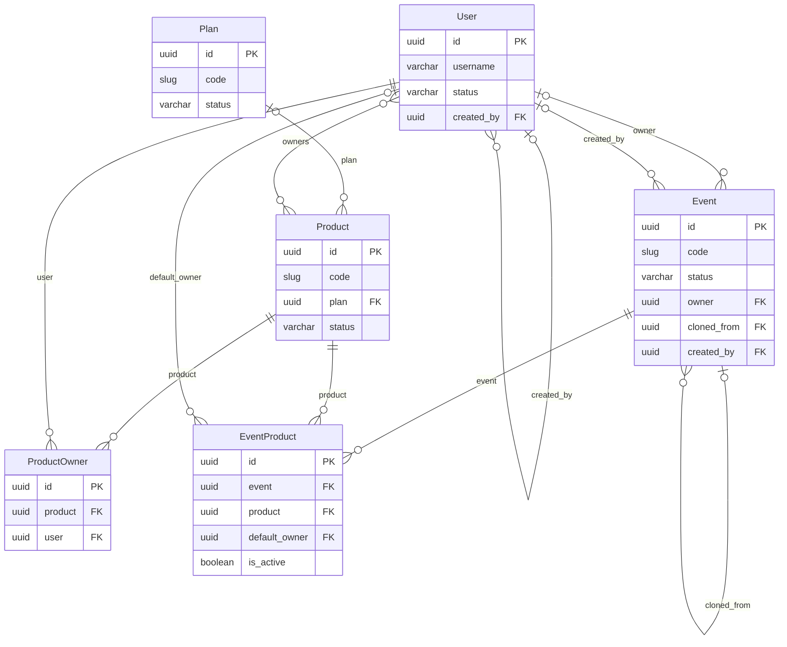
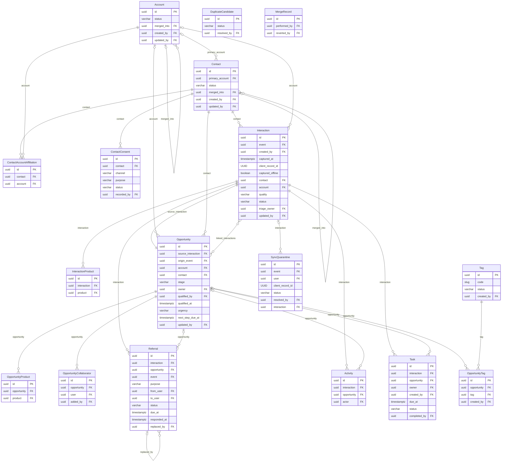
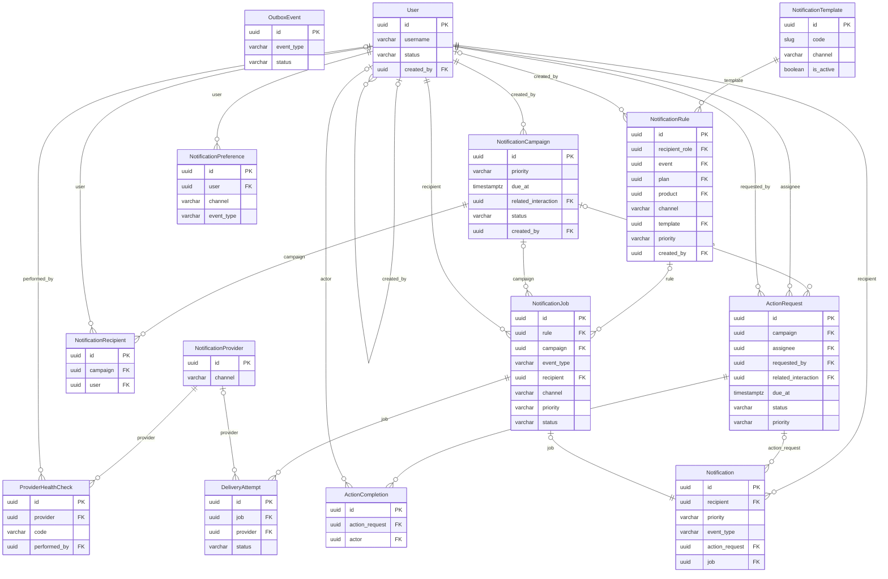
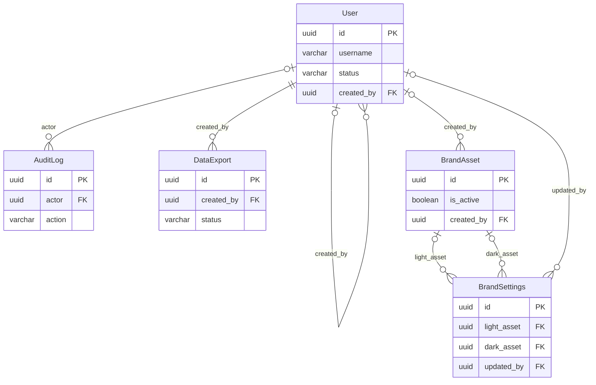

# ۳. مستند مدل داده

**مبنا:** کد شاخه `qa/audit-c6a1c88` (کد محصول `d478da7`). فهرست موجودیت‌ها، فیلدها، روابط، محدودیت‌ها و ایندکس‌ها با **درون‌نگری خود Django** (`django.apps.get_models()`) استخراج شده‌اند. هیچ جدولی حدسی نیست.

- **[موجود در کد]**: مشاهده‌شده در مدل یا مهاجرت.
- **[استنباط]**: نتیجه‌گیری از کد.
- **[پیشنهاد]**: هنوز وجود ندارد.

## ۱. خلاصه

| شاخص | مقدار | منبع |
|---|---|---|
| تعداد مدل (جدول) کسب‌وکاری | ۴۵ | `backend/apps/*/models.py` |
| اپ‌ها | `iam` (۴)، `catalog` (۷)، `crm` (۱۷)، `notify` (۱۲)، `reports` (۱)، `branding` (۲)، `common` (۲) | درون‌نگری |
| مهاجرت‌ها | یک مهاجرت `0001_initial` برای هر اپ، به‌علاوه `iam/0002_system_roles` | `backend/apps/*/migrations/` |
| پایگاه داده | PostgreSQL 16؛ زمان‌ها به UTC ذخیره و به `Asia/Tehran` نمایش داده می‌شوند | `config/settings.py` |
| قواعد حذف | ۳۱ رابطه `PROTECT`، ۳۰ رابطه `CASCADE`، ۴۸ رابطه `SET_NULL` | درون‌نگری |

**[موجود در کد] کلاس پایه:** همه موجودیت‌های کسب‌وکاری از `UUIDModel` در `apps/common/models.py` ارث می‌برند و این فیلدها را دارند:

- `id` از نوع UUID
- `created_at` با `auto_now_add` و ایندکس
- `updated_at` با `auto_now` و ایندکس

۱۴ مدلی که ویرایش هم‌زمان دارند، فیلد `version` هم دارند؛ تعارض نسخه پاسخ ۴۰۹ می‌دهد (`apps/common/concurrency.py`). این مدل‌ها `User`، `Plan`، `Product`، `Event`، `Account`، `Contact`، `Interaction`، `Opportunity`، `Task`، `Tag`، `NotificationProvider`، `NotificationTemplate`، `NotificationRule` و `ActionRequest` هستند.

## ۲. موجودیت‌های اصلی و مسئولیت آن‌ها

| حوزه | موجودیت | مسئولیت |
|---|---|---|
| هویت | `User`، `Role`، `GlobalRoleAssignment`، `PasswordResetToken` | کاربر، نقش (بسته قابلیت)، انتساب نقش سراسری، توکن یک‌بارمصرف |
| کاتالوگ | `Plan`، `Product`، `ProductOwner` | طرح و محصول و مالکان آن |
| رویداد | `Event`، `EventProduct`، `EventMembership`، `MembershipRole` | رویداد، محصولات عرضه‌شده، تیم و نقش‌های رویدادی |
| مخاطب | `Account`، `Contact`، `ContactAccountAffiliation`، `ContactConsent` | سازمان، شخص، وابستگی و رضایت |
| لید | `Interaction`، `InteractionProduct` | هر گفت‌وگوی غرفه = یک ثبت؛ محصولات مورد علاقه |
| فروش | `Opportunity`، `OpportunityProduct`، `OpportunityCollaborator`، `OpportunityTag`، `Tag` | فرصت پس از ارزیابی، برچسب‌ها و همکاران |
| پیگیری | `Referral`، `Task`، `Activity` | ارجاع، وظیفه و تاریخچه فعالیت |
| کیفیت داده | `DuplicateCandidate`، `MergeRecord`، `SyncQuarantine` | تکراری‌ها، ادغام قابل‌بازگشت، قرنطینه آفلاین |
| اعلان | `NotificationProvider`، `ProviderHealthCheck`، `NotificationTemplate`، `NotificationRule`، `NotificationCampaign`، `NotificationRecipient`، `ActionRequest`، `ActionCompletion`، `NotificationPreference`، `NotificationJob`، `DeliveryAttempt`، `Notification` | قواعد، کمپین، درخواست اقدام، صف ارسال و اعلان درون‌برنامه |
| زیرساخت | `OutboxEvent`، `AuditLog`، `DataExport`، `BrandAsset`، `BrandSettings` | صف تراکنشی، ممیزی، خروجی و هویت بصری |

## ۳. روابط کلیدی

**[موجود در کد]**

- **کاربر، نقش و مجوز:**
  - `User` ←چندبه‌چند→ `Role` از دو مسیر:
    - **سراسری:** از طریق `GlobalRoleAssignment` با یکتایی `(user, role)`.
    - **رویدادی:** از طریق `EventMembership` (یکتا روی `(event, user)`) و سپس `MembershipRole` (یکتا روی `(membership, role)`).
  - `EventMembership` می‌تواند دید عضو را به `allowed_plans` و `allowed_products` محدود کند (هر دو چندبه‌چند).
- **رویداد و لید:**
  - `Event` یک‌به‌چند `Interaction`.
  - هر `Interaction` به یک `Contact` و به‌صورت اختیاری به یک `Account` اشاره می‌کند.
  - محصولات مورد علاقه از طریق `InteractionProduct` ثبت می‌شوند (یکتا روی `(interaction, product)`). `product_code` برای گزارش کپی می‌شود.
- **لید و فرصت:** `Interaction` یک‌به‌یک `Opportunity` از طریق `Opportunity.source_interaction` با `PROTECT`. فرصت فقط پس از ارزیابی وجود دارد.
- **ارجاع:** `Referral` به `Interaction` (اجباری)، `Opportunity` (اختیاری)، `Event`، `from_user` و `to_user` اشاره می‌کند. ارجاع قبلی در `replaced_by` به ارجاع جدید پیوند می‌خورد.
- **وظیفه و فعالیت:** `Task` و `Activity` به `Interaction` و `Opportunity` با `CASCADE` وابسته‌اند.
- **برچسب:** `Tag` چندبه‌چند `Opportunity` از طریق `OpportunityTag`، با یکتایی `(opportunity, tag)`. نام برچسب فعال یکتاست (`uniq_active_tag_name` روی `name_normalized` با شرط `status = ACTIVE`).
- **پیام و اعلان:**
  - `NotificationCampaign` → `NotificationRecipient` و `ActionRequest`.
  - `NotificationJob` → `DeliveryAttempt` و `Notification`.
  - `ActionRequest.related_interaction` لید مرتبط را نشان می‌دهد.

## ۴. محدودیت‌ها و ایندکس‌ها

**[موجود در کد]** — تمام محدودیت‌های یکتای تعریف‌شده:

| جدول | محدودیت |
|---|---|
| `interactions` | `uniq_interaction_idempotency (created_by, client_record_id)`؛ ستون فقرات همگام‌سازی آفلاین بدون تکرار |
| `sync_quarantine` | `uniq_quarantine_record (user, client_record_id)` |
| `tags` | `uniq_active_tag_name (name_normalized) WHERE status='ACTIVE'` |
| `duplicate_candidates` | `uniq_duplicate_pair (entity_type, existing_id, candidate_id)` |
| `event_memberships` · `event_products` · `membership_roles` · `global_roles` · `product_owners` | یکتایی زوج‌ها |
| `interaction_products` · `opportunity_products` · `opportunity_collaborators` · `opportunity_tags` | یکتایی زوج‌ها |
| `contact_account_affiliations` · `notification_recipients` · `notification_preferences` | یکتایی زوج‌ها؛ `notification_preferences` روی سه‌تایی `(user, channel, event_type)` |

**[موجود در کد] ایندکس‌ها:**

- ایندکس مرکب `interaction_event_i_9fbabb_idx (event, captured_at)` روی `interactions`.
- هر کلید خارجی، ایندکس پیش‌فرض Django را دارد.
- `created_at` و `updated_at` همه موجودیت‌ها ایندکس دارند.
- `status` در `referrals` و چند جدول دیگر ایندکس دارد.
- `mobile` و `email` در `contacts` ایندکس دارند.

## ۵. Enumها و وضعیت‌ها

**[موجود در کد]** — `apps/crm/models.py`، `apps/catalog/models.py`، `apps/notify/models.py`، با برچسب‌های فارسی در `frontend/src/lib/labels.ts`.

| موجودیت.فیلد | مقادیر |
|---|---|
| `Interaction.quality` | `SERIOUS` جدی · `FOLLOW_UP` قابل‌پیگیری · `INTRO` آشنایی |
| `Interaction.status` | `CAPTURED` ثبت‌شده · `REVIEWED` بررسی‌شده · `ARCHIVED` بایگانی |
| `Opportunity.stage` | `QUALIFIED` واجد شرایط · `ASSIGNED` تخصیص‌یافته · `FOLLOW_UP` در حال پیگیری · `WON` موفق · `LOST` ناموفق · `NURTURE` پرورش |
| `Opportunity.urgency` | `LOW` کم · `MEDIUM` متوسط · `HIGH` زیاد |
| `Referral.status` | `PENDING` · `ACCEPTED` · `RETURNED` · `CANCELED` |
| `Referral.purpose` | `QUALIFICATION` · `FOLLOW_UP` |
| `Task.status` | `OPEN` · `DONE` · `CANCELLED` |
| `Event.status` | `DRAFT` · `READY` · `ACTIVE` · `CLOSED` · `ARCHIVED` |
| `EventMembership.status` | `ACTIVE` · `REMOVED` |
| `Contact.status` | `ACTIVE` · `MERGED` · `ARCHIVED` |
| `SyncQuarantine.status` | `PENDING` · `APPROVED` · `REJECTED` |
| `DuplicateCandidate.match_type` / `status` | `EXACT_PHONE` · `EXACT_EMAIL` · `FUZZY_NAME` / `OPEN` · `MERGED` · `DISMISSED` |
| `ActionRequest.status` | `OPEN` · `ACKNOWLEDGED` · `IN_PROGRESS` · `DONE` · `RETURNED` · `CANCELLED` |
| `ActionRequest.priority` و `Notification.priority` | `LOW` · `NORMAL` · `HIGH` · `URGENT` |
| `NotificationJob.status` | `PENDING` · `PROCESSING` · `SENT` · `DELIVERED` · `SIMULATED` · `FAILED` · `DEAD` · `SKIPPED` |
| `Activity.type` | `CAPTURED` · `CORRECTED` · `NOTE` · `CALL` · `MEETING` · `QUALIFIED` · `ENRICHED` · `STAGE_CHANGED` · `OWNER_CHANGED` · `REFERRAL_CREATED` · `REFERRAL_ACCEPTED` · `REFERRAL_RETURNED` · `REFERRAL_CANCELED` · `TASK_CREATED` · `TASK_COMPLETED` · `TAG_APPLIED` · `TAG_REMOVED` · `MERGED` · `STATUS_CHANGED` |

**[موجود در کد] استفاده از وضعیت‌های لید:**

- `Interaction.status=REVIEWED` در تابع `qualify()` (`apps/crm/services.py`) تنظیم می‌شود.
- برای `ARCHIVED` روی **ثبت** هیچ مسیر تنظیمی در کد پیدا نشد؛ مقدار تعریف شده ولی استفاده نشده است.
- بایگانی واقعی در سطح **رویداد** (`Event.status=ARCHIVED`) و **برچسب** انجام می‌شود.

## ۶. چرخه‌های عمر و انتقال‌های معتبر

**[موجود در کد] چرخه عمر فرصت** — `Opportunity.TRANSITIONS`:

**[موجود در کد] چرخه عمر ارجاع** — اقدام‌های `accept`، `return` و `cancel` در `ReferralActionView` (`apps/crm/views.py`)؛ جایگزینی در `Referral.replaced_by`:

«معوق» یک وضعیت ذخیره‌شده نیست؛ از شرط `status=PENDING AND due_at < now` محاسبه می‌شود (`WorkQueueCountsView`، `scan_due_task`).

**[موجود در کد] چرخه عمر رویداد** — `Event.TRANSITIONS`:

**[موجود در کد] چرخه عمر درخواست اقدام** — `ActionRequest.TRANSITIONS`: از `OPEN` به `ACKNOWLEDGED`، `IN_PROGRESS`، `DONE`، `RETURNED` یا `CANCELLED`؛ `RETURNED` به `OPEN` یا `CANCELLED`؛ `DONE` به `IN_PROGRESS`؛ `CANCELLED` وضعیت نهایی است.

**[موجود در کد] چرخه عمر لید (از دید کسب‌وکار):**

1. ثبت (`Interaction`، `CAPTURED`)؛ در صورت آفلاین بودن، `captured_offline=true` و `received_at` پس از همگام‌سازی.
2. در صورت دیررسیدن پس از مهلت، به `SyncQuarantine` می‌رود.
3. ارجاع برای ارزیابی (`Referral` با `purpose=QUALIFICATION`) یا ارزیابی مستقیم، که `Opportunity` را در مرحله `QUALIFIED` می‌سازد و ثبت را `REVIEWED` می‌کند.
4. تخصیص مسئول و ارجاع پیگیری، وظیفه‌ها و فعالیت‌ها.
5. نتیجه `WON`، `LOST` یا `NURTURE`.

## ۷. یادداشت‌ها، تاریخچه و ممیزی

**[موجود در کد]**

- **یادداشت اولیه غرفه:** در `Interaction.note` می‌ماند. داده خام ورودی (`captured_contact_name`، `captured_mobile`، `captured_email`، `captured_org_name`) پس از ثبت بازنویسی نمی‌شود.
- **اصلاح ثبت:** ثبت‌کننده تا پایان رویداد می‌تواند ثبت را اصلاح کند. این اصلاح `Activity(type=CORRECTED)` و `AuditLog(interaction.corrected)` می‌سازد.
- **فعالیت‌ها:** تماس، جلسه و یادداشت در `Activity` با `actor` و `notes` و `metadata` ثبت می‌شوند.
- **منشأ فیلدها:** تکمیل اطلاعات، منبع هر فیلد را در `provenance` (JSON) روی `Contact`، `Account` و `Opportunity` نگه می‌دارد.
- **ممیزی:** `AuditLog` شامل `before`، `after`، `actor`، `actor_id` و `ip_address` است. به‌علاوه `actor_id` جدا نگه داشته می‌شود تا با حذف کاربر (`SET_NULL`) شناسه از دست نرود.

## ۸. داده‌های شخصی (PII)

- **[موجود در کد] فیلدهای PII:**
  - `Contact`: `full_name`، `mobile`، `mobile_raw`، `email`، `alt_phone`
  - `Interaction`: `captured_*`
  - `User`: `mobile`، `email`
- **[موجود در کد] رمزنگاری نمی‌شوند:** این فیلدها در پایگاه داده **متن ساده** هستند (`CharField`). رمزنگاری Fernet فقط برای `NotificationProvider.secret_encrypted` استفاده می‌شود (`apps/common/crypto.py`).
- **[موجود در کد] پوشش در API:** برای کاربر بدون قابلیت `pii.view`، موبایل و ایمیل با `mask_phone` و `mask_email` پوشانده می‌شوند (`apps/crm/serializers.py`، `apps/common/text.py`). تصویر پوشش‌شده نقش ناظر در [کاتالوگ](07-screenshot-catalog.fa.md) آمده است.
- **[موجود در کد] رضایت:** در `ContactConsent` ثبت می‌شود؛ شامل کانال، هدف، وضعیت، مبنای قانونی، منبع و ثبت‌کننده.
- **[موجود در کد] سمت دستگاه:** صف آفلاین روی دستگاه با AES-GCM رمزنگاری می‌شود (`frontend/src/lib/offline.ts`).
- **[پیشنهاد] رمزنگاری ستونی:** ارزیابی رمزنگاری ستونی یا رمزنگاری در سطح دیسک برای `contacts.mobile` و `contacts.email`، متناسب با الزامات حریم خصوصی سازمان.

## ۹. Normalization و ریسک یکپارچگی

- **[موجود در کد] denormalization عمدی:** `Interaction.event_code` و `InteractionProduct.product_code` کپی‌اند تا گزارش و خروجی حتی پس از تغییر کاتالوگ پایدار بمانند. ریسک ناهمخوانی کد با رویداد پایین است، چون کد رویداد و محصول پس از ایجاد قابل تغییر نیست (`validate_code` در `apps/catalog/serializers.py`).
- **[موجود در کد] JSON به‌جای جدول:** `Referral.product_codes` (JSON) و `Opportunity.stakeholders` و `provenance` (JSON) قابل join یا کلید خارجی نیستند.
  - **[استنباط]** گزارش‌گیری روی این مقادیر به پردازش JSON در PostgreSQL نیاز دارد.
- **[موجود در کد] حذف محافظت‌شده:** رابطه‌های اصلی لید (`Interaction` → `Event` و `Contact`، `Opportunity.source_interaction`، `Referral.*`) با `PROTECT` حذف تصادفی داده کسب‌وکاری را مسدود می‌کنند.
- **[استنباط] حذف آبشاری:** `Task` و `Activity` با `CASCADE` به لید وابسته‌اند. چون لید عملاً حذف نمی‌شود (`PROTECT`)، این رابطه فقط در حذف مدیریتی دستی اثر دارد.
- **[استنباط] ریسک در `User`:** حذف فیزیکی `User` به دلیل `PROTECT` روی `Interaction.created_by` و `Referral.from_user` و `to_user` ممکن نیست. مسیر درست غیرفعال‌سازی (`is_active`) است و همین در UI استفاده می‌شود.

## ۱۰. ایندکس‌های پیشنهادی

همه موارد **[پیشنهاد]** هستند؛ پیش از ایجاد با `EXPLAIN ANALYZE` روی داده واقعی سنجیده شوند.

| ایندکس | دلیل |
|---|---|
| `referrals (to_user_id, status, due_at)` | شمارش کارتابل و معوق‌ها در هر بار بارگذاری (`WorkQueueCountsView`) |
| `tasks (owner_id, status, due_at)` | وظایف باز و معوق |
| `opportunities (stage, owner_id)` | قیف و داشبورد |
| `interactions (created_by_id, captured_at)` | «ثبت‌های امروز من» |
| `notifications (recipient_id, read_at)` | شمارش خوانده‌نشده‌ها |
| `activities (interaction_id, created_at)` | تاریخچه و KPI «زمان تا اولین اقدام» |

## ۱۱. سیاست نگهداری و حذف

- **[موجود در کد] نگهداری‌های تعریف‌شده:**
  - فایل‌های خروجی پس از `EXPORT_TTL_HOURS` (پیش‌فرض ۲۴ ساعت) با `purge_expired_exports_task` هر ساعت پاک می‌شوند.
  - توکن بازنشانی پس از `PASSWORD_RESET_TOKEN_HOURS` (پیش‌فرض ۲۴ ساعت) منقضی می‌شود.
  - روی دستگاه، محموله همگام‌شده از صف حذف و فقط وضعیت نگه داشته می‌شود.
- **[استنباط] بدون سیاست نگهداری:** برای `Interaction`، `Contact`، `AuditLog`، `Notification`، `NotificationJob`، `DeliveryAttempt` و `OutboxEvent` سیاست حذف یا بایگانی خودکار در کد دیده نشد. این جدول‌ها نامحدود رشد می‌کنند.
- **[پیشنهاد] نگهداری و حذف:**
  - سیاست نگهداری داده شخصی (مثلاً بی‌نام‌سازی مخاطبان بدون فرصت پس از N ماه).
  - بایگانی `AuditLog` و `DeliveryAttempt` قدیمی.
  - درخواست «حذف داده من» به‌صورت فرایند مدیریتی.

## ۱۲. نمودارهای ER

نمودارها از روابط واقعی مدل‌ها تولید شده‌اند. برای خوانایی، نمای کلی فقط موجودیت‌های هسته را بدون فیلدهای ممیزی (`created_by` و مانند آن) نشان می‌دهد. نمودارهای حوزه‌ای کلیدهای اصلی و خارجی و فیلدهای وضعیت را دارند.

نماد cardinality:

- `||--o{`: کلید خارجی اجباری (یک‌به‌چند)
- `|o--o{`: کلید خارجی اختیاری
- `||--||` یا `|o--||`: یک‌به‌یک
- `}o--o{`: چندبه‌چند

### نمای کلی دامنه اصلی (هسته لید تا فرصت)

### هویت، نقش و عضویت رویداد

### کاتالوگ و رویداد

### لید، مخاطب، فرصت و ارجاع

### اعلان، پیام و درخواست اقدام

### گزارش، هویت بصری و ممیزی

## پیوست الف — دیکشنری داده (تولیدشده از مدل‌های واقعی Django)

> منبع: درون‌نگری `django.apps.get_models()` روی کد شاخه `qa/audit-c6a1c88` (کد محصول = `d478da7`). ستون «منبع» به فایل و شماره خط تعریف مدل اشاره دارد. فیلدهای `created_at`/`updated_at`/`id` از کلاس پایه مشترک می‌آیند (`backend/apps/common/models.py`).

### هویت و دسترسی (`apps.iam`) — 4 مدل

#### `users` — User

کاربر سامانه (مدل کاربر سفارشی Django).  
منبع: `backend/apps/iam/models.py:27` · ترتیب پیش‌فرض: `last_name, first_name`

| فیلد | نوع | Nullable | Default | Constraint | Relation | توضیح فارسی | منبع |
|---|---|---|---|---|---|---|---|
| `password` | varchar | خیر | `—` | max_length=128 | — | هش رمز عبور | `backend/apps/iam/models.py` |
| `last_login` | timestamptz | بله | `—` | blank | — | آخرین ورود | `backend/apps/iam/models.py` |
| `id` | UUID | خیر | `uuid4` | PK | — | شناسه یکتا (UUID) | `backend/apps/iam/models.py` |
| `username` | varchar | خیر | `—` | UNIQUE max_length=64 | — | نام کاربری | `backend/apps/iam/models.py` |
| `first_name` | varchar | خیر | `—` | max_length=80 | — | نام | `backend/apps/iam/models.py` |
| `last_name` | varchar | خیر | `—` | max_length=80 | — | نام خانوادگی | `backend/apps/iam/models.py` |
| `title` | varchar | خیر | `—` | max_length=120 blank | — | عنوان/سمت | `backend/apps/iam/models.py` |
| `mobile` | varchar | خیر | `—` | max_length=16 INDEX | — | موبایل نرمال‌شده (متن ساده؛ پوشش در API بدون pii.view) | `backend/apps/iam/models.py` |
| `mobile_verified_at` | timestamptz | بله | `—` | blank | — | زمان تأیید موبایل | `backend/apps/iam/models.py` |
| `email` | varchar | خیر | `—` | max_length=254 blank | — | ایمیل | `backend/apps/iam/models.py` |
| `email_verified_at` | timestamptz | بله | `—` | blank | — | زمان تأیید ایمیل | `backend/apps/iam/models.py` |
| `status` | varchar | خیر | `User.Status.ACTIVE` | max_length=12 choices=ACTIVE\|SUSPENDED\|ARCHIVED INDEX | — | وضعیت | `backend/apps/iam/models.py` |
| `must_change_password` | boolean | خیر | `False` | — | — | الزام تغییر رمز در ورود بعدی | `backend/apps/iam/models.py` |
| `version` | integer ≥0 | خیر | `1` | — | — | شماره نسخه برای کنترل هم‌زمانی (optimistic locking) | `backend/apps/iam/models.py` |
| `created_at` | timestamptz | خیر | `—` | blank | — | زمان ایجاد | `backend/apps/iam/models.py` |
| `updated_at` | timestamptz | خیر | `—` | INDEX blank | — | زمان آخرین ویرایش | `backend/apps/iam/models.py` |
| `created_by` | FK (uuid) | بله | `—` | INDEX blank | FK → iam.User (on_delete=SET_NULL) | ایجادکننده | `backend/apps/iam/models.py` |

#### `roles` — Role

نقش = بسته‌ای از قابلیت‌ها با دامنه سراسری یا رویدادی.  
منبع: `backend/apps/iam/models.py:69` · ترتیب پیش‌فرض: `scope, name_fa`

| فیلد | نوع | Nullable | Default | Constraint | Relation | توضیح فارسی | منبع |
|---|---|---|---|---|---|---|---|
| `id` | UUID | خیر | `uuid4` | PK | — | شناسه یکتا (UUID) | `backend/apps/iam/models.py` |
| `created_at` | timestamptz | خیر | `—` | INDEX blank | — | زمان ایجاد | `backend/apps/iam/models.py` |
| `updated_at` | timestamptz | خیر | `—` | INDEX blank | — | زمان آخرین ویرایش | `backend/apps/iam/models.py` |
| `code` | slug | خیر | `—` | UNIQUE max_length=60 | — | کد ثابت (لاتین) | `backend/apps/iam/models.py` |
| `name_fa` | varchar | خیر | `—` | max_length=120 | — | نام فارسی | `backend/apps/iam/models.py` |
| `description` | text | خیر | `—` | blank | — | توضیح | `backend/apps/iam/models.py` |
| `scope` | varchar | خیر | `—` | max_length=8 choices=GLOBAL\|EVENT | — | دامنه (سراسری/رویدادی) | `backend/apps/iam/models.py` |
| `capabilities` | jsonb | خیر | `list` | — | — | فهرست قابلیت‌ها | `backend/apps/iam/models.py` |
| `is_system` | boolean | خیر | `False` | — | — | نقش سیستمی (غیرقابل حذف) | `backend/apps/iam/models.py` |
| `is_archived` | boolean | خیر | `False` | — | — | بایگانی‌شده | `backend/apps/iam/models.py` |

#### `global_roles` — GlobalRoleAssignment

انتساب نقش سراسری به کاربر.  
منبع: `backend/apps/iam/models.py:90`

| فیلد | نوع | Nullable | Default | Constraint | Relation | توضیح فارسی | منبع |
|---|---|---|---|---|---|---|---|
| `id` | UUID | خیر | `uuid4` | PK | — | شناسه یکتا (UUID) | `backend/apps/iam/models.py` |
| `created_at` | timestamptz | خیر | `—` | INDEX blank | — | زمان ایجاد | `backend/apps/iam/models.py` |
| `updated_at` | timestamptz | خیر | `—` | INDEX blank | — | زمان آخرین ویرایش | `backend/apps/iam/models.py` |
| `user` | FK (uuid) | خیر | `—` | INDEX | FK → iam.User (on_delete=CASCADE) | کاربر | `backend/apps/iam/models.py` |
| `role` | FK (uuid) | خیر | `—` | INDEX | FK → iam.Role (on_delete=PROTECT) | نقش | `backend/apps/iam/models.py` |
| `granted_by` | FK (uuid) | بله | `—` | INDEX blank | FK → iam.User (on_delete=SET_NULL) | اعطاکننده | `backend/apps/iam/models.py` |

- محدودیت: `UniqueConstraint uniq_global_role: user, role`

#### `password_reset_tokens` — PasswordResetToken

توکن یک‌بارمصرف فعال‌سازی/بازنشانی رمز (فقط هش نگهداری می‌شود).  
منبع: `backend/apps/iam/models.py:100`

| فیلد | نوع | Nullable | Default | Constraint | Relation | توضیح فارسی | منبع |
|---|---|---|---|---|---|---|---|
| `id` | UUID | خیر | `uuid4` | PK | — | شناسه یکتا (UUID) | `backend/apps/iam/models.py` |
| `created_at` | timestamptz | خیر | `—` | INDEX blank | — | زمان ایجاد | `backend/apps/iam/models.py` |
| `updated_at` | timestamptz | خیر | `—` | INDEX blank | — | زمان آخرین ویرایش | `backend/apps/iam/models.py` |
| `user` | FK (uuid) | خیر | `—` | INDEX | FK → iam.User (on_delete=CASCADE) | کاربر | `backend/apps/iam/models.py` |
| `token_hash` | varchar | خیر | `—` | UNIQUE max_length=64 | — | هش توکن (خود توکن ذخیره نمی‌شود) | `backend/apps/iam/models.py` |
| `purpose` | varchar | خیر | `—` | max_length=12 choices=ACTIVATION\|RESET | — | هدف ارجاع (ارزیابی/پیگیری) | `backend/apps/iam/models.py` |
| `expires_at` | timestamptz | خیر | `—` | — | — | زمان انقضا | `backend/apps/iam/models.py` |
| `used_at` | timestamptz | بله | `—` | blank | — | زمان مصرف | `backend/apps/iam/models.py` |
| `issued_by` | FK (uuid) | بله | `—` | INDEX blank | FK → iam.User (on_delete=SET_NULL) | صادرکننده | `backend/apps/iam/models.py` |

### کاتالوگ و رویداد (`apps.catalog`) — 7 مدل

#### `plans` — Plan

طرح/برنامه تجاری که محصولات زیر آن قرار می‌گیرند.  
منبع: `backend/apps/catalog/models.py:7` · ترتیب پیش‌فرض: `name_fa`

| فیلد | نوع | Nullable | Default | Constraint | Relation | توضیح فارسی | منبع |
|---|---|---|---|---|---|---|---|
| `id` | UUID | خیر | `uuid4` | PK | — | شناسه یکتا (UUID) | `backend/apps/catalog/models.py` |
| `created_at` | timestamptz | خیر | `—` | INDEX blank | — | زمان ایجاد | `backend/apps/catalog/models.py` |
| `updated_at` | timestamptz | خیر | `—` | INDEX blank | — | زمان آخرین ویرایش | `backend/apps/catalog/models.py` |
| `version` | integer ≥0 | خیر | `1` | — | — | شماره نسخه برای کنترل هم‌زمانی (optimistic locking) | `backend/apps/catalog/models.py` |
| `code` | slug | خیر | `—` | UNIQUE max_length=40 | — | کد ثابت (لاتین) | `backend/apps/catalog/models.py` |
| `name_fa` | varchar | خیر | `—` | max_length=160 | — | نام فارسی | `backend/apps/catalog/models.py` |
| `name_en` | varchar | خیر | `—` | max_length=160 blank | — | نام انگلیسی | `backend/apps/catalog/models.py` |
| `description` | text | خیر | `—` | blank | — | توضیح | `backend/apps/catalog/models.py` |
| `status` | varchar | خیر | `Plan.Status.ACTIVE` | max_length=10 choices=ACTIVE\|ARCHIVED INDEX | — | وضعیت | `backend/apps/catalog/models.py` |

#### `products` — Product

محصول یا خدمت قابل‌عرضه در رویداد.  
منبع: `backend/apps/catalog/models.py:26` · ترتیب پیش‌فرض: `name_fa`

| فیلد | نوع | Nullable | Default | Constraint | Relation | توضیح فارسی | منبع |
|---|---|---|---|---|---|---|---|
| `id` | UUID | خیر | `uuid4` | PK | — | شناسه یکتا (UUID) | `backend/apps/catalog/models.py` |
| `created_at` | timestamptz | خیر | `—` | INDEX blank | — | زمان ایجاد | `backend/apps/catalog/models.py` |
| `updated_at` | timestamptz | خیر | `—` | INDEX blank | — | زمان آخرین ویرایش | `backend/apps/catalog/models.py` |
| `version` | integer ≥0 | خیر | `1` | — | — | شماره نسخه برای کنترل هم‌زمانی (optimistic locking) | `backend/apps/catalog/models.py` |
| `code` | slug | خیر | `—` | UNIQUE max_length=40 | — | کد ثابت (لاتین) | `backend/apps/catalog/models.py` |
| `name_fa` | varchar | خیر | `—` | max_length=160 | — | نام فارسی | `backend/apps/catalog/models.py` |
| `name_en` | varchar | خیر | `—` | max_length=160 blank | — | نام انگلیسی | `backend/apps/catalog/models.py` |
| `description` | text | خیر | `—` | blank | — | توضیح | `backend/apps/catalog/models.py` |
| `plan` | FK (uuid) | بله | `—` | INDEX blank | FK → catalog.Plan (on_delete=PROTECT) | طرح | `backend/apps/catalog/models.py` |
| `status` | varchar | خیر | `Product.Status.ACTIVE` | max_length=10 choices=ACTIVE\|ARCHIVED INDEX | — | وضعیت | `backend/apps/catalog/models.py` |
| `owners` | M2M | خیر | `—` | blank | M2M → iam.User via ProductOwner | مالکان | `backend/apps/catalog/models.py` |

#### `product_owners` — ProductOwner

مالکان محصول (کاربرانی که مسئول محصول‌اند).  
منبع: `backend/apps/catalog/models.py:47`

| فیلد | نوع | Nullable | Default | Constraint | Relation | توضیح فارسی | منبع |
|---|---|---|---|---|---|---|---|
| `id` | UUID | خیر | `uuid4` | PK | — | شناسه یکتا (UUID) | `backend/apps/catalog/models.py` |
| `created_at` | timestamptz | خیر | `—` | INDEX blank | — | زمان ایجاد | `backend/apps/catalog/models.py` |
| `updated_at` | timestamptz | خیر | `—` | INDEX blank | — | زمان آخرین ویرایش | `backend/apps/catalog/models.py` |
| `product` | FK (uuid) | خیر | `—` | INDEX | FK → catalog.Product (on_delete=CASCADE) | محصول | `backend/apps/catalog/models.py` |
| `user` | FK (uuid) | خیر | `—` | INDEX | FK → iam.User (on_delete=CASCADE) | کاربر | `backend/apps/catalog/models.py` |

- محدودیت: `UniqueConstraint uniq_product_owner: product, user`

#### `events` — Event

رویداد/نمایشگاه با چرخه عمر و مهلت همگام‌سازی آفلاین.  
منبع: `backend/apps/catalog/models.py:56` · ترتیب پیش‌فرض: `-starts_at`

| فیلد | نوع | Nullable | Default | Constraint | Relation | توضیح فارسی | منبع |
|---|---|---|---|---|---|---|---|
| `id` | UUID | خیر | `uuid4` | PK | — | شناسه یکتا (UUID) | `backend/apps/catalog/models.py` |
| `created_at` | timestamptz | خیر | `—` | INDEX blank | — | زمان ایجاد | `backend/apps/catalog/models.py` |
| `updated_at` | timestamptz | خیر | `—` | INDEX blank | — | زمان آخرین ویرایش | `backend/apps/catalog/models.py` |
| `version` | integer ≥0 | خیر | `1` | — | — | شماره نسخه برای کنترل هم‌زمانی (optimistic locking) | `backend/apps/catalog/models.py` |
| `code` | slug | خیر | `—` | UNIQUE max_length=40 | — | کد ثابت (لاتین) | `backend/apps/catalog/models.py` |
| `display_name` | varchar | خیر | `—` | max_length=200 | — | نام نمایشی | `backend/apps/catalog/models.py` |
| `description` | text | خیر | `—` | blank | — | توضیح | `backend/apps/catalog/models.py` |
| `city` | varchar | خیر | `—` | max_length=80 blank | — | شهر | `backend/apps/catalog/models.py` |
| `venue` | varchar | خیر | `—` | max_length=160 blank | — | محل برگزاری | `backend/apps/catalog/models.py` |
| `starts_at` | timestamptz | خیر | `—` | — | — | زمان شروع | `backend/apps/catalog/models.py` |
| `ends_at` | timestamptz | خیر | `—` | — | — | زمان پایان | `backend/apps/catalog/models.py` |
| `timezone` | varchar | خیر | `'Asia/Tehran'` | max_length=40 | — | منطقه زمانی | `backend/apps/catalog/models.py` |
| `status` | varchar | خیر | `Event.Status.DRAFT` | max_length=10 choices=DRAFT\|READY\|ACTIVE\|CLOSED\|ARCHIVED INDEX | — | وضعیت | `backend/apps/catalog/models.py` |
| `owner` | FK (uuid) | بله | `—` | INDEX blank | FK → iam.User (on_delete=SET_NULL) | مسئول | `backend/apps/catalog/models.py` |
| `sync_grace_hours` | smallint ≥0 | خیر | `24` | — | — | مهلت همگام‌سازی آفلاین پس از پایان (ساعت) | `backend/apps/catalog/models.py` |
| `referral_sla_hours` | smallint ≥0 | بله | `—` | blank | — | مهلت پیش‌فرض ارجاع (ساعت) | `backend/apps/catalog/models.py` |
| `activated_at` | timestamptz | بله | `—` | blank | — | زمان فعال‌سازی | `backend/apps/catalog/models.py` |
| `closed_at` | timestamptz | بله | `—` | blank | — | زمان پایان | `backend/apps/catalog/models.py` |
| `archived_at` | timestamptz | بله | `—` | blank | — | زمان بایگانی | `backend/apps/catalog/models.py` |
| `cloned_from` | FK (uuid) | بله | `—` | INDEX blank | FK → catalog.Event (on_delete=SET_NULL) | رویداد مبدأ کپی | `backend/apps/catalog/models.py` |
| `created_by` | FK (uuid) | بله | `—` | INDEX | FK → iam.User (on_delete=SET_NULL) | ایجادکننده | `backend/apps/catalog/models.py` |

#### `event_products` — EventProduct

محصولات ارائه‌شده در یک رویداد و مسئول پیش‌فرض آن‌ها.  
منبع: `backend/apps/catalog/models.py:99` · ترتیب پیش‌فرض: `sort_order, product__name_fa`

| فیلد | نوع | Nullable | Default | Constraint | Relation | توضیح فارسی | منبع |
|---|---|---|---|---|---|---|---|
| `id` | UUID | خیر | `uuid4` | PK | — | شناسه یکتا (UUID) | `backend/apps/catalog/models.py` |
| `created_at` | timestamptz | خیر | `—` | INDEX blank | — | زمان ایجاد | `backend/apps/catalog/models.py` |
| `updated_at` | timestamptz | خیر | `—` | INDEX blank | — | زمان آخرین ویرایش | `backend/apps/catalog/models.py` |
| `event` | FK (uuid) | خیر | `—` | INDEX | FK → catalog.Event (on_delete=CASCADE) | رویداد | `backend/apps/catalog/models.py` |
| `product` | FK (uuid) | خیر | `—` | INDEX | FK → catalog.Product (on_delete=PROTECT) | محصول | `backend/apps/catalog/models.py` |
| `default_owner` | FK (uuid) | بله | `—` | INDEX blank | FK → iam.User (on_delete=SET_NULL) | مسئول پیش‌فرض | `backend/apps/catalog/models.py` |
| `is_active` | boolean | خیر | `True` | — | — | فعال/غیرفعال | `backend/apps/catalog/models.py` |
| `sort_order` | smallint ≥0 | خیر | `0` | — | — | ترتیب نمایش | `backend/apps/catalog/models.py` |

- محدودیت: `UniqueConstraint uniq_event_product: event, product`

#### `event_memberships` — EventMembership

عضویت کاربر در تیم رویداد (پایه ثبت لید و دسترسی رویدادی).  
منبع: `backend/apps/catalog/models.py:112`

| فیلد | نوع | Nullable | Default | Constraint | Relation | توضیح فارسی | منبع |
|---|---|---|---|---|---|---|---|
| `id` | UUID | خیر | `uuid4` | PK | — | شناسه یکتا (UUID) | `backend/apps/catalog/models.py` |
| `created_at` | timestamptz | خیر | `—` | INDEX blank | — | زمان ایجاد | `backend/apps/catalog/models.py` |
| `updated_at` | timestamptz | خیر | `—` | INDEX blank | — | زمان آخرین ویرایش | `backend/apps/catalog/models.py` |
| `event` | FK (uuid) | خیر | `—` | INDEX | FK → catalog.Event (on_delete=CASCADE) | رویداد | `backend/apps/catalog/models.py` |
| `user` | FK (uuid) | خیر | `—` | INDEX | FK → iam.User (on_delete=PROTECT) | کاربر | `backend/apps/catalog/models.py` |
| `status` | varchar | خیر | `EventMembership.Status.ACTIVE` | max_length=10 choices=ACTIVE\|REMOVED INDEX | — | وضعیت | `backend/apps/catalog/models.py` |
| `joined_at` | timestamptz | خیر | `—` | blank | — | زمان پیوستن | `backend/apps/catalog/models.py` |
| `left_at` | timestamptz | بله | `—` | blank | — | زمان خروج از تیم | `backend/apps/catalog/models.py` |
| `added_by` | FK (uuid) | بله | `—` | INDEX | FK → iam.User (on_delete=SET_NULL) | افزوده‌شده توسط | `backend/apps/catalog/models.py` |
| `roles` | M2M | خیر | `—` | blank | M2M → iam.Role via MembershipRole | نقش‌ها | `backend/apps/catalog/models.py` |
| `allowed_plans` | M2M | خیر | `—` | blank | M2M → catalog.Plan | طرح‌های مجاز عضو | `backend/apps/catalog/models.py` |
| `allowed_products` | M2M | خیر | `—` | blank | M2M → catalog.Product | محصولات مجاز عضو | `backend/apps/catalog/models.py` |

- محدودیت: `UniqueConstraint uniq_event_member: event, user`

#### `membership_roles` — MembershipRole

نقش‌های رویدادی یک عضویت.  
منبع: `backend/apps/catalog/models.py:132`

| فیلد | نوع | Nullable | Default | Constraint | Relation | توضیح فارسی | منبع |
|---|---|---|---|---|---|---|---|
| `id` | UUID | خیر | `uuid4` | PK | — | شناسه یکتا (UUID) | `backend/apps/catalog/models.py` |
| `created_at` | timestamptz | خیر | `—` | INDEX blank | — | زمان ایجاد | `backend/apps/catalog/models.py` |
| `updated_at` | timestamptz | خیر | `—` | INDEX blank | — | زمان آخرین ویرایش | `backend/apps/catalog/models.py` |
| `membership` | FK (uuid) | خیر | `—` | INDEX | FK → catalog.EventMembership (on_delete=CASCADE) | عضویت | `backend/apps/catalog/models.py` |
| `role` | FK (uuid) | خیر | `—` | INDEX | FK → iam.Role (on_delete=PROTECT) | نقش | `backend/apps/catalog/models.py` |

- محدودیت: `UniqueConstraint uniq_membership_role: membership, role`

### لید، مخاطب و فروش (`apps.crm`) — 17 مدل

#### `accounts` — Account

سازمان/شرکت مخاطب.  
منبع: `backend/apps/crm/models.py:18` · ترتیب پیش‌فرض: `name`

| فیلد | نوع | Nullable | Default | Constraint | Relation | توضیح فارسی | منبع |
|---|---|---|---|---|---|---|---|
| `id` | UUID | خیر | `uuid4` | PK | — | شناسه یکتا (UUID) | `backend/apps/crm/models.py` |
| `created_at` | timestamptz | خیر | `—` | INDEX blank | — | زمان ایجاد | `backend/apps/crm/models.py` |
| `updated_at` | timestamptz | خیر | `—` | INDEX blank | — | زمان آخرین ویرایش | `backend/apps/crm/models.py` |
| `version` | integer ≥0 | خیر | `1` | — | — | شماره نسخه برای کنترل هم‌زمانی (optimistic locking) | `backend/apps/crm/models.py` |
| `name` | varchar | خیر | `—` | max_length=255 | — | نام | `backend/apps/crm/models.py` |
| `name_normalized` | varchar | خیر | `—` | max_length=255 INDEX | — | نام نرمال‌شده برای یکتایی و جست‌وجو | `backend/apps/crm/models.py` |
| `official_name` | varchar | خیر | `—` | max_length=255 blank | — | نام رسمی | `backend/apps/crm/models.py` |
| `alt_name` | varchar | خیر | `—` | max_length=255 blank | — | نام جایگزین | `backend/apps/crm/models.py` |
| `industry` | varchar | خیر | `—` | max_length=120 blank | — | صنعت | `backend/apps/crm/models.py` |
| `org_type` | varchar | خیر | `—` | max_length=60 blank | — | نوع سازمان | `backend/apps/crm/models.py` |
| `city` | varchar | خیر | `—` | max_length=80 blank | — | شهر | `backend/apps/crm/models.py` |
| `website` | varchar | خیر | `—` | max_length=255 blank | — | وب‌سایت | `backend/apps/crm/models.py` |
| `legal_id` | varchar | خیر | `—` | max_length=40 blank | — | شناسه ملی/ثبتی | `backend/apps/crm/models.py` |
| `status` | varchar | خیر | `RecordStatus.ACTIVE` | max_length=10 choices=ACTIVE\|MERGED\|ARCHIVED INDEX | — | وضعیت | `backend/apps/crm/models.py` |
| `merged_into` | FK (uuid) | بله | `—` | INDEX blank | FK → crm.Account (on_delete=SET_NULL) | ادغام‌شده در | `backend/apps/crm/models.py` |
| `provenance` | jsonb | خیر | `dict` | blank | — | منبع هر فیلد (غرفه/تکمیل/ادغام) | `backend/apps/crm/models.py` |
| `created_by` | FK (uuid) | بله | `—` | INDEX | FK → iam.User (on_delete=SET_NULL) | ایجادکننده | `backend/apps/crm/models.py` |
| `updated_by` | FK (uuid) | بله | `—` | INDEX blank | FK → iam.User (on_delete=SET_NULL) | آخرین ویرایشگر | `backend/apps/crm/models.py` |

#### `contacts` — Contact

مخاطب (شخص) با شماره و ایمیل نرمال‌شده؛ در API برای نقش بدون pii.view پوشانده می‌شود (در پایگاه داده رمزنگاری نمی‌شود).  
منبع: `backend/apps/crm/models.py:44` · ترتیب پیش‌فرض: `full_name`

| فیلد | نوع | Nullable | Default | Constraint | Relation | توضیح فارسی | منبع |
|---|---|---|---|---|---|---|---|
| `id` | UUID | خیر | `uuid4` | PK | — | شناسه یکتا (UUID) | `backend/apps/crm/models.py` |
| `created_at` | timestamptz | خیر | `—` | INDEX blank | — | زمان ایجاد | `backend/apps/crm/models.py` |
| `updated_at` | timestamptz | خیر | `—` | INDEX blank | — | زمان آخرین ویرایش | `backend/apps/crm/models.py` |
| `version` | integer ≥0 | خیر | `1` | — | — | شماره نسخه برای کنترل هم‌زمانی (optimistic locking) | `backend/apps/crm/models.py` |
| `full_name` | varchar | خیر | `—` | max_length=200 | — | نام کامل | `backend/apps/crm/models.py` |
| `name_normalized` | varchar | خیر | `—` | max_length=200 INDEX | — | نام نرمال‌شده برای یکتایی و جست‌وجو | `backend/apps/crm/models.py` |
| `mobile` | varchar | خیر | `—` | max_length=20 INDEX blank | — | موبایل نرمال‌شده (متن ساده؛ پوشش در API بدون pii.view) | `backend/apps/crm/models.py` |
| `mobile_raw` | varchar | خیر | `—` | max_length=40 blank | — | موبایل خام | `backend/apps/crm/models.py` |
| `email` | varchar | خیر | `—` | max_length=254 INDEX blank | — | ایمیل | `backend/apps/crm/models.py` |
| `title` | varchar | خیر | `—` | max_length=120 blank | — | عنوان/سمت | `backend/apps/crm/models.py` |
| `alt_phone` | varchar | خیر | `—` | max_length=30 blank | — | تلفن جایگزین | `backend/apps/crm/models.py` |
| `primary_account` | FK (uuid) | بله | `—` | INDEX blank | FK → crm.Account (on_delete=SET_NULL) | سازمان اصلی | `backend/apps/crm/models.py` |
| `contact_preference` | varchar | خیر | `—` | max_length=20 blank | — | ترجیح تماس | `backend/apps/crm/models.py` |
| `status` | varchar | خیر | `RecordStatus.ACTIVE` | max_length=10 choices=ACTIVE\|MERGED\|ARCHIVED INDEX | — | وضعیت | `backend/apps/crm/models.py` |
| `merged_into` | FK (uuid) | بله | `—` | INDEX blank | FK → crm.Contact (on_delete=SET_NULL) | ادغام‌شده در | `backend/apps/crm/models.py` |
| `provenance` | jsonb | خیر | `dict` | blank | — | منبع هر فیلد (غرفه/تکمیل/ادغام) | `backend/apps/crm/models.py` |
| `created_by` | FK (uuid) | بله | `—` | INDEX | FK → iam.User (on_delete=SET_NULL) | ایجادکننده | `backend/apps/crm/models.py` |
| `updated_by` | FK (uuid) | بله | `—` | INDEX blank | FK → iam.User (on_delete=SET_NULL) | آخرین ویرایشگر | `backend/apps/crm/models.py` |

#### `contact_account_affiliations` — ContactAccountAffiliation

وابستگی مخاطب به سازمان (سمت، اصلی بودن).  
منبع: `backend/apps/crm/models.py:70`

| فیلد | نوع | Nullable | Default | Constraint | Relation | توضیح فارسی | منبع |
|---|---|---|---|---|---|---|---|
| `id` | UUID | خیر | `uuid4` | PK | — | شناسه یکتا (UUID) | `backend/apps/crm/models.py` |
| `created_at` | timestamptz | خیر | `—` | INDEX blank | — | زمان ایجاد | `backend/apps/crm/models.py` |
| `updated_at` | timestamptz | خیر | `—` | INDEX blank | — | زمان آخرین ویرایش | `backend/apps/crm/models.py` |
| `contact` | FK (uuid) | خیر | `—` | INDEX | FK → crm.Contact (on_delete=CASCADE) | مخاطب | `backend/apps/crm/models.py` |
| `account` | FK (uuid) | خیر | `—` | INDEX | FK → crm.Account (on_delete=CASCADE) | سازمان | `backend/apps/crm/models.py` |
| `role_title` | varchar | خیر | `—` | max_length=120 blank | — | عنوان نقش | `backend/apps/crm/models.py` |
| `is_primary` | boolean | خیر | `False` | — | — | اصلی | `backend/apps/crm/models.py` |
| `source` | varchar | خیر | `'CAPTURE'` | max_length=40 | — | منبع | `backend/apps/crm/models.py` |

- محدودیت: `UniqueConstraint uniq_affiliation: contact, account`

#### `contact_consents` — ContactConsent

رضایت مخاطب برای کانال‌های ارتباطی و مبنای قانونی.  
منبع: `backend/apps/crm/models.py:82`

| فیلد | نوع | Nullable | Default | Constraint | Relation | توضیح فارسی | منبع |
|---|---|---|---|---|---|---|---|
| `id` | UUID | خیر | `uuid4` | PK | — | شناسه یکتا (UUID) | `backend/apps/crm/models.py` |
| `created_at` | timestamptz | خیر | `—` | INDEX blank | — | زمان ایجاد | `backend/apps/crm/models.py` |
| `updated_at` | timestamptz | خیر | `—` | INDEX blank | — | زمان آخرین ویرایش | `backend/apps/crm/models.py` |
| `contact` | FK (uuid) | خیر | `—` | INDEX | FK → crm.Contact (on_delete=CASCADE) | مخاطب | `backend/apps/crm/models.py` |
| `channel` | varchar | خیر | `—` | max_length=10 choices=SMS\|EMAIL | — | کانال (درون‌برنامه/پیامک/ایمیل) | `backend/apps/crm/models.py` |
| `purpose` | varchar | خیر | `'CATALOG'` | max_length=40 | — | هدف ارجاع (ارزیابی/پیگیری) | `backend/apps/crm/models.py` |
| `status` | varchar | خیر | `—` | max_length=12 choices=GRANTED\|WITHDRAWN\|SUPPRESSED | — | وضعیت | `backend/apps/crm/models.py` |
| `legal_basis` | varchar | خیر | `—` | max_length=60 blank | — | مبنای قانونی رضایت | `backend/apps/crm/models.py` |
| `source` | varchar | خیر | `—` | max_length=60 blank | — | منبع | `backend/apps/crm/models.py` |
| `recorded_by` | FK (uuid) | بله | `—` | INDEX | FK → iam.User (on_delete=SET_NULL) | ثبت‌کننده | `backend/apps/crm/models.py` |

#### `interactions` — Interaction

لید = یک برخورد/گفت‌وگو در غرفه؛ داده اولیه غرفه تغییرناپذیر نگه داشته می‌شود.  
منبع: `backend/apps/crm/models.py:103` · ترتیب پیش‌فرض: `-captured_at`

| فیلد | نوع | Nullable | Default | Constraint | Relation | توضیح فارسی | منبع |
|---|---|---|---|---|---|---|---|
| `id` | UUID | خیر | `uuid4` | PK | — | شناسه یکتا (UUID) | `backend/apps/crm/models.py` |
| `created_at` | timestamptz | خیر | `—` | INDEX blank | — | زمان ایجاد | `backend/apps/crm/models.py` |
| `updated_at` | timestamptz | خیر | `—` | INDEX blank | — | زمان آخرین ویرایش | `backend/apps/crm/models.py` |
| `version` | integer ≥0 | خیر | `1` | — | — | شماره نسخه برای کنترل هم‌زمانی (optimistic locking) | `backend/apps/crm/models.py` |
| `event` | FK (uuid) | خیر | `—` | INDEX | FK → catalog.Event (on_delete=PROTECT) | رویداد | `backend/apps/crm/models.py` |
| `event_code` | varchar | خیر | `—` | max_length=40 | — | کد رویداد (کپی برای گزارش) | `backend/apps/crm/models.py` |
| `created_by` | FK (uuid) | خیر | `—` | INDEX | FK → iam.User (on_delete=PROTECT) | ایجادکننده | `backend/apps/crm/models.py` |
| `captured_at` | timestamptz | خیر | `—` | INDEX | — | زمان ثبت در غرفه (زمان دستگاه) | `backend/apps/crm/models.py` |
| `received_at` | timestamptz | خیر | `—` | blank | — | زمان دریافت در سرور | `backend/apps/crm/models.py` |
| `client_record_id` | UUID | خیر | `uuid4` | — | — | شناسه یکتای سمت دستگاه برای ضد تکرار (idempotency) | `backend/apps/crm/models.py` |
| `captured_offline` | boolean | خیر | `False` | — | — | آیا ثبت در حالت آفلاین انجام شد | `backend/apps/crm/models.py` |
| `contact` | FK (uuid) | خیر | `—` | INDEX | FK → crm.Contact (on_delete=PROTECT) | مخاطب | `backend/apps/crm/models.py` |
| `account` | FK (uuid) | بله | `—` | INDEX blank | FK → crm.Account (on_delete=PROTECT) | سازمان | `backend/apps/crm/models.py` |
| `captured_contact_name` | varchar | خیر | `—` | max_length=200 | — | نام مخاطب همان‌طور که در غرفه وارد شد | `backend/apps/crm/models.py` |
| `captured_mobile` | varchar | خیر | `—` | max_length=40 blank | — | موبایل واردشده در غرفه (متن ساده؛ پوشش در API) | `backend/apps/crm/models.py` |
| `captured_email` | varchar | خیر | `—` | max_length=254 blank | — | ایمیل واردشده در غرفه (متن ساده؛ پوشش در API) | `backend/apps/crm/models.py` |
| `captured_org_name` | varchar | خیر | `—` | max_length=255 blank | — | نام سازمان واردشده در غرفه | `backend/apps/crm/models.py` |
| `quality` | varchar | خیر | `Quality.FOLLOW_UP` | max_length=10 choices=SERIOUS\|FOLLOW_UP\|INTRO INDEX | — | کیفیت گفت‌وگو (جدی/قابل‌پیگیری/آشنایی) | `backend/apps/crm/models.py` |
| `note` | text | خیر | `—` | max_length=2000 blank | — | یادداشت | `backend/apps/crm/models.py` |
| `status` | varchar | خیر | `Interaction.Status.CAPTURED` | max_length=10 choices=CAPTURED\|REVIEWED\|ARCHIVED INDEX | — | وضعیت | `backend/apps/crm/models.py` |
| `triage_owner` | FK (uuid) | بله | `—` | INDEX blank | FK → iam.User (on_delete=SET_NULL) | مسئول بررسی اولیه ثبت | `backend/apps/crm/models.py` |
| `updated_by` | FK (uuid) | بله | `—` | INDEX blank | FK → iam.User (on_delete=SET_NULL) | آخرین ویرایشگر | `backend/apps/crm/models.py` |
| `products` | M2M | خیر | `—` | — | M2M → catalog.Product via InteractionProduct | محصولات | `backend/apps/crm/models.py` |

- محدودیت: `UniqueConstraint uniq_interaction_idempotency: created_by, client_record_id`
- ایندکس: `interaction_event_i_9fbabb_idx: event, captured_at`

#### `interaction_products` — InteractionProduct

محصولات مورد علاقه در یک ثبت.  
منبع: `backend/apps/crm/models.py:139`

| فیلد | نوع | Nullable | Default | Constraint | Relation | توضیح فارسی | منبع |
|---|---|---|---|---|---|---|---|
| `id` | UUID | خیر | `uuid4` | PK | — | شناسه یکتا (UUID) | `backend/apps/crm/models.py` |
| `created_at` | timestamptz | خیر | `—` | INDEX blank | — | زمان ایجاد | `backend/apps/crm/models.py` |
| `updated_at` | timestamptz | خیر | `—` | INDEX blank | — | زمان آخرین ویرایش | `backend/apps/crm/models.py` |
| `interaction` | FK (uuid) | خیر | `—` | INDEX | FK → crm.Interaction (on_delete=CASCADE) | ثبت (لید) | `backend/apps/crm/models.py` |
| `product` | FK (uuid) | خیر | `—` | INDEX | FK → catalog.Product (on_delete=PROTECT) | محصول | `backend/apps/crm/models.py` |
| `product_code` | varchar | خیر | `—` | max_length=40 | — | کد محصول (کپی) | `backend/apps/crm/models.py` |

- محدودیت: `UniqueConstraint uniq_interaction_product: interaction, product`

#### `opportunities` — Opportunity

فرصت فروش که فقط با ارزیابی صریح از یک ثبت ساخته می‌شود.  
منبع: `backend/apps/crm/models.py:149` · ترتیب پیش‌فرض: `-created_at`

| فیلد | نوع | Nullable | Default | Constraint | Relation | توضیح فارسی | منبع |
|---|---|---|---|---|---|---|---|
| `id` | UUID | خیر | `uuid4` | PK | — | شناسه یکتا (UUID) | `backend/apps/crm/models.py` |
| `created_at` | timestamptz | خیر | `—` | INDEX blank | — | زمان ایجاد | `backend/apps/crm/models.py` |
| `updated_at` | timestamptz | خیر | `—` | INDEX blank | — | زمان آخرین ویرایش | `backend/apps/crm/models.py` |
| `version` | integer ≥0 | خیر | `1` | — | — | شماره نسخه برای کنترل هم‌زمانی (optimistic locking) | `backend/apps/crm/models.py` |
| `source_interaction` | 1:1 (uuid) | خیر | `—` | UNIQUE | 1:1 → crm.Interaction (on_delete=PROTECT) | ثبت مبدأ فرصت | `backend/apps/crm/models.py` |
| `origin_event` | FK (uuid) | خیر | `—` | INDEX | FK → catalog.Event (on_delete=PROTECT) | رویداد مبدأ | `backend/apps/crm/models.py` |
| `account` | FK (uuid) | بله | `—` | INDEX blank | FK → crm.Account (on_delete=PROTECT) | سازمان | `backend/apps/crm/models.py` |
| `contact` | FK (uuid) | خیر | `—` | INDEX | FK → crm.Contact (on_delete=PROTECT) | مخاطب | `backend/apps/crm/models.py` |
| `stage` | varchar | خیر | `Opportunity.Stage.QUALIFIED` | max_length=10 choices=QUALIFIED\|ASSIGNED\|FOLLOW_UP\|WON\|LOST\|NURTURE INDEX | — | مرحله فرصت | `backend/apps/crm/models.py` |
| `owner` | FK (uuid) | بله | `—` | INDEX blank | FK → iam.User (on_delete=SET_NULL) | مسئول | `backend/apps/crm/models.py` |
| `qualified_by` | FK (uuid) | بله | `—` | INDEX | FK → iam.User (on_delete=SET_NULL) | ارزیابی‌کننده | `backend/apps/crm/models.py` |
| `qualified_at` | timestamptz | بله | `—` | — | — | زمان ارزیابی | `backend/apps/crm/models.py` |
| `business_problem` | text | خیر | `—` | blank | — | مسئله کسب‌وکار مشتری | `backend/apps/crm/models.py` |
| `use_case` | text | خیر | `—` | blank | — | مورد کاربرد | `backend/apps/crm/models.py` |
| `urgency` | varchar | خیر | `—` | max_length=8 choices=LOW\|MEDIUM\|HIGH blank | — | فوریت (کم/متوسط/زیاد) | `backend/apps/crm/models.py` |
| `decision_role` | varchar | خیر | `—` | max_length=120 blank | — | نقش در تصمیم خرید | `backend/apps/crm/models.py` |
| `stakeholders` | text | خیر | `—` | blank | — | ذی‌نفعان | `backend/apps/crm/models.py` |
| `size_estimate` | varchar | خیر | `—` | max_length=120 blank | — | برآورد حجم سازمان | `backend/apps/crm/models.py` |
| `readiness` | varchar | خیر | `—` | max_length=120 blank | — | آمادگی خرید | `backend/apps/crm/models.py` |
| `blockers` | text | خیر | `—` | blank | — | موانع تصمیم | `backend/apps/crm/models.py` |
| `next_step` | varchar | خیر | `—` | max_length=255 blank | — | اقدام بعدی | `backend/apps/crm/models.py` |
| `next_step_due_at` | timestamptz | بله | `—` | blank | — | موعد اقدام بعدی | `backend/apps/crm/models.py` |
| `outcome_note` | text | خیر | `—` | blank | — | توضیح نتیجه | `backend/apps/crm/models.py` |
| `closed_at` | timestamptz | بله | `—` | blank | — | زمان پایان | `backend/apps/crm/models.py` |
| `provenance` | jsonb | خیر | `dict` | blank | — | منبع هر فیلد (غرفه/تکمیل/ادغام) | `backend/apps/crm/models.py` |
| `updated_by` | FK (uuid) | بله | `—` | INDEX blank | FK → iam.User (on_delete=SET_NULL) | آخرین ویرایشگر | `backend/apps/crm/models.py` |
| `products` | M2M | خیر | `—` | — | M2M → catalog.Product via OpportunityProduct | محصولات | `backend/apps/crm/models.py` |
| `linked_interactions` | M2M | خیر | `—` | blank | M2M → crm.Interaction | ثبت‌های مرتبط | `backend/apps/crm/models.py` |

#### `opportunity_products` — OpportunityProduct

محصولات مرتبط با فرصت.  
منبع: `backend/apps/crm/models.py:204`

| فیلد | نوع | Nullable | Default | Constraint | Relation | توضیح فارسی | منبع |
|---|---|---|---|---|---|---|---|
| `id` | UUID | خیر | `uuid4` | PK | — | شناسه یکتا (UUID) | `backend/apps/crm/models.py` |
| `created_at` | timestamptz | خیر | `—` | INDEX blank | — | زمان ایجاد | `backend/apps/crm/models.py` |
| `updated_at` | timestamptz | خیر | `—` | INDEX blank | — | زمان آخرین ویرایش | `backend/apps/crm/models.py` |
| `opportunity` | FK (uuid) | خیر | `—` | INDEX | FK → crm.Opportunity (on_delete=CASCADE) | فرصت | `backend/apps/crm/models.py` |
| `product` | FK (uuid) | خیر | `—` | INDEX | FK → catalog.Product (on_delete=PROTECT) | محصول | `backend/apps/crm/models.py` |

- محدودیت: `UniqueConstraint uniq_opportunity_product: opportunity, product`

#### `opportunity_collaborators` — OpportunityCollaborator

همکاران فرصت با نقش.  
منبع: `backend/apps/crm/models.py:213`

| فیلد | نوع | Nullable | Default | Constraint | Relation | توضیح فارسی | منبع |
|---|---|---|---|---|---|---|---|
| `id` | UUID | خیر | `uuid4` | PK | — | شناسه یکتا (UUID) | `backend/apps/crm/models.py` |
| `created_at` | timestamptz | خیر | `—` | INDEX blank | — | زمان ایجاد | `backend/apps/crm/models.py` |
| `updated_at` | timestamptz | خیر | `—` | INDEX blank | — | زمان آخرین ویرایش | `backend/apps/crm/models.py` |
| `opportunity` | FK (uuid) | خیر | `—` | INDEX | FK → crm.Opportunity (on_delete=CASCADE) | فرصت | `backend/apps/crm/models.py` |
| `user` | FK (uuid) | خیر | `—` | INDEX | FK → iam.User (on_delete=CASCADE) | کاربر | `backend/apps/crm/models.py` |
| `added_by` | FK (uuid) | بله | `—` | INDEX | FK → iam.User (on_delete=SET_NULL) | افزوده‌شده توسط | `backend/apps/crm/models.py` |

- محدودیت: `UniqueConstraint uniq_collaborator: opportunity, user`

#### `referrals` — Referral

ارجاع لید/فرصت از یک کاربر به کاربر دیگر با مهلت و دلیل.  
منبع: `backend/apps/crm/models.py:223` · ترتیب پیش‌فرض: `-created_at`

| فیلد | نوع | Nullable | Default | Constraint | Relation | توضیح فارسی | منبع |
|---|---|---|---|---|---|---|---|
| `id` | UUID | خیر | `uuid4` | PK | — | شناسه یکتا (UUID) | `backend/apps/crm/models.py` |
| `created_at` | timestamptz | خیر | `—` | INDEX blank | — | زمان ایجاد | `backend/apps/crm/models.py` |
| `updated_at` | timestamptz | خیر | `—` | INDEX blank | — | زمان آخرین ویرایش | `backend/apps/crm/models.py` |
| `interaction` | FK (uuid) | خیر | `—` | INDEX | FK → crm.Interaction (on_delete=PROTECT) | ثبت (لید) | `backend/apps/crm/models.py` |
| `opportunity` | FK (uuid) | بله | `—` | INDEX blank | FK → crm.Opportunity (on_delete=PROTECT) | فرصت | `backend/apps/crm/models.py` |
| `event` | FK (uuid) | خیر | `—` | INDEX | FK → catalog.Event (on_delete=PROTECT) | رویداد | `backend/apps/crm/models.py` |
| `purpose` | varchar | خیر | `Referral.Purpose.FOLLOW_UP` | max_length=14 choices=QUALIFICATION\|FOLLOW_UP | — | هدف ارجاع (ارزیابی/پیگیری) | `backend/apps/crm/models.py` |
| `from_user` | FK (uuid) | خیر | `—` | INDEX | FK → iam.User (on_delete=PROTECT) | ارجاع‌دهنده | `backend/apps/crm/models.py` |
| `to_user` | FK (uuid) | خیر | `—` | INDEX | FK → iam.User (on_delete=PROTECT) | گیرنده ارجاع | `backend/apps/crm/models.py` |
| `reason` | text | خیر | `—` | blank | — | دلیل | `backend/apps/crm/models.py` |
| `product_codes` | jsonb | خیر | `list` | blank | — | کدهای محصول | `backend/apps/crm/models.py` |
| `status` | varchar | خیر | `Referral.Status.PENDING` | max_length=10 choices=PENDING\|ACCEPTED\|RETURNED\|CANCELED INDEX | — | وضعیت | `backend/apps/crm/models.py` |
| `due_at` | timestamptz | بله | `—` | blank | — | مهلت/موعد | `backend/apps/crm/models.py` |
| `responded_at` | timestamptz | بله | `—` | blank | — | زمان پاسخ | `backend/apps/crm/models.py` |
| `response_note` | text | خیر | `—` | blank | — | توضیح پاسخ | `backend/apps/crm/models.py` |
| `replaced_by` | FK (uuid) | بله | `—` | INDEX blank | FK → crm.Referral (on_delete=SET_NULL) | جایگزین‌شده با ارجاع | `backend/apps/crm/models.py` |

#### `activities` — Activity

فعالیت ثبت‌شده روی لید (تماس، جلسه، یادداشت).  
منبع: `backend/apps/crm/models.py:253` · ترتیب پیش‌فرض: `-created_at`

| فیلد | نوع | Nullable | Default | Constraint | Relation | توضیح فارسی | منبع |
|---|---|---|---|---|---|---|---|
| `id` | UUID | خیر | `uuid4` | PK | — | شناسه یکتا (UUID) | `backend/apps/crm/models.py` |
| `interaction` | FK (uuid) | خیر | `—` | INDEX | FK → crm.Interaction (on_delete=CASCADE) | ثبت (لید) | `backend/apps/crm/models.py` |
| `opportunity` | FK (uuid) | بله | `—` | INDEX blank | FK → crm.Opportunity (on_delete=CASCADE) | فرصت | `backend/apps/crm/models.py` |
| `type` | varchar | خیر | `—` | max_length=20 choices=CAPTURED\|CORRECTED\|NOTE\|CALL\|MEETING\|QUALIFIED\|ENRICHED\|STAGE_CHANGED\|OWNER_CHANGED\|REFERRAL_CREATED\|REFERRAL_ACCEPTED\|REFERRAL_RETURNED\|REFERRAL_CANCELED\|TASK_CREATED\|TASK_COMPLETED\|TAG_APPLIED\|TAG_REMOVED\|MERGED\|STATUS_CHANGED INDEX | — | نوع | `backend/apps/crm/models.py` |
| `actor` | FK (uuid) | بله | `—` | INDEX | FK → iam.User (on_delete=SET_NULL) | انجام‌دهنده | `backend/apps/crm/models.py` |
| `notes` | text | خیر | `—` | blank | — | یادداشت‌ها | `backend/apps/crm/models.py` |
| `metadata` | jsonb | خیر | `dict` | blank | — | داده تکمیلی (JSON) | `backend/apps/crm/models.py` |
| `created_at` | timestamptz | خیر | `—` | INDEX blank | — | زمان ایجاد | `backend/apps/crm/models.py` |

#### `tasks` — Task

وظیفه پیگیری با مسئول، موعد و نتیجه.  
منبع: `backend/apps/crm/models.py:296` · ترتیب پیش‌فرض: `due_at, -created_at`

| فیلد | نوع | Nullable | Default | Constraint | Relation | توضیح فارسی | منبع |
|---|---|---|---|---|---|---|---|
| `id` | UUID | خیر | `uuid4` | PK | — | شناسه یکتا (UUID) | `backend/apps/crm/models.py` |
| `created_at` | timestamptz | خیر | `—` | INDEX blank | — | زمان ایجاد | `backend/apps/crm/models.py` |
| `updated_at` | timestamptz | خیر | `—` | INDEX blank | — | زمان آخرین ویرایش | `backend/apps/crm/models.py` |
| `version` | integer ≥0 | خیر | `1` | — | — | شماره نسخه برای کنترل هم‌زمانی (optimistic locking) | `backend/apps/crm/models.py` |
| `interaction` | FK (uuid) | خیر | `—` | INDEX | FK → crm.Interaction (on_delete=CASCADE) | ثبت (لید) | `backend/apps/crm/models.py` |
| `opportunity` | FK (uuid) | بله | `—` | INDEX blank | FK → crm.Opportunity (on_delete=CASCADE) | فرصت | `backend/apps/crm/models.py` |
| `title` | varchar | خیر | `—` | max_length=200 | — | عنوان/سمت | `backend/apps/crm/models.py` |
| `description` | text | خیر | `—` | blank | — | توضیح | `backend/apps/crm/models.py` |
| `owner` | FK (uuid) | خیر | `—` | INDEX | FK → iam.User (on_delete=PROTECT) | مسئول | `backend/apps/crm/models.py` |
| `created_by` | FK (uuid) | خیر | `—` | INDEX | FK → iam.User (on_delete=PROTECT) | ایجادکننده | `backend/apps/crm/models.py` |
| `due_at` | timestamptz | بله | `—` | INDEX blank | — | مهلت/موعد | `backend/apps/crm/models.py` |
| `status` | varchar | خیر | `Task.Status.OPEN` | max_length=10 choices=OPEN\|DONE\|CANCELLED INDEX | — | وضعیت | `backend/apps/crm/models.py` |
| `outcome` | text | خیر | `—` | blank | — | نتیجه | `backend/apps/crm/models.py` |
| `completed_at` | timestamptz | بله | `—` | blank | — | زمان انجام | `backend/apps/crm/models.py` |
| `completed_by` | FK (uuid) | بله | `—` | INDEX blank | FK → iam.User (on_delete=SET_NULL) | انجام‌شده توسط | `backend/apps/crm/models.py` |

#### `tags` — Tag

برچسب سراسری (مدیریت‌شده) برای فرصت‌ها.  
منبع: `backend/apps/crm/models.py:319` · ترتیب پیش‌فرض: `sort_order, name_fa`

| فیلد | نوع | Nullable | Default | Constraint | Relation | توضیح فارسی | منبع |
|---|---|---|---|---|---|---|---|
| `id` | UUID | خیر | `uuid4` | PK | — | شناسه یکتا (UUID) | `backend/apps/crm/models.py` |
| `created_at` | timestamptz | خیر | `—` | INDEX blank | — | زمان ایجاد | `backend/apps/crm/models.py` |
| `updated_at` | timestamptz | خیر | `—` | INDEX blank | — | زمان آخرین ویرایش | `backend/apps/crm/models.py` |
| `version` | integer ≥0 | خیر | `1` | — | — | شماره نسخه برای کنترل هم‌زمانی (optimistic locking) | `backend/apps/crm/models.py` |
| `code` | slug | خیر | `—` | UNIQUE max_length=60 | — | کد ثابت (لاتین) | `backend/apps/crm/models.py` |
| `name_fa` | varchar | خیر | `—` | max_length=60 | — | نام فارسی | `backend/apps/crm/models.py` |
| `name_en` | varchar | خیر | `—` | max_length=60 blank | — | نام انگلیسی | `backend/apps/crm/models.py` |
| `name_normalized` | varchar | خیر | `—` | max_length=60 | — | نام نرمال‌شده برای یکتایی و جست‌وجو | `backend/apps/crm/models.py` |
| `description` | varchar | خیر | `—` | max_length=255 blank | — | توضیح | `backend/apps/crm/models.py` |
| `color` | varchar | خیر | `'slate'` | max_length=12 | — | رنگ | `backend/apps/crm/models.py` |
| `status` | varchar | خیر | `Tag.Status.ACTIVE` | max_length=10 choices=ACTIVE\|ARCHIVED INDEX | — | وضعیت | `backend/apps/crm/models.py` |
| `sort_order` | smallint ≥0 | خیر | `0` | — | — | ترتیب نمایش | `backend/apps/crm/models.py` |
| `created_by` | FK (uuid) | بله | `—` | INDEX | FK → iam.User (on_delete=SET_NULL) | ایجادکننده | `backend/apps/crm/models.py` |

- محدودیت: `UniqueConstraint uniq_active_tag_name: name_normalized WHERE (AND: ('status', 'ACTIVE'))`

#### `opportunity_tags` — OpportunityTag

انتساب برچسب به فرصت.  
منبع: `backend/apps/crm/models.py:344`

| فیلد | نوع | Nullable | Default | Constraint | Relation | توضیح فارسی | منبع |
|---|---|---|---|---|---|---|---|
| `id` | UUID | خیر | `uuid4` | PK | — | شناسه یکتا (UUID) | `backend/apps/crm/models.py` |
| `opportunity` | FK (uuid) | خیر | `—` | INDEX | FK → crm.Opportunity (on_delete=CASCADE) | فرصت | `backend/apps/crm/models.py` |
| `tag` | FK (uuid) | خیر | `—` | INDEX | FK → crm.Tag (on_delete=PROTECT) | برچسب | `backend/apps/crm/models.py` |
| `created_by` | FK (uuid) | بله | `—` | INDEX | FK → iam.User (on_delete=SET_NULL) | ایجادکننده | `backend/apps/crm/models.py` |
| `created_at` | timestamptz | خیر | `—` | blank | — | زمان ایجاد | `backend/apps/crm/models.py` |

- محدودیت: `UniqueConstraint uniq_opportunity_tag: opportunity, tag`

#### `duplicate_candidates` — DuplicateCandidate

زوج مشکوک به تکرار (مخاطب/سازمان) برای بازبینی.  
منبع: `backend/apps/crm/models.py:358` · ترتیب پیش‌فرض: `-created_at`

| فیلد | نوع | Nullable | Default | Constraint | Relation | توضیح فارسی | منبع |
|---|---|---|---|---|---|---|---|
| `id` | UUID | خیر | `uuid4` | PK | — | شناسه یکتا (UUID) | `backend/apps/crm/models.py` |
| `created_at` | timestamptz | خیر | `—` | INDEX blank | — | زمان ایجاد | `backend/apps/crm/models.py` |
| `updated_at` | timestamptz | خیر | `—` | INDEX blank | — | زمان آخرین ویرایش | `backend/apps/crm/models.py` |
| `entity_type` | varchar | خیر | `—` | max_length=10 choices=CONTACT\|ACCOUNT | — | نوع موجودیت | `backend/apps/crm/models.py` |
| `existing_id` | UUID | خیر | `—` | — | — | شناسه رکورد موجود | `backend/apps/crm/models.py` |
| `candidate_id` | UUID | خیر | `—` | — | — | شناسه رکورد مشکوک | `backend/apps/crm/models.py` |
| `match_type` | varchar | خیر | `—` | max_length=12 choices=EXACT_PHONE\|EXACT_EMAIL\|FUZZY_NAME | — | نوع تطابق (شماره/ایمیل/نام) | `backend/apps/crm/models.py` |
| `score` | float | خیر | `1.0` | — | — | امتیاز تطابق | `backend/apps/crm/models.py` |
| `status` | varchar | خیر | `DuplicateCandidate.Status.OPEN` | max_length=10 choices=OPEN\|MERGED\|DISMISSED INDEX | — | وضعیت | `backend/apps/crm/models.py` |
| `resolved_by` | FK (uuid) | بله | `—` | INDEX blank | FK → iam.User (on_delete=SET_NULL) | تصمیم‌گیرنده | `backend/apps/crm/models.py` |
| `resolved_at` | timestamptz | بله | `—` | blank | — | زمان تصمیم | `backend/apps/crm/models.py` |

- محدودیت: `UniqueConstraint uniq_duplicate_pair: entity_type, existing_id, candidate_id`

#### `merge_records` — MergeRecord

سابقه ادغام رکوردها با امکان بازگردانی.  
منبع: `backend/apps/crm/models.py:384` · ترتیب پیش‌فرض: `-created_at`

| فیلد | نوع | Nullable | Default | Constraint | Relation | توضیح فارسی | منبع |
|---|---|---|---|---|---|---|---|
| `id` | UUID | خیر | `uuid4` | PK | — | شناسه یکتا (UUID) | `backend/apps/crm/models.py` |
| `created_at` | timestamptz | خیر | `—` | INDEX blank | — | زمان ایجاد | `backend/apps/crm/models.py` |
| `updated_at` | timestamptz | خیر | `—` | INDEX blank | — | زمان آخرین ویرایش | `backend/apps/crm/models.py` |
| `entity_type` | varchar | خیر | `—` | max_length=10 | — | نوع موجودیت | `backend/apps/crm/models.py` |
| `survivor_id` | UUID | خیر | `—` | — | — | شناسه رکورد باقی‌مانده | `backend/apps/crm/models.py` |
| `merged_id` | UUID | خیر | `—` | — | — | شناسه رکورد ادغام‌شده | `backend/apps/crm/models.py` |
| `moved_refs` | jsonb | خیر | `dict` | — | — | ارجاعات منتقل‌شده در ادغام | `backend/apps/crm/models.py` |
| `performed_by` | FK (uuid) | بله | `—` | INDEX | FK → iam.User (on_delete=SET_NULL) | انجام‌دهنده | `backend/apps/crm/models.py` |
| `reverted_at` | timestamptz | بله | `—` | blank | — | زمان بازگردانی | `backend/apps/crm/models.py` |
| `reverted_by` | FK (uuid) | بله | `—` | INDEX blank | FK → iam.User (on_delete=SET_NULL) | بازگرداننده | `backend/apps/crm/models.py` |

#### `sync_quarantine` — SyncQuarantine

ثبت آفلاین قرنطینه‌شده (مثلاً پس از مهلت پایان رویداد) برای تصمیم مدیر.  
منبع: `backend/apps/crm/models.py:398` · ترتیب پیش‌فرض: `-created_at`

| فیلد | نوع | Nullable | Default | Constraint | Relation | توضیح فارسی | منبع |
|---|---|---|---|---|---|---|---|
| `id` | UUID | خیر | `uuid4` | PK | — | شناسه یکتا (UUID) | `backend/apps/crm/models.py` |
| `created_at` | timestamptz | خیر | `—` | INDEX blank | — | زمان ایجاد | `backend/apps/crm/models.py` |
| `updated_at` | timestamptz | خیر | `—` | INDEX blank | — | زمان آخرین ویرایش | `backend/apps/crm/models.py` |
| `event` | FK (uuid) | خیر | `—` | INDEX | FK → catalog.Event (on_delete=PROTECT) | رویداد | `backend/apps/crm/models.py` |
| `user` | FK (uuid) | خیر | `—` | INDEX | FK → iam.User (on_delete=PROTECT) | کاربر | `backend/apps/crm/models.py` |
| `client_record_id` | UUID | خیر | `—` | — | — | شناسه یکتای سمت دستگاه برای ضد تکرار (idempotency) | `backend/apps/crm/models.py` |
| `payload` | jsonb | خیر | `—` | — | — | محتوا (JSON) | `backend/apps/crm/models.py` |
| `reason` | varchar | خیر | `—` | max_length=60 | — | دلیل | `backend/apps/crm/models.py` |
| `status` | varchar | خیر | `SyncQuarantine.Status.PENDING` | max_length=10 choices=PENDING\|APPROVED\|REJECTED INDEX | — | وضعیت | `backend/apps/crm/models.py` |
| `resolved_by` | FK (uuid) | بله | `—` | INDEX blank | FK → iam.User (on_delete=SET_NULL) | تصمیم‌گیرنده | `backend/apps/crm/models.py` |
| `resolved_at` | timestamptz | بله | `—` | blank | — | زمان تصمیم | `backend/apps/crm/models.py` |
| `resolution_note` | text | خیر | `—` | blank | — | توضیح تصمیم | `backend/apps/crm/models.py` |
| `interaction` | FK (uuid) | بله | `—` | INDEX blank | FK → crm.Interaction (on_delete=SET_NULL) | ثبت (لید) | `backend/apps/crm/models.py` |

- محدودیت: `UniqueConstraint uniq_quarantine_record: user, client_record_id`

### اعلان و پیام (`apps.notify`) — 12 مدل

#### `notification_providers` — NotificationProvider

سرویس‌دهنده پیامک/ایمیل (Mock، پیکربندی‌شده، زنده)؛ راز آن با Fernet رمزنگاری می‌شود (apps/common/crypto.py).  
منبع: `backend/apps/notify/models.py:24` · ترتیب پیش‌فرض: `channel, name`

| فیلد | نوع | Nullable | Default | Constraint | Relation | توضیح فارسی | منبع |
|---|---|---|---|---|---|---|---|
| `id` | UUID | خیر | `uuid4` | PK | — | شناسه یکتا (UUID) | `backend/apps/notify/models.py` |
| `created_at` | timestamptz | خیر | `—` | INDEX blank | — | زمان ایجاد | `backend/apps/notify/models.py` |
| `updated_at` | timestamptz | خیر | `—` | INDEX blank | — | زمان آخرین ویرایش | `backend/apps/notify/models.py` |
| `version` | integer ≥0 | خیر | `1` | — | — | شماره نسخه برای کنترل هم‌زمانی (optimistic locking) | `backend/apps/notify/models.py` |
| `name` | varchar | خیر | `—` | max_length=120 | — | نام | `backend/apps/notify/models.py` |
| `channel` | varchar | خیر | `—` | max_length=6 choices=SMS\|EMAIL | — | کانال (درون‌برنامه/پیامک/ایمیل) | `backend/apps/notify/models.py` |
| `adapter` | varchar | خیر | `—` | max_length=12 choices=MOCK_SMS\|HTTP_SMS\|MOCK_EMAIL\|SMTP | — | نوع آداپتور ارسال | `backend/apps/notify/models.py` |
| `mode` | varchar | خیر | `NotificationProvider.Mode.DISABLED` | max_length=10 choices=DISABLED\|MOCK\|CONFIGURED\|LIVE | — | حالت (غیرفعال/Mock/پیکربندی/زنده) | `backend/apps/notify/models.py` |
| `config` | jsonb | خیر | `dict` | blank | — | پیکربندی (JSON) | `backend/apps/notify/models.py` |
| `secret_encrypted` | text | خیر | `—` | blank | — | راز سرویس‌دهنده، رمزنگاری‌شده با Fernet و FIELD_ENCRYPTION_KEY | `backend/apps/notify/models.py` |
| `is_default` | boolean | خیر | `False` | — | — | پیش‌فرض | `backend/apps/notify/models.py` |
| `last_test_at` | timestamptz | بله | `—` | blank | — | زمان آخرین آزمون | `backend/apps/notify/models.py` |
| `last_test_ok` | boolean | بله | `—` | — | — | نتیجه آخرین آزمون | `backend/apps/notify/models.py` |
| `last_test_message` | varchar | خیر | `—` | max_length=500 blank | — | پیام آخرین آزمون | `backend/apps/notify/models.py` |
| `live_verified_at` | timestamptz | بله | `—` | blank | — | زمان تأیید ارسال زنده | `backend/apps/notify/models.py` |

#### `provider_health_checks` — ProviderHealthCheck

نتیجه آزمون سلامت سرویس‌دهنده.  
منبع: `backend/apps/notify/models.py:54` · ترتیب پیش‌فرض: `-created_at`

| فیلد | نوع | Nullable | Default | Constraint | Relation | توضیح فارسی | منبع |
|---|---|---|---|---|---|---|---|
| `id` | UUID | خیر | `uuid4` | PK | — | شناسه یکتا (UUID) | `backend/apps/notify/models.py` |
| `created_at` | timestamptz | خیر | `—` | INDEX blank | — | زمان ایجاد | `backend/apps/notify/models.py` |
| `updated_at` | timestamptz | خیر | `—` | INDEX blank | — | زمان آخرین ویرایش | `backend/apps/notify/models.py` |
| `provider` | FK (uuid) | خیر | `—` | INDEX | FK → notify.NotificationProvider (on_delete=CASCADE) | سرویس‌دهنده | `backend/apps/notify/models.py` |
| `kind` | varchar | خیر | `'CONNECTION'` | max_length=20 | — | گونه | `backend/apps/notify/models.py` |
| `ok` | boolean | خیر | `—` | — | — | موفق | `backend/apps/notify/models.py` |
| `code` | varchar | خیر | `—` | max_length=40 | — | کد ثابت (لاتین) | `backend/apps/notify/models.py` |
| `message` | varchar | خیر | `—` | max_length=500 blank | — | پیام | `backend/apps/notify/models.py` |
| `latency_ms` | integer ≥0 | بله | `—` | — | — | تأخیر (میلی‌ثانیه) | `backend/apps/notify/models.py` |
| `performed_by` | FK (uuid) | بله | `—` | INDEX | FK → iam.User (on_delete=SET_NULL) | انجام‌دهنده | `backend/apps/notify/models.py` |

#### `notification_templates` — NotificationTemplate

قالب پیام برای کانال/رویداد.  
منبع: `backend/apps/notify/models.py:68` · ترتیب پیش‌فرض: `channel, name`

| فیلد | نوع | Nullable | Default | Constraint | Relation | توضیح فارسی | منبع |
|---|---|---|---|---|---|---|---|
| `id` | UUID | خیر | `uuid4` | PK | — | شناسه یکتا (UUID) | `backend/apps/notify/models.py` |
| `created_at` | timestamptz | خیر | `—` | INDEX blank | — | زمان ایجاد | `backend/apps/notify/models.py` |
| `updated_at` | timestamptz | خیر | `—` | INDEX blank | — | زمان آخرین ویرایش | `backend/apps/notify/models.py` |
| `version` | integer ≥0 | خیر | `1` | — | — | شماره نسخه برای کنترل هم‌زمانی (optimistic locking) | `backend/apps/notify/models.py` |
| `code` | slug | خیر | `—` | UNIQUE max_length=60 | — | کد ثابت (لاتین) | `backend/apps/notify/models.py` |
| `name` | varchar | خیر | `—` | max_length=120 | — | نام | `backend/apps/notify/models.py` |
| `channel` | varchar | خیر | `—` | max_length=6 choices=IN_APP\|SMS\|EMAIL | — | کانال (درون‌برنامه/پیامک/ایمیل) | `backend/apps/notify/models.py` |
| `subject` | varchar | خیر | `—` | max_length=200 blank | — | عنوان | `backend/apps/notify/models.py` |
| `body` | text | خیر | `—` | — | — | متن | `backend/apps/notify/models.py` |
| `body_html` | text | خیر | `—` | blank | — | متن HTML | `backend/apps/notify/models.py` |
| `locale` | varchar | خیر | `'fa'` | max_length=5 | — | زبان/منطقه | `backend/apps/notify/models.py` |
| `is_active` | boolean | خیر | `True` | — | — | فعال/غیرفعال | `backend/apps/notify/models.py` |

#### `notification_rules` — NotificationRule

قاعده اعلان: چه رویدادی، برای چه گیرنده‌ای، از چه کانالی.  
منبع: `backend/apps/notify/models.py:83` · ترتیب پیش‌فرض: `trigger, name`

| فیلد | نوع | Nullable | Default | Constraint | Relation | توضیح فارسی | منبع |
|---|---|---|---|---|---|---|---|
| `id` | UUID | خیر | `uuid4` | PK | — | شناسه یکتا (UUID) | `backend/apps/notify/models.py` |
| `created_at` | timestamptz | خیر | `—` | INDEX blank | — | زمان ایجاد | `backend/apps/notify/models.py` |
| `updated_at` | timestamptz | خیر | `—` | INDEX blank | — | زمان آخرین ویرایش | `backend/apps/notify/models.py` |
| `version` | integer ≥0 | خیر | `1` | — | — | شماره نسخه برای کنترل هم‌زمانی (optimistic locking) | `backend/apps/notify/models.py` |
| `name` | varchar | خیر | `—` | max_length=160 | — | نام | `backend/apps/notify/models.py` |
| `trigger` | varchar | خیر | `—` | max_length=80 INDEX | — | رویداد آغازگر | `backend/apps/notify/models.py` |
| `recipient_type` | varchar | خیر | `NotificationRule.Recipient.DIRECT_ASSIGNEE` | max_length=16 choices=DIRECT_ASSIGNEE\|INITIATOR\|EVENT_OWNER\|EVENT_ROLE | — | نوع گیرنده | `backend/apps/notify/models.py` |
| `recipient_role` | FK (uuid) | بله | `—` | INDEX blank | FK → iam.Role (on_delete=PROTECT) | نقش گیرنده | `backend/apps/notify/models.py` |
| `event` | FK (uuid) | بله | `—` | INDEX blank | FK → catalog.Event (on_delete=CASCADE) | رویداد | `backend/apps/notify/models.py` |
| `plan` | FK (uuid) | بله | `—` | INDEX blank | FK → catalog.Plan (on_delete=CASCADE) | طرح | `backend/apps/notify/models.py` |
| `product` | FK (uuid) | بله | `—` | INDEX blank | FK → catalog.Product (on_delete=CASCADE) | محصول | `backend/apps/notify/models.py` |
| `channel` | varchar | خیر | `—` | max_length=6 choices=IN_APP\|SMS\|EMAIL | — | کانال (درون‌برنامه/پیامک/ایمیل) | `backend/apps/notify/models.py` |
| `template` | FK (uuid) | خیر | `—` | INDEX | FK → notify.NotificationTemplate (on_delete=PROTECT) | قالب | `backend/apps/notify/models.py` |
| `delay_minutes` | integer ≥0 | خیر | `0` | — | — | تأخیر (دقیقه) | `backend/apps/notify/models.py` |
| `quiet_hours_enabled` | boolean | خیر | `False` | — | — | ساعات سکوت فعال | `backend/apps/notify/models.py` |
| `quiet_start` | time | بله | `—` | blank | — | شروع ساعات سکوت | `backend/apps/notify/models.py` |
| `quiet_end` | time | بله | `—` | blank | — | پایان ساعات سکوت | `backend/apps/notify/models.py` |
| `cooldown_minutes` | integer ≥0 | خیر | `0` | — | — | بازه خنک‌سازی ضد تکرار (دقیقه) | `backend/apps/notify/models.py` |
| `max_attempts` | smallint ≥0 | خیر | `3` | — | — | حداکثر تلاش | `backend/apps/notify/models.py` |
| `priority` | varchar | خیر | `Priority.NORMAL` | max_length=6 choices=LOW\|NORMAL\|HIGH\|URGENT | — | اولویت | `backend/apps/notify/models.py` |
| `enabled` | boolean | خیر | `True` | — | — | فعال | `backend/apps/notify/models.py` |
| `created_by` | FK (uuid) | بله | `—` | INDEX | FK → iam.User (on_delete=SET_NULL) | ایجادکننده | `backend/apps/notify/models.py` |

#### `notification_campaigns` — NotificationCampaign

پیام/درخواست اقدام گروهی ارسال‌شده توسط کاربر.  
منبع: `backend/apps/notify/models.py:114` · ترتیب پیش‌فرض: `-created_at`

| فیلد | نوع | Nullable | Default | Constraint | Relation | توضیح فارسی | منبع |
|---|---|---|---|---|---|---|---|
| `id` | UUID | خیر | `uuid4` | PK | — | شناسه یکتا (UUID) | `backend/apps/notify/models.py` |
| `created_at` | timestamptz | خیر | `—` | INDEX blank | — | زمان ایجاد | `backend/apps/notify/models.py` |
| `updated_at` | timestamptz | خیر | `—` | INDEX blank | — | زمان آخرین ویرایش | `backend/apps/notify/models.py` |
| `kind` | varchar | خیر | `—` | max_length=16 choices=INFORMATION\|ACTION_REQUEST | — | گونه | `backend/apps/notify/models.py` |
| `subject` | varchar | خیر | `—` | max_length=200 | — | عنوان | `backend/apps/notify/models.py` |
| `body` | text | خیر | `—` | — | — | متن | `backend/apps/notify/models.py` |
| `priority` | varchar | خیر | `Priority.NORMAL` | max_length=6 choices=LOW\|NORMAL\|HIGH\|URGENT | — | اولویت | `backend/apps/notify/models.py` |
| `targeting` | jsonb | خیر | `dict` | — | — | هدف‌گیری گیرندگان (JSON) | `backend/apps/notify/models.py` |
| `channels` | jsonb | خیر | `list` | — | — | کانال‌ها | `backend/apps/notify/models.py` |
| `action_type` | varchar | خیر | `—` | max_length=20 blank | — | نوع اقدام | `backend/apps/notify/models.py` |
| `due_at` | timestamptz | بله | `—` | blank | — | مهلت/موعد | `backend/apps/notify/models.py` |
| `related_interaction` | FK (uuid) | بله | `—` | INDEX blank | FK → crm.Interaction (on_delete=SET_NULL) | ثبت مرتبط | `backend/apps/notify/models.py` |
| `scheduled_at` | timestamptz | بله | `—` | blank | — | زمان برنامه‌ریزی‌شده | `backend/apps/notify/models.py` |
| `status` | varchar | خیر | `NotificationCampaign.Status.DRAFT` | max_length=10 choices=DRAFT\|SCHEDULED\|SENT\|CANCELLED INDEX | — | وضعیت | `backend/apps/notify/models.py` |
| `recipient_count` | integer ≥0 | خیر | `0` | — | — | تعداد گیرندگان | `backend/apps/notify/models.py` |
| `idempotency_key` | varchar | خیر | `—` | UNIQUE max_length=80 | — | کلید ضد تکرار | `backend/apps/notify/models.py` |
| `created_by` | FK (uuid) | خیر | `—` | INDEX | FK → iam.User (on_delete=PROTECT) | ایجادکننده | `backend/apps/notify/models.py` |
| `sent_at` | timestamptz | بله | `—` | blank | — | زمان ارسال | `backend/apps/notify/models.py` |

#### `notification_recipients` — NotificationRecipient

گیرندگان یک کمپین.  
منبع: `backend/apps/notify/models.py:148`

| فیلد | نوع | Nullable | Default | Constraint | Relation | توضیح فارسی | منبع |
|---|---|---|---|---|---|---|---|
| `id` | UUID | خیر | `uuid4` | PK | — | شناسه یکتا (UUID) | `backend/apps/notify/models.py` |
| `created_at` | timestamptz | خیر | `—` | INDEX blank | — | زمان ایجاد | `backend/apps/notify/models.py` |
| `updated_at` | timestamptz | خیر | `—` | INDEX blank | — | زمان آخرین ویرایش | `backend/apps/notify/models.py` |
| `campaign` | FK (uuid) | خیر | `—` | INDEX | FK → notify.NotificationCampaign (on_delete=CASCADE) | کمپین | `backend/apps/notify/models.py` |
| `user` | FK (uuid) | خیر | `—` | INDEX | FK → iam.User (on_delete=CASCADE) | کاربر | `backend/apps/notify/models.py` |

- محدودیت: `UniqueConstraint uniq_campaign_recipient: campaign, user`

#### `action_requests` — ActionRequest

درخواست اقدام قابل‌پیگیری در کارتابل گیرنده.  
منبع: `backend/apps/notify/models.py:157` · ترتیب پیش‌فرض: `status, due_at, -created_at`

| فیلد | نوع | Nullable | Default | Constraint | Relation | توضیح فارسی | منبع |
|---|---|---|---|---|---|---|---|
| `id` | UUID | خیر | `uuid4` | PK | — | شناسه یکتا (UUID) | `backend/apps/notify/models.py` |
| `created_at` | timestamptz | خیر | `—` | INDEX blank | — | زمان ایجاد | `backend/apps/notify/models.py` |
| `updated_at` | timestamptz | خیر | `—` | INDEX blank | — | زمان آخرین ویرایش | `backend/apps/notify/models.py` |
| `version` | integer ≥0 | خیر | `1` | — | — | شماره نسخه برای کنترل هم‌زمانی (optimistic locking) | `backend/apps/notify/models.py` |
| `campaign` | FK (uuid) | بله | `—` | INDEX blank | FK → notify.NotificationCampaign (on_delete=SET_NULL) | کمپین | `backend/apps/notify/models.py` |
| `assignee` | FK (uuid) | خیر | `—` | INDEX | FK → iam.User (on_delete=PROTECT) | مسئول انجام | `backend/apps/notify/models.py` |
| `requested_by` | FK (uuid) | خیر | `—` | INDEX | FK → iam.User (on_delete=PROTECT) | درخواست‌کننده | `backend/apps/notify/models.py` |
| `action_type` | varchar | خیر | `—` | max_length=20 choices=ACKNOWLEDGE\|ACCEPT_REFERRAL\|REVIEW\|UPDATE_LEAD\|CALL_CONTACT\|SCHEDULE_MEETING\|UPLOAD_REPORT\|CUSTOM_ALLOWED | — | نوع اقدام | `backend/apps/notify/models.py` |
| `subject` | varchar | خیر | `—` | max_length=200 | — | عنوان | `backend/apps/notify/models.py` |
| `instructions` | text | خیر | `—` | blank | — | دستورالعمل | `backend/apps/notify/models.py` |
| `related_interaction` | FK (uuid) | بله | `—` | INDEX blank | FK → crm.Interaction (on_delete=SET_NULL) | ثبت مرتبط | `backend/apps/notify/models.py` |
| `due_at` | timestamptz | بله | `—` | blank | — | مهلت/موعد | `backend/apps/notify/models.py` |
| `status` | varchar | خیر | `ActionRequest.Status.OPEN` | max_length=12 choices=OPEN\|ACKNOWLEDGED\|IN_PROGRESS\|DONE\|RETURNED\|CANCELLED INDEX | — | وضعیت | `backend/apps/notify/models.py` |
| `status_changed_at` | timestamptz | خیر | `—` | blank | — | زمان تغییر وضعیت | `backend/apps/notify/models.py` |
| `priority` | varchar | خیر | `Priority.NORMAL` | max_length=6 choices=LOW\|NORMAL\|HIGH\|URGENT | — | اولویت | `backend/apps/notify/models.py` |

#### `action_completions` — ActionCompletion

ثبت انجام/تغییر وضعیت درخواست اقدام.  
منبع: `backend/apps/notify/models.py:202` · ترتیب پیش‌فرض: `created_at`

| فیلد | نوع | Nullable | Default | Constraint | Relation | توضیح فارسی | منبع |
|---|---|---|---|---|---|---|---|
| `id` | UUID | خیر | `uuid4` | PK | — | شناسه یکتا (UUID) | `backend/apps/notify/models.py` |
| `created_at` | timestamptz | خیر | `—` | INDEX blank | — | زمان ایجاد | `backend/apps/notify/models.py` |
| `updated_at` | timestamptz | خیر | `—` | INDEX blank | — | زمان آخرین ویرایش | `backend/apps/notify/models.py` |
| `action_request` | FK (uuid) | خیر | `—` | INDEX | FK → notify.ActionRequest (on_delete=CASCADE) | درخواست اقدام | `backend/apps/notify/models.py` |
| `actor` | FK (uuid) | بله | `—` | INDEX | FK → iam.User (on_delete=SET_NULL) | انجام‌دهنده | `backend/apps/notify/models.py` |
| `from_status` | varchar | خیر | `—` | max_length=12 | — | وضعیت قبلی | `backend/apps/notify/models.py` |
| `to_status` | varchar | خیر | `—` | max_length=12 | — | وضعیت جدید | `backend/apps/notify/models.py` |
| `note` | text | خیر | `—` | blank | — | یادداشت | `backend/apps/notify/models.py` |

#### `notification_preferences` — NotificationPreference

ترجیح کانال اعلان کاربر برای هر نوع رویداد.  
منبع: `backend/apps/notify/models.py:214`

| فیلد | نوع | Nullable | Default | Constraint | Relation | توضیح فارسی | منبع |
|---|---|---|---|---|---|---|---|
| `id` | UUID | خیر | `uuid4` | PK | — | شناسه یکتا (UUID) | `backend/apps/notify/models.py` |
| `created_at` | timestamptz | خیر | `—` | INDEX blank | — | زمان ایجاد | `backend/apps/notify/models.py` |
| `updated_at` | timestamptz | خیر | `—` | INDEX blank | — | زمان آخرین ویرایش | `backend/apps/notify/models.py` |
| `user` | FK (uuid) | خیر | `—` | INDEX | FK → iam.User (on_delete=CASCADE) | کاربر | `backend/apps/notify/models.py` |
| `channel` | varchar | خیر | `—` | max_length=6 choices=IN_APP\|SMS\|EMAIL | — | کانال (درون‌برنامه/پیامک/ایمیل) | `backend/apps/notify/models.py` |
| `event_type` | varchar | خیر | `'*'` | max_length=80 | — | نوع رویداد دامنه | `backend/apps/notify/models.py` |
| `enabled` | boolean | خیر | `True` | — | — | فعال | `backend/apps/notify/models.py` |

- محدودیت: `UniqueConstraint uniq_pref: user, channel, event_type`

#### `notification_jobs` — NotificationJob

کار ارسال اعلان (یک گیرنده × یک کانال) با وضعیت و تلاش‌ها.  
منبع: `backend/apps/notify/models.py:225` · ترتیب پیش‌فرض: `-created_at`

| فیلد | نوع | Nullable | Default | Constraint | Relation | توضیح فارسی | منبع |
|---|---|---|---|---|---|---|---|
| `id` | UUID | خیر | `uuid4` | PK | — | شناسه یکتا (UUID) | `backend/apps/notify/models.py` |
| `created_at` | timestamptz | خیر | `—` | INDEX blank | — | زمان ایجاد | `backend/apps/notify/models.py` |
| `updated_at` | timestamptz | خیر | `—` | INDEX blank | — | زمان آخرین ویرایش | `backend/apps/notify/models.py` |
| `source` | varchar | خیر | `—` | max_length=10 choices=RULE\|CAMPAIGN\|SYSTEM | — | منبع | `backend/apps/notify/models.py` |
| `rule` | FK (uuid) | بله | `—` | INDEX blank | FK → notify.NotificationRule (on_delete=SET_NULL) | قاعده اعلان | `backend/apps/notify/models.py` |
| `campaign` | FK (uuid) | بله | `—` | INDEX blank | FK → notify.NotificationCampaign (on_delete=SET_NULL) | کمپین | `backend/apps/notify/models.py` |
| `outbox_event_id` | UUID | بله | `—` | blank | — | شناسه رویداد خروجی | `backend/apps/notify/models.py` |
| `event_type` | varchar | خیر | `—` | max_length=80 blank | — | نوع رویداد دامنه | `backend/apps/notify/models.py` |
| `recipient` | FK (uuid) | خیر | `—` | INDEX | FK → iam.User (on_delete=CASCADE) | گیرنده | `backend/apps/notify/models.py` |
| `channel` | varchar | خیر | `—` | max_length=6 choices=IN_APP\|SMS\|EMAIL | — | کانال (درون‌برنامه/پیامک/ایمیل) | `backend/apps/notify/models.py` |
| `priority` | varchar | خیر | `Priority.NORMAL` | max_length=6 choices=LOW\|NORMAL\|HIGH\|URGENT | — | اولویت | `backend/apps/notify/models.py` |
| `context` | jsonb | خیر | `dict` | — | — | داده زمینه (JSON) | `backend/apps/notify/models.py` |
| `dedup_key` | varchar | خیر | `—` | UNIQUE max_length=255 | — | کلید ضد تکرار | `backend/apps/notify/models.py` |
| `status` | varchar | خیر | `NotificationJob.Status.PENDING` | max_length=12 choices=PENDING\|PROCESSING\|SENT\|DELIVERED\|SIMULATED\|FAILED\|DEAD\|SKIPPED INDEX | — | وضعیت | `backend/apps/notify/models.py` |
| `scheduled_at` | timestamptz | خیر | `—` | INDEX | — | زمان برنامه‌ریزی‌شده | `backend/apps/notify/models.py` |
| `attempts` | smallint ≥0 | خیر | `0` | — | — | تعداد تلاش‌ها | `backend/apps/notify/models.py` |
| `max_attempts` | smallint ≥0 | خیر | `3` | — | — | حداکثر تلاش | `backend/apps/notify/models.py` |
| `last_error` | varchar | خیر | `—` | max_length=500 blank | — | آخرین خطا | `backend/apps/notify/models.py` |
| `skip_reason` | varchar | خیر | `—` | max_length=60 blank | — | دلیل عدم ارسال | `backend/apps/notify/models.py` |
| `rendered_subject` | varchar | خیر | `—` | max_length=200 blank | — | عنوان نهایی | `backend/apps/notify/models.py` |
| `rendered_body` | text | خیر | `—` | blank | — | متن نهایی | `backend/apps/notify/models.py` |
| `completed_at` | timestamptz | بله | `—` | blank | — | زمان انجام | `backend/apps/notify/models.py` |

#### `notification_delivery_attempts` — DeliveryAttempt

تلاش ارسال به سرویس‌دهنده و پاسخ آن.  
منبع: `backend/apps/notify/models.py:266` · ترتیب پیش‌فرض: `-created_at`

| فیلد | نوع | Nullable | Default | Constraint | Relation | توضیح فارسی | منبع |
|---|---|---|---|---|---|---|---|
| `id` | UUID | خیر | `uuid4` | PK | — | شناسه یکتا (UUID) | `backend/apps/notify/models.py` |
| `created_at` | timestamptz | خیر | `—` | INDEX blank | — | زمان ایجاد | `backend/apps/notify/models.py` |
| `updated_at` | timestamptz | خیر | `—` | INDEX blank | — | زمان آخرین ویرایش | `backend/apps/notify/models.py` |
| `job` | FK (uuid) | خیر | `—` | INDEX | FK → notify.NotificationJob (on_delete=CASCADE) | کار ارسال | `backend/apps/notify/models.py` |
| `provider` | FK (uuid) | بله | `—` | INDEX | FK → notify.NotificationProvider (on_delete=SET_NULL) | سرویس‌دهنده | `backend/apps/notify/models.py` |
| `attempt_no` | smallint ≥0 | خیر | `—` | — | — | شماره تلاش | `backend/apps/notify/models.py` |
| `status` | varchar | خیر | `—` | max_length=10 choices=PENDING\|SENT\|DELIVERED\|FAILED\|UNKNOWN\|SIMULATED | — | وضعیت | `backend/apps/notify/models.py` |
| `is_mock` | boolean | خیر | `False` | — | — | شبیه‌سازی (Mock) | `backend/apps/notify/models.py` |
| `provider_message_id` | varchar | خیر | `—` | max_length=120 blank | — | شناسه پیام نزد سرویس‌دهنده | `backend/apps/notify/models.py` |
| `reason_code` | varchar | خیر | `—` | max_length=60 blank | — | کد دلیل | `backend/apps/notify/models.py` |
| `response_summary` | varchar | خیر | `—` | max_length=500 blank | — | خلاصه پاسخ سرویس‌دهنده | `backend/apps/notify/models.py` |
| `cost` | numeric | بله | `—` | blank | — | هزینه | `backend/apps/notify/models.py` |
| `finished_at` | timestamptz | بله | `—` | blank | — | زمان اتمام | `backend/apps/notify/models.py` |

#### `notifications` — Notification

اعلان درون‌برنامه کاربر (خواندن، تعویق).  
منبع: `backend/apps/notify/models.py:291` · ترتیب پیش‌فرض: `-created_at`

| فیلد | نوع | Nullable | Default | Constraint | Relation | توضیح فارسی | منبع |
|---|---|---|---|---|---|---|---|
| `id` | UUID | خیر | `uuid4` | PK | — | شناسه یکتا (UUID) | `backend/apps/notify/models.py` |
| `recipient` | FK (uuid) | خیر | `—` | INDEX | FK → iam.User (on_delete=CASCADE) | گیرنده | `backend/apps/notify/models.py` |
| `kind` | varchar | خیر | `—` | max_length=16 choices=INFORMATION\|ACTION_REQUEST\|SYSTEM_EVENT | — | گونه | `backend/apps/notify/models.py` |
| `title` | varchar | خیر | `—` | max_length=200 | — | عنوان/سمت | `backend/apps/notify/models.py` |
| `body` | text | خیر | `—` | blank | — | متن | `backend/apps/notify/models.py` |
| `priority` | varchar | خیر | `Priority.NORMAL` | max_length=6 choices=LOW\|NORMAL\|HIGH\|URGENT | — | اولویت | `backend/apps/notify/models.py` |
| `link` | varchar | خیر | `—` | max_length=300 blank | — | پیوند | `backend/apps/notify/models.py` |
| `source_label` | varchar | خیر | `—` | max_length=120 blank | — | برچسب منبع | `backend/apps/notify/models.py` |
| `event_type` | varchar | خیر | `—` | max_length=80 blank | — | نوع رویداد دامنه | `backend/apps/notify/models.py` |
| `action_request` | FK (uuid) | بله | `—` | INDEX blank | FK → notify.ActionRequest (on_delete=SET_NULL) | درخواست اقدام | `backend/apps/notify/models.py` |
| `job` | 1:1 (uuid) | بله | `—` | UNIQUE blank | 1:1 → notify.NotificationJob (on_delete=SET_NULL) | کار ارسال | `backend/apps/notify/models.py` |
| `read_at` | timestamptz | بله | `—` | blank | — | زمان خواندن | `backend/apps/notify/models.py` |
| `snoozed_until` | timestamptz | بله | `—` | blank | — | به تعویق تا | `backend/apps/notify/models.py` |
| `created_at` | timestamptz | خیر | `—` | INDEX blank | — | زمان ایجاد | `backend/apps/notify/models.py` |

### گزارش و خروجی (`apps.reports`) — 1 مدل

#### `data_exports` — DataExport

درخواست خروجی CSV/XLSX با توکن دانلود و انقضا.  
منبع: `backend/apps/reports/models.py:9` · ترتیب پیش‌فرض: `-created_at`

| فیلد | نوع | Nullable | Default | Constraint | Relation | توضیح فارسی | منبع |
|---|---|---|---|---|---|---|---|
| `id` | UUID | خیر | `uuid4` | PK | — | شناسه یکتا (UUID) | `backend/apps/reports/models.py` |
| `created_at` | timestamptz | خیر | `—` | INDEX blank | — | زمان ایجاد | `backend/apps/reports/models.py` |
| `updated_at` | timestamptz | خیر | `—` | INDEX blank | — | زمان آخرین ویرایش | `backend/apps/reports/models.py` |
| `created_by` | FK (uuid) | خیر | `—` | INDEX | FK → iam.User (on_delete=PROTECT) | ایجادکننده | `backend/apps/reports/models.py` |
| `format` | varchar | خیر | `—` | max_length=5 choices=XLSX\|CSV\|JSON | — | قالب (CSV/XLSX) | `backend/apps/reports/models.py` |
| `datasets` | jsonb | خیر | `list` | — | — | مجموعه‌داده‌های خروجی | `backend/apps/reports/models.py` |
| `filters` | jsonb | خیر | `dict` | — | — | فیلترهای خروجی | `backend/apps/reports/models.py` |
| `status` | varchar | خیر | `DataExport.Status.QUEUED` | max_length=8 choices=QUEUED\|RUNNING\|READY\|FAILED\|EXPIRED INDEX | — | وضعیت | `backend/apps/reports/models.py` |
| `row_counts` | jsonb | خیر | `dict` | — | — | تعداد ردیف‌ها | `backend/apps/reports/models.py` |
| `schema_version` | varchar | خیر | `'1.0'` | max_length=10 | — | نسخه طرح خروجی | `backend/apps/reports/models.py` |
| `file_key` | varchar | خیر | `—` | max_length=120 blank | — | کلید فایل | `backend/apps/reports/models.py` |
| `file_name` | varchar | خیر | `—` | max_length=160 blank | — | نام فایل | `backend/apps/reports/models.py` |
| `file_size` | PositiveBigIntegerField | بله | `—` | — | — | حجم فایل | `backend/apps/reports/models.py` |
| `download_token` | varchar | خیر | `token_urlsafe` | UNIQUE max_length=64 | — | توکن دانلود | `backend/apps/reports/models.py` |
| `expires_at` | timestamptz | بله | `—` | blank | — | زمان انقضا | `backend/apps/reports/models.py` |
| `completed_at` | timestamptz | بله | `—` | blank | — | زمان انجام | `backend/apps/reports/models.py` |
| `downloaded_count` | integer ≥0 | خیر | `0` | — | — | تعداد دانلود | `backend/apps/reports/models.py` |
| `error` | varchar | خیر | `—` | max_length=500 blank | — | خطا | `backend/apps/reports/models.py` |
| `pii_masked` | boolean | خیر | `False` | — | — | پوشاندن داده شخصی | `backend/apps/reports/models.py` |

### هویت بصری (`apps.branding`) — 2 مدل

#### `brand_assets` — BrandAsset

فایل نشان/لوگو بارگذاری‌شده با نسخه.  
منبع: `backend/apps/branding/models.py:7` · ترتیب پیش‌فرض: `-created_at`

| فیلد | نوع | Nullable | Default | Constraint | Relation | توضیح فارسی | منبع |
|---|---|---|---|---|---|---|---|
| `id` | UUID | خیر | `uuid4` | PK | — | شناسه یکتا (UUID) | `backend/apps/branding/models.py` |
| `created_at` | timestamptz | خیر | `—` | INDEX blank | — | زمان ایجاد | `backend/apps/branding/models.py` |
| `updated_at` | timestamptz | خیر | `—` | INDEX blank | — | زمان آخرین ویرایش | `backend/apps/branding/models.py` |
| `variant` | varchar | خیر | `—` | max_length=5 choices=LIGHT\|DARK | — | گونه (روشن/تیره) | `backend/apps/branding/models.py` |
| `original_filename` | varchar | خیر | `—` | max_length=200 | — | نام اصلی فایل | `backend/apps/branding/models.py` |
| `storage_key` | varchar | خیر | `—` | UNIQUE max_length=120 | — | کلید ذخیره‌سازی فایل | `backend/apps/branding/models.py` |
| `thumb_key` | varchar | خیر | `—` | max_length=120 blank | — | کلید تصویر کوچک | `backend/apps/branding/models.py` |
| `mime` | varchar | خیر | `—` | max_length=40 | — | نوع MIME | `backend/apps/branding/models.py` |
| `checksum` | varchar | خیر | `—` | max_length=64 | — | چکیده فایل | `backend/apps/branding/models.py` |
| `width` | integer ≥0 | خیر | `—` | — | — | عرض | `backend/apps/branding/models.py` |
| `height` | integer ≥0 | خیر | `—` | — | — | ارتفاع | `backend/apps/branding/models.py` |
| `size` | integer ≥0 | خیر | `—` | — | — | اندازه | `backend/apps/branding/models.py` |
| `is_active` | boolean | خیر | `True` | — | — | فعال/غیرفعال | `backend/apps/branding/models.py` |
| `archived_at` | timestamptz | بله | `—` | blank | — | زمان بایگانی | `backend/apps/branding/models.py` |
| `created_by` | FK (uuid) | بله | `—` | INDEX | FK → iam.User (on_delete=SET_NULL) | ایجادکننده | `backend/apps/branding/models.py` |

#### `brand_settings` — BrandSettings

تنظیمات هویت بصری (عنوان، برچسب‌ها، لوگوی فعال).  
منبع: `backend/apps/branding/models.py:30`

| فیلد | نوع | Nullable | Default | Constraint | Relation | توضیح فارسی | منبع |
|---|---|---|---|---|---|---|---|
| `id` | smallint ≥0 | خیر | `1` | PK | — | شناسه یکتا (UUID) | `backend/apps/branding/models.py` |
| `system_title` | varchar | خیر | `'سامانه لیدهای نمایشگاهی'` | max_length=80 | — | عنوان سامانه | `backend/apps/branding/models.py` |
| `footer_label` | varchar | خیر | `—` | max_length=120 blank | — | متن پانویس | `backend/apps/branding/models.py` |
| `brand_label` | varchar | خیر | `'همراه اول'` | max_length=80 | — | برچسب نشان | `backend/apps/branding/models.py` |
| `logo_alt` | varchar | خیر | `'نشان سازمان'` | max_length=120 | — | متن جایگزین لوگو | `backend/apps/branding/models.py` |
| `logo_scale` | float | خیر | `1.0` | — | — | مقیاس لوگو | `backend/apps/branding/models.py` |
| `light_asset` | FK (uuid) | بله | `—` | INDEX blank | FK → branding.BrandAsset (on_delete=SET_NULL) | نسخه روشن لوگو | `backend/apps/branding/models.py` |
| `dark_asset` | FK (uuid) | بله | `—` | INDEX blank | FK → branding.BrandAsset (on_delete=SET_NULL) | نسخه تیره لوگو | `backend/apps/branding/models.py` |
| `show_on_exports` | boolean | خیر | `True` | — | — | نمایش در خروجی‌ها | `backend/apps/branding/models.py` |
| `revision` | integer ≥0 | خیر | `1` | — | — | شماره بازبینی | `backend/apps/branding/models.py` |
| `updated_by` | FK (uuid) | بله | `—` | INDEX blank | FK → iam.User (on_delete=SET_NULL) | آخرین ویرایشگر | `backend/apps/branding/models.py` |
| `updated_at` | timestamptz | خیر | `—` | blank | — | زمان آخرین ویرایش | `backend/apps/branding/models.py` |

### مشترک (ممیزی و صف خروجی) (`apps.common`) — 2 مدل

#### `audit_logs` — AuditLog

گزارش ممیزی تغییرنا‌پذیر؛ هر عملیات حساس با انجام‌دهنده، زمان، IP و مقدار قبل/بعد.  
منبع: `backend/apps/common/models.py:27` · ترتیب پیش‌فرض: `-created_at`

| فیلد | نوع | Nullable | Default | Constraint | Relation | توضیح فارسی | منبع |
|---|---|---|---|---|---|---|---|
| `id` | UUID | خیر | `uuid4` | PK | — | شناسه یکتا (UUID) | `backend/apps/common/models.py` |
| `actor` | FK (uuid) | بله | `—` | INDEX blank | FK → iam.User (on_delete=SET_NULL) | انجام‌دهنده | `backend/apps/common/models.py` |
| `action` | varchar | خیر | `—` | max_length=80 INDEX | — | عملیات | `backend/apps/common/models.py` |
| `entity_type` | varchar | خیر | `—` | max_length=60 INDEX | — | نوع موجودیت | `backend/apps/common/models.py` |
| `entity_id` | varchar | خیر | `—` | max_length=64 INDEX blank | — | شناسه موجودیت | `backend/apps/common/models.py` |
| `before` | jsonb | بله | `—` | blank | — | مقدار پیش از تغییر | `backend/apps/common/models.py` |
| `after` | jsonb | بله | `—` | blank | — | مقدار پس از تغییر | `backend/apps/common/models.py` |
| `metadata` | jsonb | خیر | `dict` | blank | — | داده تکمیلی (JSON) | `backend/apps/common/models.py` |
| `ip_address` | inet | بله | `—` | max_length=39 blank | — | نشانی IP (با احتساب NUM_PROXIES) | `backend/apps/common/models.py` |
| `created_at` | timestamptz | خیر | `—` | INDEX blank | — | زمان ایجاد | `backend/apps/common/models.py` |

#### `outbox_events` — OutboxEvent

صف خروجی تراکنشی؛ رویدادهای دامنه که پس از commit به موتور اعلان تحویل می‌شوند.  
منبع: `backend/apps/common/models.py:52` · ترتیب پیش‌فرض: `occurred_at`

| فیلد | نوع | Nullable | Default | Constraint | Relation | توضیح فارسی | منبع |
|---|---|---|---|---|---|---|---|
| `id` | UUID | خیر | `uuid4` | PK | — | شناسه یکتا (UUID) | `backend/apps/common/models.py` |
| `event_type` | varchar | خیر | `—` | max_length=80 INDEX | — | نوع رویداد دامنه | `backend/apps/common/models.py` |
| `schema_version` | smallint ≥0 | خیر | `1` | — | — | نسخه طرح خروجی | `backend/apps/common/models.py` |
| `aggregate_type` | varchar | خیر | `—` | max_length=60 | — | نوع موجودیت مرجع | `backend/apps/common/models.py` |
| `aggregate_id` | varchar | خیر | `—` | max_length=64 | — | شناسه موجودیت مرجع | `backend/apps/common/models.py` |
| `payload` | jsonb | خیر | `dict` | — | — | محتوا (JSON) | `backend/apps/common/models.py` |
| `correlation_id` | varchar | خیر | `—` | UNIQUE max_length=200 | — | شناسه همبستگی برای ردیابی | `backend/apps/common/models.py` |
| `actor_id` | UUID | بله | `—` | blank | — | شناسه انجام‌دهنده (برای حذف‌نشدنی بودن) | `backend/apps/common/models.py` |
| `status` | varchar | خیر | `OutboxEvent.Status.PENDING` | max_length=12 choices=PENDING\|PROCESSED\|FAILED\|DEAD INDEX | — | وضعیت | `backend/apps/common/models.py` |
| `attempts` | smallint ≥0 | خیر | `0` | — | — | تعداد تلاش‌ها | `backend/apps/common/models.py` |
| `last_error` | text | خیر | `—` | blank | — | آخرین خطا | `backend/apps/common/models.py` |
| `occurred_at` | timestamptz | خیر | `—` | INDEX blank | — | زمان وقوع | `backend/apps/common/models.py` |
| `processed_at` | timestamptz | بله | `—` | blank | — | زمان پردازش | `backend/apps/common/models.py` |
