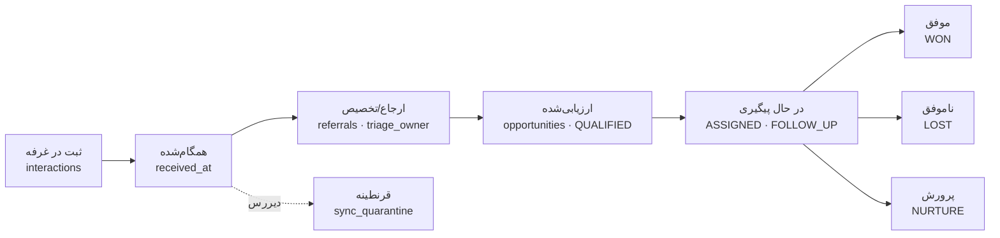

# ۴. تحلیل داده و KPIها

**مبنا:** مدل داده واقعی (سند ۳) و API داشبورد موجود (`backend/apps/reports/views.py::DashboardView`).

> **هشدار صداقت:** این سند **هیچ عدد واقعی کسب‌وکاری** ارائه نمی‌دهد. پایگاه داده‌ای که در دسترس ممیزی بود فقط داده ساختگی (`seed_demo` و `seed_qa`) داشت.
>
> - همه پرس‌وجوهای این سند روی همان پایگاه داده ساختگی **اجرا و از نظر نحوی تأیید** شدند (۱۵ از ۱۵ موفق)، ولی نتایجشان گزارش نمی‌شود.
> - اعداد آزمون QA فقط کیفیت نرم‌افزار را می‌سنجند (سند ۶) و ربطی به عملکرد فروش ندارند.
> - KPIهای پیشنهادی با برچسب وضعیت دسترسی مشخص شده‌اند.

## ۱. اهداف تحلیل داده

1. هیچ گفت‌وگوی غرفه‌ای گم نشود: ثبت، همگام‌سازی و مالکیت.
2. سرعت و کیفیت پیگیری: ارجاع، پاسخ در مهلت، اولین اقدام.
3. اثربخشی رویداد و محصول: علاقه، تبدیل به فرصت، نتیجه.
4. کیفیت داده: کامل‌بودن، تکراری‌ها، شکست همگام‌سازی.

## ۲. داده‌ای که امروز واقعاً ثبت می‌شود

**[موجود در کد]**

| داده | جدول و ستون | یادداشت |
|---|---|---|
| زمان ثبت در دستگاه و زمان دریافت در سرور | `interactions.captured_at`، `received_at`، `captured_offline` | زمان‌ها UTC؛ «روز» با `Asia/Tehran` محاسبه می‌شود (`apps/common/dates.py`) |
| ثبت‌کننده، رویداد، مخاطب، سازمان، کیفیت | `interactions.created_by_id`، `event_id`، `contact_id`، `account_id`، `quality` | — |
| محصولات مورد علاقه | `interaction_products.product_id`، `product_code` | — |
| فرصت، مرحله، مسئول، فوریت، اقدام بعدی | `opportunities.stage`، `owner_id`، `urgency`، `next_step`، `next_step_due_at`، `qualified_at`، `closed_at` | — |
| ارجاع و پاسخ | `referrals.created_at`، `status`، `due_at`، `responded_at`، `purpose`، `from_user_id`، `to_user_id` | «معوق» ذخیره نمی‌شود؛ محاسبه می‌شود |
| فعالیت و وظیفه | `activities.type`، `created_at`، `actor_id`؛ `tasks.status`، `due_at`، `completed_at`، `owner_id` | — |
| کیفیت داده | `duplicate_candidates`، `merge_records`، `sync_quarantine` | — |
| ممیزی | `audit_logs.action`، `before`، `after` | برای بازسازی زمان تغییرات |

**[موجود در کد] داده‌ای که ثبت نمی‌شود (شکاف تحلیلی):**

- **منبع جذب:** فیلد کانال یا کمپین جذب روی ثبت وجود ندارد.
- **پول:** مبلغ فرصت و هزینه رویداد ذخیره نمی‌شوند.
- **رد اعتبارسنجی فرم:** تلاش‌های ناموفق ثبت ذخیره نمی‌شوند.
- **ردهای سمت دستگاه:** رکوردهای `REJECTED` در صف محلی به سرور گزارش نمی‌شوند.
- **زمان تعیین مسئول اولیه:** زمان تعیین `triage_owner` فیلد جدا ندارد؛ فقط در `activities` یا `audit_logs` قابل بازسازی است.
- **زمان کار در صفحه:** زمان باز بودن یا کار کاربر در صفحه (UX analytics) ثبت نمی‌شود.

## ۳. رویدادهای قابل‌اندازه‌گیری و ابعاد تحلیلی

**[موجود در کد] رویدادهای دامنه (Outbox):**

- `interaction.captured`
- `opportunity.qualified`، `opportunity.owner_changed`
- `referral.accepted`، `referral.returned`، `referral.overdue`
- `task.assigned`
- `action_request.created`، `action_request.overdue`
- `event.activated`، `event.closed`، `event.member_added`

**[موجود در کد] انواع `Activity`:** `CALL`، `MEETING`، `NOTE`، `QUALIFIED`، `STAGE_CHANGED`، `OWNER_CHANGED`، `REFERRAL_*`، `TASK_*`، `TAG_*`، `MERGED` و غیره.

**ابعاد تحلیلی موجود:**

- رویداد (`events.code`، شهر، تاریخ)
- روز و ساعت تهران
- محصول و طرح
- کارشناس ثبت‌کننده
- مسئول فرصت و گیرنده ارجاع
- کیفیت غرفه، مرحله و فوریت
- برچسب فرصت
- آنلاین یا آفلاین

## ۴. KPIها

**تعریف وضعیت‌های دسترسی:**

| وضعیت | معنا |
|---|---|
| «قابل محاسبه با داده فعلی» | با جدول‌های فعلی و یک پرس‌وجوی ساده قابل محاسبه است؛ بسیاری از این‌ها همین الان در API داشبورد محاسبه می‌شوند |
| «نیازمند query یا view جدید» | داده هست ولی محاسبه، view یا پرس‌وجوی ترکیبی لازم دارد |
| «نیازمند instrumentation» | داده ثبت نمی‌شود |
| «نیازمند تعریف کسب‌وکاری» | تعریف دقیق کسب‌وکاری لازم دارد |

### ۴.۱ KPIهای عملیاتی
| KPI | تعریف | فرمول | صورت | مخرج | منبع داده | ابعاد برش | تناوب گزارش | مالک KPI | وضعیت دسترسی |
|---|---|---|---|---|---|---|---|---|---|
| تعداد ثبت (لید) | تعداد گفت‌وگوهای ثبت‌شده در غرفه | count(interactions) | ثبت‌ها | — | `interactions` (داشبورد: `interactions`) | رویداد، روز تهران، ثبت‌کننده، محصول | ساعتی در رویداد / روزانه | مدیر رویداد | قابل محاسبه با داده فعلی |
| مخاطبان یکتا | مخاطبان پس از نرمال‌سازی شماره/ایمیل | count(distinct contact_id) | مخاطبان یکتا | — | `interactions.contact_id` (داشبورد: `unique_contacts`) | رویداد، روز | روزانه | مدیر رویداد | قابل محاسبه با داده فعلی |
| سازمان‌های یکتا | سازمان‌های متمایز در ثبت‌ها | count(distinct account_id) | سازمان‌ها | — | `interactions.account_id` (`unique_accounts`) | رویداد، صنعت | روزانه | مدیر رویداد | قابل محاسبه با داده فعلی |
| ثبت چندمحصولی | ثبت‌هایی که بیش از یک محصول دارند | count(interaction با >1 محصول) | ثبت‌های چندمحصولی | — | `interaction_products` (`multi_product_interactions`) | رویداد | روزانه | مدیر رویداد | قابل محاسبه با داده فعلی |
| ثبت آفلاین | سهم ثبت‌های انجام‌شده بدون اتصال | آفلاین ÷ کل | `captured_offline=true` | کل ثبت‌ها | `interactions.captured_offline` (`offline_captures`) | رویداد، کارشناس، روز | روزانه | مدیر رویداد | قابل محاسبه با داده فعلی |

### ۴.۲ KPIهای فروش و قیف تبدیل
| KPI | تعریف | فرمول | صورت | مخرج | منبع داده | ابعاد برش | تناوب گزارش | مالک KPI | وضعیت دسترسی |
|---|---|---|---|---|---|---|---|---|---|
| نرخ ارزیابی (ثبت ← فرصت) | سهم ثبت‌هایی که با ارزیابی صریح به فرصت تبدیل شدند | فرصت ÷ ثبت | count(opportunities) | count(interactions) | `opportunities.source_interaction_id` | رویداد، محصول، کیفیت غرفه | هفتگی | مدیر فروش | قابل محاسبه با داده فعلی |
| نرخ موفقیت فرصت | سهم فرصت‌های بسته‌شده موفق | WON ÷ (WON+LOST) | stage=WON | stage∈{WON,LOST} | `opportunities.stage` | رویداد، محصول، مسئول | ماهانه | مدیر فروش | قابل محاسبه با داده فعلی |
| قیف مراحل | توزیع فرصت‌ها در مراحل | count by stage | هر مرحله | کل فرصت‌ها | `opportunities.stage` (`by_stage`) | رویداد، مسئول | هفتگی | مدیر فروش | قابل محاسبه با داده فعلی |
| فرصت‌های باز بدون اقدام بعدی | فرصت باز بدون `next_step_due_at` یا با موعد گذشته | count | فرصت‌های بی‌اقدام | — | `opportunities.next_step_due_at` | مسئول، فوریت | روزانه | مدیر فروش | قابل محاسبه با داده فعلی |
| ارزش/درآمد فرصت | ارزش ریالی فرصت | — | — | — | فیلد مبلغ در مدل وجود ندارد | — | — | مدیر فروش | نیازمند instrumentation |

### ۴.۳ KPIهای نمایشگاهی و منبع جذب
| KPI | تعریف | فرمول | صورت | مخرج | منبع داده | ابعاد برش | تناوب گزارش | مالک KPI | وضعیت دسترسی |
|---|---|---|---|---|---|---|---|---|---|
| ثبت به ازای ساعت/روز رویداد | الگوی بار غرفه | count by hour | ثبت‌ها | — | `interactions.captured_at` با منطقه تهران (`by_day`) | رویداد، ساعت | ساعتی | مدیر رویداد | نیازمند query یا view جدید |
| علاقه بر اساس محصول | ثبت‌های دارای هر محصول | count distinct interaction by product | ثبت‌ها | — | `interaction_products` (`by_product`) | رویداد، محصول | روزانه | مالک محصول | قابل محاسبه با داده فعلی |
| مقایسه رویدادها | ثبت، فرصت و موفقیت به ازای رویداد | نسبت‌های قیف به تفکیک رویداد | — | — | `interactions`، `opportunities`، `events` (`by_event`) | رویداد، سال | پس از هر رویداد | مدیر توسعه بازار | قابل محاسبه با داده فعلی |
| هزینه به ازای لید رویداد | هزینه شرکت در رویداد ÷ لیدها | هزینه ÷ ثبت | هزینه رویداد | ثبت‌ها | فیلد هزینه رویداد وجود ندارد | رویداد | پس از رویداد | مدیر توسعه بازار | نیازمند instrumentation |
| منبع جذب | از کجا مخاطب به غرفه آمد (دعوت، عبوری، کمپین) | — | — | — | فیلد منبع روی `Interaction` وجود ندارد؛ فقط `event` و `Opportunity.origin_event` | منبع | — | مدیر توسعه بازار | نیازمند instrumentation |

### ۴.۴ KPIهای ارجاع
| KPI | تعریف | فرمول | صورت | مخرج | منبع داده | ابعاد برش | تناوب گزارش | مالک KPI | وضعیت دسترسی |
|---|---|---|---|---|---|---|---|---|---|
| ارجاع‌های در انتظار | ارجاع‌های پاسخ‌نداده | count status=PENDING | PENDING | — | `referrals.status` (`pending_referrals`) | گیرنده، رویداد | لحظه‌ای | مدیر فروش | قابل محاسبه با داده فعلی |
| ارجاع معوق | در انتظار و مهلت گذشته | count PENDING ∧ due_at<now | معوق | — | `referrals.due_at` (`overdue_referrals`) | گیرنده، رویداد | لحظه‌ای | مدیر فروش | قابل محاسبه با داده فعلی |
| نرخ پذیرش ارجاع | سهم ارجاع‌های پاسخ‌داده که پذیرفته شدند | ACCEPTED ÷ (ACCEPTED+RETURNED) | ACCEPTED | ACCEPTED+RETURNED | `referrals.status` | گیرنده، محصول، هدف | هفتگی | مدیر فروش | قابل محاسبه با داده فعلی |
| نرخ بازگشت ارجاع | سهم ارجاع‌های بازگردانده‌شده | RETURNED ÷ پاسخ‌داده | RETURNED | پاسخ‌داده | `referrals.status`، `response_note` | گیرنده، دلیل | هفتگی | مدیر فروش | قابل محاسبه با داده فعلی |
| نرخ ارجاع موفق | ارجاعی که به فرصت موفق رسید | ارجاع‌های پذیرفته با فرصت WON ÷ ارجاع‌های پذیرفته | ACCEPTED ∧ stage=WON | ACCEPTED | `referrals` ⋈ `opportunities` | گیرنده، محصول | ماهانه | مدیر فروش | نیازمند query یا view جدید |

### ۴.۵ KPIهای کیفیت داده، تکراری‌ها و همگام‌سازی
| KPI | تعریف | فرمول | صورت | مخرج | منبع داده | ابعاد برش | تناوب گزارش | مالک KPI | وضعیت دسترسی |
|---|---|---|---|---|---|---|---|---|---|
| نرخ تکمیل اطلاعات | سهم فیلدهای کلیدی پرشده | فیلدهای پر ÷ فیلدهای کلیدی | فیلدهای پر | ۱۳ فیلد کامل‌بودن (labels.ts) | `contacts`، `accounts`، `opportunities` (`COMPLETENESS_LABELS`) | رویداد، کارشناس | روزانه | مدیر رویداد | نیازمند query یا view جدید |
| نرخ لید/مخاطب تکراری | برخوردهای تکراری با یک مخاطب | ۱ − مخاطبان یکتا ÷ ثبت‌ها | — | ثبت‌ها | `interactions.contact_id`، `duplicate_candidates` | رویداد | هفتگی | مدیر سامانه | قابل محاسبه با داده فعلی |
| نامزدهای تکراری باز | زوج‌های مشکوک بررسی‌نشده | count status=OPEN | OPEN | — | `duplicate_candidates` | نوع تطابق | هفتگی | مدیر سامانه | قابل محاسبه با داده فعلی |
| کیفیت شماره همراه | شماره‌های معتبر و نرمال‌شده | با موبایل ÷ مخاطبان | مخاطب با موبایل | مخاطبان فعال | `contacts.mobile`؛ شماره نامعتبر در اعتبارسنجی رد و ذخیره نمی‌شود | رویداد | روزانه | مدیر رویداد | نیازمند query یا view جدید |
| نرخ رد اعتبارسنجی ورودی | چند بار فرم ثبت با شماره نامعتبر رد شد | — | — | — | رد اعتبارسنجی ذخیره نمی‌شود | کارشناس | — | مدیر رویداد | نیازمند instrumentation |
| نرخ شکست همگام‌سازی آفلاین | ثبت آفلاینی که به قرنطینه رفت یا رد شد | قرنطینه ÷ ثبت آفلاین | `sync_quarantine` | ثبت‌های آفلاین + قرنطینه | `sync_quarantine`، `interactions.captured_offline`؛ ردهای سمت دستگاه (REJECTED محلی) به سرور گزارش نمی‌شوند | رویداد، کارشناس | روزانه | مدیر رویداد | نیازمند instrumentation |
| تأخیر همگام‌سازی | فاصله ثبت در دستگاه تا دریافت در سرور | median(received_at − captured_at) | — | — | `interactions.received_at`، `captured_at` | رویداد | روزانه | مدیر سامانه | قابل محاسبه با داده فعلی |

### ۴.۶ KPIهای عملکرد کارشناسان و تیم
| KPI | تعریف | فرمول | صورت | مخرج | منبع داده | ابعاد برش | تناوب گزارش | مالک KPI | وضعیت دسترسی |
|---|---|---|---|---|---|---|---|---|---|
| ثبت به ازای کارشناس | تعداد ثبت هر کارشناس غرفه | count by created_by | ثبت‌ها | — | `interactions.created_by_id` (`by_creator`) | رویداد، روز | روزانه | مدیر رویداد | قابل محاسبه با داده فعلی |
| کیفیت ثبت کارشناس | سهم «جدی» و سهم ثبت با سازمان/یادداشت | نسبت‌ها | ثبت‌های واجد شرط | ثبت‌های کارشناس | `interactions.quality`، `account_id`، `note` | کارشناس | روزانه | مدیر رویداد | قابل محاسبه با داده فعلی |
| بار کاری تیم فروش | ارجاع و وظیفه باز به ازای فرد | count | باز | — | `referrals`، `tasks` (`WorkQueueCountsView`) | فرد | لحظه‌ای | مدیر فروش | قابل محاسبه با داده فعلی |
| وظایف انجام‌شده در موعد | سهم وظایفی که قبل از موعد انجام شدند | DONE∧completed≤due ÷ DONE | در موعد | انجام‌شده | `tasks.completed_at`، `due_at` | مسئول | هفتگی | مدیر فروش | قابل محاسبه با داده فعلی |

### ۴.۷ KPIهای SLA و زمان پاسخ
| KPI | تعریف | فرمول | صورت | مخرج | منبع داده | ابعاد برش | تناوب گزارش | مالک KPI | وضعیت دسترسی |
|---|---|---|---|---|---|---|---|---|---|
| زمان ثبت تا تخصیص | فاصله ثبت تا اولین ارجاع/تعیین مسئول | min(referral.created_at) − captured_at | — | — | `referrals.created_at`؛ تعیین `triage_owner` زمان جدا ندارد (فقط در `audit_logs`/`activities`) | رویداد، محصول | روزانه | مدیر رویداد | نیازمند query یا view جدید |
| زمان پاسخ به ارجاع | فاصله ارجاع تا پذیرش/بازگشت | responded_at − created_at | — | — | `referrals.responded_at` | گیرنده | روزانه | مدیر فروش | قابل محاسبه با داده فعلی |
| زمان ثبت تا اولین اقدام | فاصله ثبت تا اولین تماس/جلسه/یادداشت/ارزیابی | min(activity.created_at) − captured_at | — | — | `activities.type,created_at` | رویداد، مسئول | روزانه | مدیر فروش | نیازمند query یا view جدید |
| زمان تخصیص تا تماس | فاصله پذیرش ارجاع تا اولین تماس ثبت‌شده | first CALL − accepted_at | — | — | `referrals.responded_at`، `activities(type=CALL)`؛ دقیق فقط اگر تماس‌ها ثبت شوند | مسئول | هفتگی | مدیر فروش | نیازمند تعریف کسب‌وکاری |
| پاسخ در مهلت SLA | سهم ارجاع‌های پاسخ‌داده تا `due_at` | on-time ÷ responded | در مهلت | پاسخ‌داده | `referrals.due_at`، `responded_at`؛ مهلت پیش‌فرض `events.referral_sla_hours` | گیرنده، رویداد | هفتگی | مدیر فروش | قابل محاسبه با داده فعلی |

### ۴.۸ لیدهای بدون مالک، فوری و معوق
| KPI | تعریف | فرمول | صورت | مخرج | منبع داده | ابعاد برش | تناوب گزارش | مالک KPI | وضعیت دسترسی |
|---|---|---|---|---|---|---|---|---|---|
| لیدهای بدون مالک | بدون triage_owner، بدون مسئول فرصت و بدون ارجاع در انتظار | count (تعریف داشبورد) | — | — | `interactions`، `opportunities`، `referrals` (`ownerless`) | رویداد، روز | لحظه‌ای | مدیر رویداد | قابل محاسبه با داده فعلی |
| لیدهای فوری معطل | فرصت با فوریت زیاد، باز و بدون اقدام بعدی معتبر | count | — | — | `opportunities.urgency='HIGH'` | مسئول | روزانه | مدیر فروش | قابل محاسبه با داده فعلی |
| درخواست‌های اقدام معوق | درخواست اقدام باز با مهلت گذشته | count | — | — | `action_requests.due_at,status` | گیرنده، نوع اقدام | روزانه | مدیر فروش | قابل محاسبه با داده فعلی |

## ۵. قیف تبدیل لید



**[موجود در کد] قواعد خوانش قیف:**

- فرصت فقط با ارزیابی صریح ساخته می‌شود. پس «ثبت ← فرصت» نرخ ارزیابی است، نه نرخ علاقه.
- `WON` و `LOST` قابل بازگشت‌اند (`Opportunity.TRANSITIONS`). برای قیف تاریخی باید از `activities(type=STAGE_CHANGED)` استفاده کرد، نه فقط از مرحله فعلی.

## ۶. پرس‌وجوهای نمونه (PostgreSQL، نام‌های واقعی جدول و ستون)

هر ۱۵ پرس‌وجو روی پایگاه داده QA (`expo_leads_qa`، داده ساختگی) با موفقیت اجرا شدند. نتایج عمداً گزارش نشده‌اند.

**Q1: ثبت‌ها به تفکیک رویداد و روز تهران**

```sql
SELECT e.code AS event_code, (i.captured_at AT TIME ZONE 'Asia/Tehran')::date AS tehran_day, count(*) AS interactions
FROM interactions i JOIN events e ON e.id = i.event_id
GROUP BY 1, 2 ORDER BY 2, 1;
```

**Q2: قیف تبدیل لید: ثبت → فرصت → مرحله**

```sql
SELECT e.code AS event_code,
       count(DISTINCT i.id) AS interactions,
       count(DISTINCT o.id) AS qualified_opportunities,
       count(DISTINCT o.id) FILTER (WHERE o.stage = 'WON')  AS won,
       count(DISTINCT o.id) FILTER (WHERE o.stage = 'LOST') AS lost,
       round(100.0 * count(DISTINCT o.id) / NULLIF(count(DISTINCT i.id), 0), 1) AS qualification_rate_pct
FROM interactions i
JOIN events e ON e.id = i.event_id
LEFT JOIN opportunities o ON o.source_interaction_id = i.id
GROUP BY e.code;
```

**Q3: زمان ثبت تا اولین ارجاع (ساعت) — میانه و صدک ۹۰**

```sql
WITH first_ref AS (
  SELECT r.interaction_id, min(r.created_at) AS first_referral_at
  FROM referrals r GROUP BY r.interaction_id
)
SELECT percentile_cont(0.5) WITHIN GROUP (ORDER BY extract(epoch FROM fr.first_referral_at - i.captured_at) / 3600) AS median_hours,
       percentile_cont(0.9) WITHIN GROUP (ORDER BY extract(epoch FROM fr.first_referral_at - i.captured_at) / 3600) AS p90_hours,
       count(*) AS referred_interactions
FROM interactions i JOIN first_ref fr ON fr.interaction_id = i.id;
```

**Q4: پاسخ به ارجاع در مهلت (SLA)**

```sql
SELECT r.to_user_id,
       count(*) FILTER (WHERE r.status IN ('ACCEPTED', 'RETURNED')) AS responded,
       count(*) FILTER (WHERE r.status IN ('ACCEPTED', 'RETURNED') AND (r.due_at IS NULL OR r.responded_at <= r.due_at)) AS responded_on_time,
       count(*) FILTER (WHERE r.status = 'PENDING' AND r.due_at < now()) AS overdue_now,
       count(*) FILTER (WHERE r.status = 'RETURNED') AS returned
FROM referrals r
GROUP BY r.to_user_id;
```

**Q5: لیدهای بدون مالک (همان تعریف داشبورد: بدون triage_owner، بدون مسئول فرصت و بدون ارجاع در انتظار)**

```sql
SELECT e.code AS event_code, count(*) AS ownerless
FROM interactions i
JOIN events e ON e.id = i.event_id
LEFT JOIN opportunities o ON o.source_interaction_id = i.id
WHERE i.triage_owner_id IS NULL
  AND (o.id IS NULL OR o.owner_id IS NULL)
  AND NOT EXISTS (SELECT 1 FROM referrals r WHERE r.interaction_id = i.id AND r.status = 'PENDING')
GROUP BY e.code;
```

**Q6: زمان ثبت تا اولین اقدام انسانی بعد از ثبت (تماس/جلسه/یادداشت/ارزیابی)**

```sql
WITH first_action AS (
  SELECT a.interaction_id, min(a.created_at) AS first_action_at
  FROM activities a
  WHERE a.type IN ('CALL', 'MEETING', 'NOTE', 'QUALIFIED', 'REFERRAL_ACCEPTED')
  GROUP BY a.interaction_id
)
SELECT percentile_cont(0.5) WITHIN GROUP (ORDER BY extract(epoch FROM fa.first_action_at - i.captured_at) / 3600) AS median_hours_to_first_action,
       count(*) AS interactions_with_action
FROM interactions i JOIN first_action fa ON fa.interaction_id = i.id;
```

**Q7: نرخ ثبت آفلاین و قرنطینه**

```sql
SELECT e.code AS event_code,
       count(i.id) AS interactions,
       count(i.id) FILTER (WHERE i.captured_offline) AS offline_captures,
       (SELECT count(*) FROM sync_quarantine q WHERE q.event_id = e.id) AS quarantined,
       (SELECT count(*) FROM sync_quarantine q WHERE q.event_id = e.id AND q.status = 'REJECTED') AS quarantine_rejected
FROM events e LEFT JOIN interactions i ON i.event_id = e.id
GROUP BY e.id, e.code;
```

**Q8: تأخیر همگام‌سازی (ثبت تا دریافت در سرور) برای ثبت‌های آفلاین**

```sql
SELECT percentile_cont(0.5) WITHIN GROUP (ORDER BY extract(epoch FROM i.received_at - i.captured_at) / 60) AS median_sync_delay_minutes
FROM interactions i WHERE i.captured_offline AND i.received_at IS NOT NULL;
```

**Q9: عملکرد کارشناس غرفه: تعداد ثبت و سهم کیفیت جدی و کامل‌بودن سازمان**

```sql
SELECT u.username,
       count(i.id) AS captures,
       round(100.0 * count(i.id) FILTER (WHERE i.quality = 'SERIOUS') / NULLIF(count(i.id), 0), 1) AS serious_pct,
       round(100.0 * count(i.id) FILTER (WHERE i.account_id IS NOT NULL) / NULLIF(count(i.id), 0), 1) AS with_account_pct,
       round(100.0 * count(i.id) FILTER (WHERE coalesce(i.note, '') <> '') / NULLIF(count(i.id), 0), 1) AS with_note_pct
FROM interactions i JOIN users u ON u.id = i.created_by_id
GROUP BY u.username ORDER BY captures DESC;
```

**Q10: نرخ تکرار مخاطب (یک مخاطب، چند برخورد) و نامزدهای تکراری باز**

```sql
SELECT (SELECT count(*) FROM interactions) AS interactions,
       (SELECT count(DISTINCT contact_id) FROM interactions) AS unique_contacts,
       round(100.0 * (1 - (SELECT count(DISTINCT contact_id) FROM interactions)::numeric / NULLIF((SELECT count(*) FROM interactions), 0)), 1) AS repeat_interaction_pct,
       (SELECT count(*) FROM duplicate_candidates WHERE status = 'OPEN') AS open_duplicate_candidates;
```

**Q11: علاقه بر اساس محصول**

```sql
SELECT ip.product_code, count(DISTINCT ip.interaction_id) AS interactions
FROM interaction_products ip GROUP BY ip.product_code ORDER BY 2 DESC;
```

**Q12: کیفیت اطلاعات تماس مخاطبان**

```sql
SELECT count(*) AS contacts,
       count(*) FILTER (WHERE coalesce(mobile, '') <> '') AS with_mobile,
       count(*) FILTER (WHERE coalesce(email, '') <> '') AS with_email,
       count(*) FILTER (WHERE coalesce(title, '') <> '') AS with_title,
       count(*) FILTER (WHERE primary_account_id IS NOT NULL) AS with_account
FROM contacts WHERE status = 'ACTIVE';
```

**Q13: وظایف پیگیری: باز، معوق، انجام‌شده در موعد**

```sql
SELECT t.owner_id,
       count(*) FILTER (WHERE t.status = 'OPEN') AS open_tasks,
       count(*) FILTER (WHERE t.status = 'OPEN' AND t.due_at < now()) AS overdue_tasks,
       count(*) FILTER (WHERE t.status = 'DONE' AND (t.due_at IS NULL OR t.completed_at <= t.due_at)) AS done_on_time
FROM tasks t GROUP BY t.owner_id;
```

**Q14: لیدهای فوری بدون اقدام بعدی معتبر**

```sql
SELECT o.id, o.stage, o.next_step_due_at
FROM opportunities o
WHERE o.urgency = 'HIGH' AND o.stage NOT IN ('WON', 'LOST')
  AND (o.next_step_due_at IS NULL OR o.next_step_due_at < now());
```

**Q15: زمان تخصیص (ارجاع پذیرفته‌شده) تا اولین تماس ثبت‌شده**

```sql
WITH accepted AS (
  SELECT r.interaction_id, min(r.responded_at) AS accepted_at
  FROM referrals r WHERE r.status = 'ACCEPTED' GROUP BY r.interaction_id
), first_call AS (
  SELECT a.interaction_id, min(a.created_at) AS call_at
  FROM activities a WHERE a.type = 'CALL' GROUP BY a.interaction_id
)
SELECT percentile_cont(0.5) WITHIN GROUP (ORDER BY extract(epoch FROM fc.call_at - ac.accepted_at) / 3600) AS median_hours_accept_to_call
FROM accepted ac JOIN first_call fc ON fc.interaction_id = ac.interaction_id AND fc.call_at >= ac.accepted_at;
```

## ۷. مدل پیشنهادی داشبوردها

**[پیشنهاد توسعه]** ستون «موجود امروز» از `DashboardView` و صفحه `/dashboard` آمده است؛ ستون «پیشنهاد» اضافه‌ای است که هنوز ساخته نشده است.

| داشبورد | موجود امروز (API داشبورد) | پیشنهاد فاز بعد |
|---|---|---|
| کارشناس غرفه | `my_captures_today`، `my_captures_total`، `my_pending_referrals`، `my_open_tasks`، `my_overdue_tasks`، `recent` | شمار صف آفلاین روی همین دستگاه (اکنون در کلاینت)، سهم ثبت با سازمان و یادداشت، هدف روزانه |
| مدیر فروش | `qualified_opportunities`، `won`، `by_stage`، `pending_referrals`، `overdue_referrals`، `returned_referrals`، `open_tasks`، `overdue_tasks`، `completed_followups` | نرخ پذیرش ارجاع، پاسخ در مهلت، میانه زمان تا اولین اقدام، عملکرد هر عضو تیم، فرصت‌های فوری معطل |
| مدیر رویداد | `interactions`، `unique_contacts`، `unique_accounts`، `by_day`، `by_product`، `by_creator`، `ownerless`، `offline_captures`، `multi_product_interactions` | توزیع ساعتی، نرخ تکمیل اطلاعات، قرنطینه، تأخیر همگام‌سازی، مقایسه با رویداد قبلی |
| مدیر سامانه | (از API داشبورد مستقل است) صف کارهای اعلان `notify/jobs`، `audit`، `duplicates`، `sync-quarantine` | سلامت ارسال (FAILED، DEAD، SIMULATED)، حجم ممیزی، تکراری‌های باز، کاربران بدون ورود، رشد جدول‌ها |

**[پیشنهاد توسعه] پیاده‌سازی:**

1. یک view مادی‌شده روزانه (`kpi_daily`) به تفکیک رویداد، روز تهران، محصول و کاربر.
2. ثبت رویداد صریح «اولین تماس» و «تعیین مسئول» با زمان.
3. فیلدهای اختیاری «منبع جذب» و «ارزش تخمینی فرصت»، پس از تعریف کسب‌وکاری.
