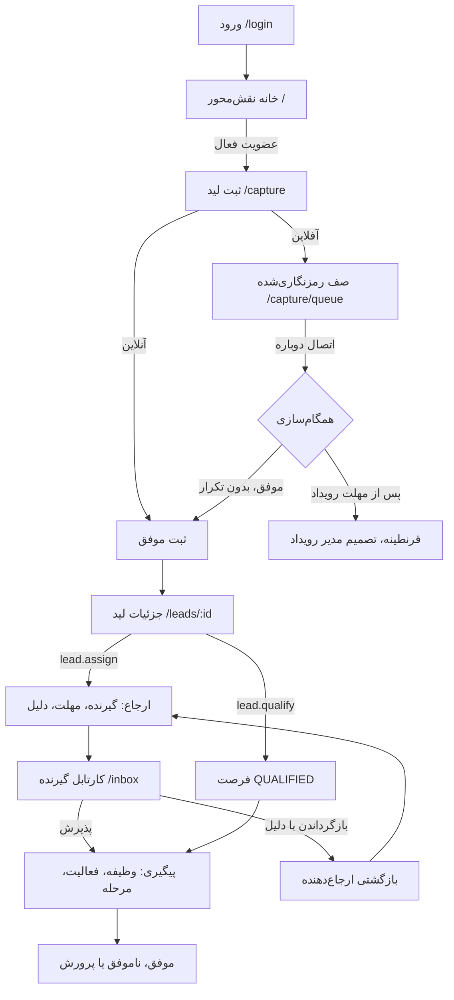
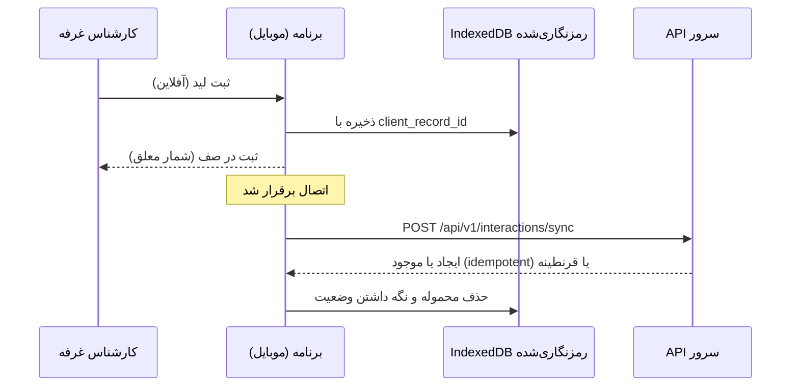

# ۵. نقش‌ها، دسترسی‌ها و جریان‌های کاربری

**مبنا:**

- قابلیت‌ها و نقش‌ها: `backend/apps/iam/capabilities.py`
- محدوده ردیف‌ها: `backend/apps/crm/scoping.py`
- منو و نگهبان‌ها: `frontend/src/layout/AppShell.tsx` و `frontend/src/App.tsx`
- نتایج آزمون: `qa/ROLE-DEVICE-MATRIX.csv` (اجرای نهایی، desktop-1440) و `qa/results/API-AUTHZ-MATRIX.csv`

## ۱. نقش‌های واقعی موجود در کد

**[موجود در کد]** — ۸ نقش سیستمی:

| کد نقش | نام فارسی | دامنه | تعداد قابلیت |
|---|---|---|---|
| `SYSTEM_ADMIN` | مدیر سامانه (اداره توسعه بازار) | GLOBAL | 23 |
| `MARKET_DEV_MANAGER` | مدیر توسعه بازار | GLOBAL | 18 |
| `DIRECTOR_GENERAL` | مدیرکل | GLOBAL | 9 |
| `EXECUTIVE_READONLY` | ناظر اجرایی (فقط‌خواندنی) | GLOBAL | 2 |
| `EVENT_MANAGER` | مدیر رویداد | EVENT | 10 |
| `PLAN_MANAGER` | مدیر طرح/برنامه | EVENT | 9 |
| `PRODUCT_OWNER` | مالک محصول/پروژه | EVENT | 4 |
| `BOOTH_SPECIALIST` | کارشناس غرفه | EVENT | 0 |

نقش‌ها **افزایشی**اند. قابلیت مؤثر یک کاربر از این دو بخش تشکیل می‌شود:

- قابلیت‌های نقش‌های سراسری او؛
- قابلیت‌های نقش‌های عضویت‌های فعال او در رویدادهای فعال، فقط در محدوده همان رویداد.

\* قابلیت `interaction.create` به هیچ نقشی داده نشده است. این قابلیت برای **هر عضویت فعال در رویداد فعال** ضمنی است، حتی بدون نقش. به همین دلیل نقش «کارشناس غرفه» صفر قابلیت صریح دارد و باز هم می‌تواند ثبت کند.

### نگاشت چهار نقش ارائه به نقش‌های کد

| نقش ارائه | نقش در کد | پرسونای آزمون | توضیح |
|---|---|---|---|
| کارشناس غرفه | `BOOTH_SPECIALIST` (رویدادی) | `specialist1` | ثبت لید، دیدن ثبت‌های خود، کارتابل خود |
| مدیر فروش | **در کد نقشی با این نام نیست.** نزدیک‌ترین نقش‌ها `PLAN_MANAGER` (رویدادی) و `MARKET_DEV_MANAGER` (سراسری) هستند؛ `PRODUCT_OWNER` بخشی از کار را دارد | `planmgr` (مدیر طرح) | ارزیابی، ارجاع، پیگیری، داشبورد، خروجی |
| مدیر رویداد | `EVENT_MANAGER` (رویدادی) | `evmgr` | همه کارهای مدیر طرح به‌علاوه `event.team.manage` |
| مدیر سامانه | `SYSTEM_ADMIN` (سراسری) | `admin` | ۲۳ قابلیت صریح، یعنی همه به‌جز ثبت لید که با عضویت ضمنی است |

## ۲. قابلیت‌ها به تفکیک نقش

**[موجود در کد]**

| قابلیت | شرح | `SYSTEM_ADMIN` | `MARKET_DEV_MANAGER` | `DIRECTOR_GENERAL` | `EXECUTIVE_READONLY` | `EVENT_MANAGER` | `PLAN_MANAGER` | `PRODUCT_OWNER` | `BOOTH_SPECIALIST` |
|---|---|---|---|---|---|---|---|---|---|
| `interaction.create` | ثبت لید در رویداد | ضمنی* | ضمنی* | ضمنی* | ضمنی* | ضمنی* | ضمنی* | ضمنی* | ضمنی* |
| `lead.view.scope` | مشاهده لیدهای محدوده رویداد/طرح/محصول | ✓ | — | — | — | ✓ | ✓ | ✓ | — |
| `lead.view.all` | مشاهده همه لیدهای مجاز سازمان | ✓ | ✓ | ✓ | ✓ | — | — | — | — |
| `lead.detail.edit` | تکمیل و ویرایش جزئیات لید | ✓ | ✓ | ✓ | — | ✓ | ✓ | ✓ | — |
| `lead.qualify` | ارزیابی و تبدیل به فرصت | ✓ | ✓ | ✓ | — | ✓ | ✓ | — | — |
| `lead.assign` | ارجاع و تخصیص مجدد | ✓ | ✓ | ✓ | — | ✓ | ✓ | — | — |
| `task.manage` | تعریف و مدیریت وظایف پیگیری | ✓ | ✓ | ✓ | — | ✓ | ✓ | ✓ | — |
| `pii.view` | مشاهده شماره تماس و ایمیل مخاطبان | ✓ | ✓ | ✓ | — | ✓ | ✓ | ✓ | — |
| `contact.merge` | بازبینی و ادغام رکوردهای تکراری | ✓ | ✓ | — | — | — | — | — | — |
| `sync.review` | بازبینی ثبت‌های آفلاین معلق | ✓ | ✓ | — | — | — | — | — | — |
| `dashboard.view` | مشاهده داشبورد | ✓ | ✓ | ✓ | ✓ | ✓ | ✓ | — | — |
| `export.run` | خروجی داده | ✓ | ✓ | ✓ | — | ✓ | ✓ | — | — |
| `audit.view` | مشاهده گزارش ممیزی | ✓ | ✓ | — | — | — | — | — | — |
| `notification.send` | ارسال پیام و درخواست اقدام | ✓ | ✓ | ✓ | — | ✓ | ✓ | — | — |
| `notification.configure` | تنظیم قواعد و قالب‌های اعلان | ✓ | ✓ | — | — | — | — | — | — |
| `provider.manage` | مدیریت سرویس‌دهنده پیامک/ایمیل و اسرار | ✓ | — | — | — | — | — | — | — |
| `event.manage` | مدیریت رویدادها | ✓ | ✓ | — | — | — | — | — | — |
| `event.team.manage` | مدیریت تیم رویداد | ✓ | ✓ | — | — | ✓ | — | — | — |
| `catalog.manage` | مدیریت طرح‌ها و محصولات | ✓ | ✓ | — | — | — | — | — | — |
| `user.manage` | مدیریت کاربران | ✓ | — | — | — | — | — | — | — |
| `user.password_reset` | صدور لینک بازنشانی رمز | ✓ | — | — | — | — | — | — | — |
| `role.manage` | مدیریت نقش‌ها | ✓ | — | — | — | — | — | — | — |
| `tags.manage` | مدیریت برچسب‌های سراسری | ✓ | ✓ | — | — | — | — | — | — |
| `branding.manage` | مدیریت نشان و هویت بصری | ✓ | ✓ | — | — | — | — | — | — |

## ۳. منوهای قابل‌مشاهده

**[موجود در کد]** — `useNav()` در `AppShell.tsx`.

| بخش منو | گزینه‌ها | شرط نمایش |
|---|---|---|
| همیشه | خانه، لیدها، کارتابل، اعلان‌ها | نشست معتبر |
| داشبورد تحلیلی | `/dashboard` | `dashboard.view` |
| گزارش و خروجی | `/reports` | `export.run` |
| پیام و درخواست اقدام | `/messages` | `notification.send` |
| مدیریت | یک گزینه به ازای هر مسیر `/admin/*` | قابلیت همان مسیر (جدول سند ۲، بخش ۹) |
| دکمه «ثبت لید جدید» | — | فعال فقط اگر `me.capture_events` خالی نباشد، یعنی عضویت فعال در رویداد فعال |

## ۴. تفاوت نقش در Frontend و Backend و fallbackها

- **[موجود در کد] تصمیم مجوز در سرور است:** منو و `<Guard>` در کلاینت فقط تجربه کاربری‌اند و تصمیم مجوز همیشه در سرور گرفته می‌شود.
  - نمونه: پرسونای `planmgr` منوی «برچسب‌ها» را نمی‌بیند. اگر `/admin/tags` را مستقیم باز کند، صفحه «دسترسی مجاز نیست» نمایش داده می‌شود و `POST /api/v1/tags` پاسخ ۴۰۳ می‌دهد (`API-TAG-01`).
- **[موجود در کد] پوشش PII:** نقش بدون `pii.view`، مثل ناظر اجرایی، لید را می‌بیند ولی موبایل و ایمیل پوشانده‌اند.
- **[موجود در کد] پاسخ ۴۰۴ برای لید خارج از محدوده:** لیدی که در محدوده کاربر نیست، ۴۰۴ برمی‌گرداند، نه ۴۰۳ (`API-IDOR-01`، `API-IDOR-02`)، تا وجود رکورد افشا نشود.
- **[موجود در کد] کاربر بدون عضویت فعال:** می‌تواند وارد شود. صفحه ثبت پیام صادقانه «عضو فعال هیچ رویدادی نیستید» نشان می‌دهد و فهرست لیدها فقط ثبت‌های خود او را دارد (`qa_nomember`).
- **[موجود در کد] کاربر فقط با رویداد بسته یا بایگانی:** ثبت جدید ندارد (`qa_closed`).
- **[موجود در کد] انقضای نشست:** پاسخ ۴۰۱ کاربر را به صفحه ورود می‌برد (QA-D-04).

## ۵. ماتریس نقش × مسیر برای چهار نقش ارائه

**[موجود در کد]**

- ستون «مشاهده» نتیجه واقعی اجرای نهایی (`e661188`، desktop-1440) است. در همه ۱۴۵۲ ردیف ماتریس، مشاهده با مقدار مورد انتظار یکسان بود.
- ستون‌های «ایجاد»، «ویرایش»، «ارجاع»، «گزارش» و «مدیریت» از قابلیت‌های نقش در `capabilities.py` استخراج شده‌اند.
- هر چهار پرسونا در `seed_demo` عضویت فعال در یک رویداد فعال دارند؛ پس ثبت لید برای همه ضمنی است.
- «—» یعنی مجاز نیست یا در این صفحه کاربرد ندارد.

| نقش | Route | مشاهده | ایجاد | ویرایش | ارجاع | گزارش | مدیریت | منبع تست |
|---|---|---|---|---|---|---|---|---|
| کارشناس غرفه (`specialist1` · `BOOTH_SPECIALIST`) | `/` | ✓ | — | — | — | — | — | TC-MTX-specialist1 (ALLOW) |
| کارشناس غرفه (`specialist1` · `BOOTH_SPECIALIST`) | `/capture` | ✓ | ✓ ثبت | — | — | — | — | TC-MTX-specialist1 (ALLOW) |
| کارشناس غرفه (`specialist1` · `BOOTH_SPECIALIST`) | `/capture/queue` | ✓ | ✓ ثبت | — | — | — | — | TC-MTX-specialist1 (ALLOW) |
| کارشناس غرفه (`specialist1` · `BOOTH_SPECIALIST`) | `/leads` | ✓ | — | — | — | — | — | TC-MTX-specialist1 (ALLOW) |
| کارشناس غرفه (`specialist1` · `BOOTH_SPECIALIST`) | `/leads/:id` | ✓ | — | — | — | — | — | TC-MTX-specialist1 (ALLOW) |
| کارشناس غرفه (`specialist1` · `BOOTH_SPECIALIST`) | `/inbox` | ✓ | — | — | ✓ پذیرش/بازگرداندن | — | — | TC-MTX-specialist1 (ALLOW) |
| کارشناس غرفه (`specialist1` · `BOOTH_SPECIALIST`) | `/notifications` | ✓ | — | — | — | — | — | TC-MTX-specialist1 (ALLOW) |
| کارشناس غرفه (`specialist1` · `BOOTH_SPECIALIST`) | `/profile` | ✓ | — | — | — | — | — | TC-MTX-specialist1 (ALLOW) |
| کارشناس غرفه (`specialist1` · `BOOTH_SPECIALIST`) | `/dashboard` | — | — | — | — | — | — | TC-MTX-specialist1 (DENY) |
| کارشناس غرفه (`specialist1` · `BOOTH_SPECIALIST`) | `/reports` | — | — | — | — | — | — | TC-MTX-specialist1 (DENY) |
| کارشناس غرفه (`specialist1` · `BOOTH_SPECIALIST`) | `/messages` | — | — | — | — | — | — | TC-MTX-specialist1 (DENY) |
| کارشناس غرفه (`specialist1` · `BOOTH_SPECIALIST`) | `/admin/events` | — | — | — | — | — | — | TC-MTX-specialist1 (DENY) |
| کارشناس غرفه (`specialist1` · `BOOTH_SPECIALIST`) | `/admin/users` | — | — | — | — | — | — | TC-MTX-specialist1 (DENY) |
| کارشناس غرفه (`specialist1` · `BOOTH_SPECIALIST`) | `/admin/catalog` | — | — | — | — | — | — | TC-MTX-specialist1 (DENY) |
| کارشناس غرفه (`specialist1` · `BOOTH_SPECIALIST`) | `/admin/accounts` | — | — | — | — | — | — | TC-MTX-specialist1 (DENY) |
| کارشناس غرفه (`specialist1` · `BOOTH_SPECIALIST`) | `/admin/duplicates` | — | — | — | — | — | — | TC-MTX-specialist1 (DENY) |
| کارشناس غرفه (`specialist1` · `BOOTH_SPECIALIST`) | `/admin/quarantine` | — | — | — | — | — | — | TC-MTX-specialist1 (DENY) |
| کارشناس غرفه (`specialist1` · `BOOTH_SPECIALIST`) | `/admin/tags` | — | — | — | — | — | — | TC-MTX-specialist1 (DENY) |
| کارشناس غرفه (`specialist1` · `BOOTH_SPECIALIST`) | `/admin/notify` | — | — | — | — | — | — | TC-MTX-specialist1 (DENY) |
| کارشناس غرفه (`specialist1` · `BOOTH_SPECIALIST`) | `/admin/branding` | — | — | — | — | — | — | TC-MTX-specialist1 (DENY) |
| کارشناس غرفه (`specialist1` · `BOOTH_SPECIALIST`) | `/admin/roles` | — | — | — | — | — | — | TC-MTX-specialist1 (DENY) |
| کارشناس غرفه (`specialist1` · `BOOTH_SPECIALIST`) | `/admin/audit` | — | — | — | — | — | — | TC-MTX-specialist1 (DENY) |
| مدیر فروش ← مدیر طرح (`planmgr` · `PLAN_MANAGER`) | `/` | ✓ | — | — | — | — | — | TC-MTX-planmgr (ALLOW) |
| مدیر فروش ← مدیر طرح (`planmgr` · `PLAN_MANAGER`) | `/capture` | ✓ | ✓ ثبت | — | — | — | — | TC-MTX-planmgr (ALLOW) |
| مدیر فروش ← مدیر طرح (`planmgr` · `PLAN_MANAGER`) | `/capture/queue` | ✓ | ✓ ثبت | — | — | — | — | TC-MTX-planmgr (ALLOW) |
| مدیر فروش ← مدیر طرح (`planmgr` · `PLAN_MANAGER`) | `/leads` | ✓ | — | — | — | — | — | TC-MTX-planmgr (ALLOW) |
| مدیر فروش ← مدیر طرح (`planmgr` · `PLAN_MANAGER`) | `/leads/:id` | ✓ | — | ✓ | ✓ | — | — | TC-MTX-planmgr (ALLOW) |
| مدیر فروش ← مدیر طرح (`planmgr` · `PLAN_MANAGER`) | `/inbox` | ✓ | — | — | ✓ پذیرش/بازگرداندن | — | — | TC-MTX-planmgr (ALLOW) |
| مدیر فروش ← مدیر طرح (`planmgr` · `PLAN_MANAGER`) | `/notifications` | ✓ | — | — | — | — | — | TC-MTX-planmgr (ALLOW) |
| مدیر فروش ← مدیر طرح (`planmgr` · `PLAN_MANAGER`) | `/profile` | ✓ | — | — | — | — | — | TC-MTX-planmgr (ALLOW) |
| مدیر فروش ← مدیر طرح (`planmgr` · `PLAN_MANAGER`) | `/dashboard` | ✓ | — | — | — | ✓ | — | TC-MTX-planmgr (ALLOW) |
| مدیر فروش ← مدیر طرح (`planmgr` · `PLAN_MANAGER`) | `/reports` | ✓ | — | — | — | ✓ خروجی | — | TC-MTX-planmgr (ALLOW) |
| مدیر فروش ← مدیر طرح (`planmgr` · `PLAN_MANAGER`) | `/messages` | ✓ | ✓ پیام | — | — | — | — | TC-MTX-planmgr (ALLOW) |
| مدیر فروش ← مدیر طرح (`planmgr` · `PLAN_MANAGER`) | `/admin/events` | — | — | — | — | — | — | TC-MTX-planmgr (DENY) |
| مدیر فروش ← مدیر طرح (`planmgr` · `PLAN_MANAGER`) | `/admin/users` | — | — | — | — | — | — | TC-MTX-planmgr (DENY) |
| مدیر فروش ← مدیر طرح (`planmgr` · `PLAN_MANAGER`) | `/admin/catalog` | — | — | — | — | — | — | TC-MTX-planmgr (DENY) |
| مدیر فروش ← مدیر طرح (`planmgr` · `PLAN_MANAGER`) | `/admin/accounts` | — | — | — | — | — | — | TC-MTX-planmgr (DENY) |
| مدیر فروش ← مدیر طرح (`planmgr` · `PLAN_MANAGER`) | `/admin/duplicates` | — | — | — | — | — | — | TC-MTX-planmgr (DENY) |
| مدیر فروش ← مدیر طرح (`planmgr` · `PLAN_MANAGER`) | `/admin/quarantine` | — | — | — | — | — | — | TC-MTX-planmgr (DENY) |
| مدیر فروش ← مدیر طرح (`planmgr` · `PLAN_MANAGER`) | `/admin/tags` | — | — | — | — | — | — | TC-MTX-planmgr (DENY) |
| مدیر فروش ← مدیر طرح (`planmgr` · `PLAN_MANAGER`) | `/admin/notify` | — | — | — | — | — | — | TC-MTX-planmgr (DENY) |
| مدیر فروش ← مدیر طرح (`planmgr` · `PLAN_MANAGER`) | `/admin/branding` | — | — | — | — | — | — | TC-MTX-planmgr (DENY) |
| مدیر فروش ← مدیر طرح (`planmgr` · `PLAN_MANAGER`) | `/admin/roles` | — | — | — | — | — | — | TC-MTX-planmgr (DENY) |
| مدیر فروش ← مدیر طرح (`planmgr` · `PLAN_MANAGER`) | `/admin/audit` | — | — | — | — | — | — | TC-MTX-planmgr (DENY) |
| مدیر رویداد (`evmgr` · `EVENT_MANAGER`) | `/` | ✓ | — | — | — | — | — | TC-MTX-evmgr (ALLOW) |
| مدیر رویداد (`evmgr` · `EVENT_MANAGER`) | `/capture` | ✓ | ✓ ثبت | — | — | — | — | TC-MTX-evmgr (ALLOW) |
| مدیر رویداد (`evmgr` · `EVENT_MANAGER`) | `/capture/queue` | ✓ | ✓ ثبت | — | — | — | — | TC-MTX-evmgr (ALLOW) |
| مدیر رویداد (`evmgr` · `EVENT_MANAGER`) | `/leads` | ✓ | — | — | — | — | — | TC-MTX-evmgr (ALLOW) |
| مدیر رویداد (`evmgr` · `EVENT_MANAGER`) | `/leads/:id` | ✓ | — | ✓ | ✓ | — | — | TC-MTX-evmgr (ALLOW) |
| مدیر رویداد (`evmgr` · `EVENT_MANAGER`) | `/inbox` | ✓ | — | — | ✓ پذیرش/بازگرداندن | — | — | TC-MTX-evmgr (ALLOW) |
| مدیر رویداد (`evmgr` · `EVENT_MANAGER`) | `/notifications` | ✓ | — | — | — | — | — | TC-MTX-evmgr (ALLOW) |
| مدیر رویداد (`evmgr` · `EVENT_MANAGER`) | `/profile` | ✓ | — | — | — | — | — | TC-MTX-evmgr (ALLOW) |
| مدیر رویداد (`evmgr` · `EVENT_MANAGER`) | `/dashboard` | ✓ | — | — | — | ✓ | — | TC-MTX-evmgr (ALLOW) |
| مدیر رویداد (`evmgr` · `EVENT_MANAGER`) | `/reports` | ✓ | — | — | — | ✓ خروجی | — | TC-MTX-evmgr (ALLOW) |
| مدیر رویداد (`evmgr` · `EVENT_MANAGER`) | `/messages` | ✓ | ✓ پیام | — | — | — | — | TC-MTX-evmgr (ALLOW) |
| مدیر رویداد (`evmgr` · `EVENT_MANAGER`) | `/admin/events` | ✓ | — | — | — | — | ✓ | TC-MTX-evmgr (ALLOW) |
| مدیر رویداد (`evmgr` · `EVENT_MANAGER`) | `/admin/users` | — | — | — | — | — | — | TC-MTX-evmgr (DENY) |
| مدیر رویداد (`evmgr` · `EVENT_MANAGER`) | `/admin/catalog` | — | — | — | — | — | — | TC-MTX-evmgr (DENY) |
| مدیر رویداد (`evmgr` · `EVENT_MANAGER`) | `/admin/accounts` | — | — | — | — | — | — | TC-MTX-evmgr (DENY) |
| مدیر رویداد (`evmgr` · `EVENT_MANAGER`) | `/admin/duplicates` | — | — | — | — | — | — | TC-MTX-evmgr (DENY) |
| مدیر رویداد (`evmgr` · `EVENT_MANAGER`) | `/admin/quarantine` | — | — | — | — | — | — | TC-MTX-evmgr (DENY) |
| مدیر رویداد (`evmgr` · `EVENT_MANAGER`) | `/admin/tags` | — | — | — | — | — | — | TC-MTX-evmgr (DENY) |
| مدیر رویداد (`evmgr` · `EVENT_MANAGER`) | `/admin/notify` | — | — | — | — | — | — | TC-MTX-evmgr (DENY) |
| مدیر رویداد (`evmgr` · `EVENT_MANAGER`) | `/admin/branding` | — | — | — | — | — | — | TC-MTX-evmgr (DENY) |
| مدیر رویداد (`evmgr` · `EVENT_MANAGER`) | `/admin/roles` | — | — | — | — | — | — | TC-MTX-evmgr (DENY) |
| مدیر رویداد (`evmgr` · `EVENT_MANAGER`) | `/admin/audit` | — | — | — | — | — | — | TC-MTX-evmgr (DENY) |
| مدیر سامانه (`admin` · `SYSTEM_ADMIN`) | `/` | ✓ | — | — | — | — | — | TC-MTX-admin (ALLOW) |
| مدیر سامانه (`admin` · `SYSTEM_ADMIN`) | `/capture` | ✓ | ✓ ثبت | — | — | — | — | TC-MTX-admin (ALLOW) |
| مدیر سامانه (`admin` · `SYSTEM_ADMIN`) | `/capture/queue` | ✓ | ✓ ثبت | — | — | — | — | TC-MTX-admin (ALLOW) |
| مدیر سامانه (`admin` · `SYSTEM_ADMIN`) | `/leads` | ✓ | — | — | — | — | — | TC-MTX-admin (ALLOW) |
| مدیر سامانه (`admin` · `SYSTEM_ADMIN`) | `/leads/:id` | ✓ | — | ✓ | ✓ | — | — | TC-MTX-admin (ALLOW) |
| مدیر سامانه (`admin` · `SYSTEM_ADMIN`) | `/inbox` | ✓ | — | — | ✓ پذیرش/بازگرداندن | — | — | TC-MTX-admin (ALLOW) |
| مدیر سامانه (`admin` · `SYSTEM_ADMIN`) | `/notifications` | ✓ | — | — | — | — | — | TC-MTX-admin (ALLOW) |
| مدیر سامانه (`admin` · `SYSTEM_ADMIN`) | `/profile` | ✓ | — | — | — | — | — | TC-MTX-admin (ALLOW) |
| مدیر سامانه (`admin` · `SYSTEM_ADMIN`) | `/dashboard` | ✓ | — | — | — | ✓ | — | TC-MTX-admin (ALLOW) |
| مدیر سامانه (`admin` · `SYSTEM_ADMIN`) | `/reports` | ✓ | — | — | — | ✓ خروجی | — | TC-MTX-admin (ALLOW) |
| مدیر سامانه (`admin` · `SYSTEM_ADMIN`) | `/messages` | ✓ | ✓ پیام | — | — | — | — | TC-MTX-admin (ALLOW) |
| مدیر سامانه (`admin` · `SYSTEM_ADMIN`) | `/admin/events` | ✓ | — | — | — | — | ✓ | TC-MTX-admin (ALLOW) |
| مدیر سامانه (`admin` · `SYSTEM_ADMIN`) | `/admin/users` | ✓ | — | — | — | — | ✓ | TC-MTX-admin (ALLOW) |
| مدیر سامانه (`admin` · `SYSTEM_ADMIN`) | `/admin/catalog` | ✓ | — | — | — | — | ✓ | TC-MTX-admin (ALLOW) |
| مدیر سامانه (`admin` · `SYSTEM_ADMIN`) | `/admin/accounts` | ✓ | — | — | — | — | ✓ | TC-MTX-admin (ALLOW) |
| مدیر سامانه (`admin` · `SYSTEM_ADMIN`) | `/admin/duplicates` | ✓ | — | — | — | — | ✓ | TC-MTX-admin (ALLOW) |
| مدیر سامانه (`admin` · `SYSTEM_ADMIN`) | `/admin/quarantine` | ✓ | — | — | — | — | ✓ | TC-MTX-admin (ALLOW) |
| مدیر سامانه (`admin` · `SYSTEM_ADMIN`) | `/admin/tags` | ✓ | — | — | — | — | ✓ | TC-MTX-admin (ALLOW) |
| مدیر سامانه (`admin` · `SYSTEM_ADMIN`) | `/admin/notify` | ✓ | — | — | — | — | ✓ | TC-MTX-admin (ALLOW) |
| مدیر سامانه (`admin` · `SYSTEM_ADMIN`) | `/admin/branding` | ✓ | — | — | — | — | ✓ | TC-MTX-admin (ALLOW) |
| مدیر سامانه (`admin` · `SYSTEM_ADMIN`) | `/admin/roles` | ✓ | — | — | — | — | ✓ | TC-MTX-admin (ALLOW) |
| مدیر سامانه (`admin` · `SYSTEM_ADMIN`) | `/admin/audit` | ✓ | — | — | — | — | ✓ | TC-MTX-admin (ALLOW) |

## ۶. ماتریس کامل مسیر × همه پرسوناهای آزمون

**[موجود در کد]** — اجرای نهایی، desktop-1440. نشانه‌ها: ✓ مجاز · ⛔ صفحه «دسترسی مجاز نیست» · N/A لیدی در محدوده نبود.

| Route | `admin` | `mdm` | `dg` | `exec` | `evmgr` | `planmgr` | `owner` | `specialist1` | `qa_dual` | `qa_nomember` | `qa_closed` |
|---|---|---|---|---|---|---|---|---|---|---|---|
| `/` | ✓ | ✓ | ✓ | ✓ | ✓ | ✓ | ✓ | ✓ | ✓ | ✓ | ✓ |
| `/capture` | ✓ | ✓ | ✓ | ✓ | ✓ | ✓ | ✓ | ✓ | ✓ | ✓ | ✓ |
| `/capture/queue` | ✓ | ✓ | ✓ | ✓ | ✓ | ✓ | ✓ | ✓ | ✓ | ✓ | ✓ |
| `/leads` | ✓ | ✓ | ✓ | ✓ | ✓ | ✓ | ✓ | ✓ | ✓ | ✓ | ✓ |
| `/leads/:id` | ✓ | ✓ | ✓ | ✓ | ✓ | ✓ | ✓ | ✓ | ✓ | N/A | N/A |
| `/inbox` | ✓ | ✓ | ✓ | ✓ | ✓ | ✓ | ✓ | ✓ | ✓ | ✓ | ✓ |
| `/notifications` | ✓ | ✓ | ✓ | ✓ | ✓ | ✓ | ✓ | ✓ | ✓ | ✓ | ✓ |
| `/profile` | ✓ | ✓ | ✓ | ✓ | ✓ | ✓ | ✓ | ✓ | ✓ | ✓ | ✓ |
| `/dashboard` | ✓ | ✓ | ✓ | ✓ | ✓ | ✓ | ⛔ | ⛔ | ⛔ | ⛔ | ⛔ |
| `/reports` | ✓ | ✓ | ✓ | ⛔ | ✓ | ✓ | ⛔ | ⛔ | ⛔ | ⛔ | ⛔ |
| `/messages` | ✓ | ✓ | ✓ | ⛔ | ✓ | ✓ | ⛔ | ⛔ | ⛔ | ⛔ | ⛔ |
| `/admin/events` | ✓ | ✓ | ⛔ | ⛔ | ✓ | ⛔ | ⛔ | ⛔ | ⛔ | ⛔ | ⛔ |
| `/admin/users` | ✓ | ⛔ | ⛔ | ⛔ | ⛔ | ⛔ | ⛔ | ⛔ | ⛔ | ⛔ | ⛔ |
| `/admin/catalog` | ✓ | ✓ | ⛔ | ⛔ | ⛔ | ⛔ | ⛔ | ⛔ | ⛔ | ⛔ | ⛔ |
| `/admin/accounts` | ✓ | ✓ | ✓ | ✓ | ⛔ | ⛔ | ⛔ | ⛔ | ⛔ | ⛔ | ⛔ |
| `/admin/duplicates` | ✓ | ✓ | ⛔ | ⛔ | ⛔ | ⛔ | ⛔ | ⛔ | ⛔ | ⛔ | ⛔ |
| `/admin/quarantine` | ✓ | ✓ | ⛔ | ⛔ | ⛔ | ⛔ | ⛔ | ⛔ | ⛔ | ⛔ | ⛔ |
| `/admin/tags` | ✓ | ✓ | ⛔ | ⛔ | ⛔ | ⛔ | ⛔ | ⛔ | ⛔ | ⛔ | ⛔ |
| `/admin/notify` | ✓ | ✓ | ⛔ | ⛔ | ⛔ | ⛔ | ⛔ | ⛔ | ⛔ | ⛔ | ⛔ |
| `/admin/branding` | ✓ | ✓ | ⛔ | ⛔ | ⛔ | ⛔ | ⛔ | ⛔ | ⛔ | ⛔ | ⛔ |
| `/admin/roles` | ✓ | ⛔ | ⛔ | ⛔ | ⛔ | ⛔ | ⛔ | ⛔ | ⛔ | ⛔ | ⛔ |
| `/admin/audit` | ✓ | ✓ | ⛔ | ⛔ | ⛔ | ⛔ | ⛔ | ⛔ | ⛔ | ⛔ | ⛔ |

پرسوناها:

- `mdm`: `MARKET_DEV_MANAGER` به‌علاوه `EVENT_MANAGER` رویدادی
- `dg`: `DIRECTOR_GENERAL`
- `exec`: `EXECUTIVE_READONLY`
- `owner`: `PRODUCT_OWNER`
- `qa_dual`: کارشناس در دو رویداد
- `qa_nomember`: بدون عضویت
- `qa_closed`: فقط رویداد بسته یا بایگانی

## ۷. تطبیق با آزمون API (مرز مجوز سمت سرور)

**[موجود در کد]**

- منبع: `backend/tests/test_qa_audit.py::test_api_authorization_matrix`.
- همه ۱۸۰ مورد مطابق انتظار بودند.
- ✓ یعنی «مجاز» مورد انتظار و ⛔ یعنی «ممنوع» مورد انتظار؛ عدد کنار نشانه کد HTTP مشاهده‌شده است.
- پاسخ ۴۰۹ در `API-IDOR-03` یعنی مجوز عبور کرد و تعارض نسخه رخ داد.

**پرسوناهای این آزمون** با ماتریس مرورگر کمی فرق دارند:

| پرسونا | نقش |
|---|---|
| `specialist` | کارشناس رویداد E |
| `spec_f` | کارشناس فقط رویداد F |
| `outsider` | کاربر بدون نقش و عضویت |

| مورد | عملیات | `specialist` | `planmgr` | `owner` | `mdm` | `dg` | `exec` | `admin` | `spec_f` | `outsider` |
|---|---|---|---|---|---|---|---|---|---|---|
| API-IDOR-01 | `GET /api/v1/interactions/<id>` | ⛔ 404 | ⛔ 404 | ⛔ 404 | ✓ 200 | ✓ 200 | ✓ 200 | ✓ 200 | ✓ 200 | ⛔ 404 |
| API-IDOR-02 | `GET /api/v1/interactions/<id>` | ✓ 200 | ✓ 200 | ✓ 200 | ✓ 200 | ✓ 200 | ✓ 200 | ✓ 200 | ⛔ 404 | ⛔ 404 |
| API-IDOR-03 | `PATCH /api/v1/interactions/<id>/enrichment` | ⛔ 403 | ✓ 409 | ✓ 409 | ✓ 409 | ✓ 409 | ⛔ 403 | ✓ 200 | ⛔ 404 | ⛔ 404 |
| API-REF-01 | `POST /api/v1/interactions/<id>/refer` | ⛔ 403 | ✓ 201 | ⛔ 403 | ✓ 201 | ✓ 201 | ⛔ 403 | ✓ 201 | ⛔ 404 | ⛔ 404 |
| API-TAG-01 | `POST /api/v1/tags` | ⛔ 403 | ⛔ 403 | ⛔ 403 | ✓ 201 | ⛔ 403 | ⛔ 403 | ✓ 201 | ⛔ 403 | ⛔ 403 |
| API-EXP-01 | `POST /api/v1/exports` | ⛔ 403 | ✓ 201 | ⛔ 403 | ✓ 201 | ✓ 201 | ⛔ 403 | ✓ 201 | ⛔ 403 | ⛔ 403 |
| API-EXP-02 | `POST /api/v1/exports` | ⛔ 403 | ⛔ 403 | ⛔ 403 | ✓ 201 | ✓ 201 | ⛔ 403 | ✓ 201 | ⛔ 403 | ⛔ 403 |
| API-USR-01 | `POST /api/v1/users` | ⛔ 403 | ⛔ 403 | ⛔ 403 | ⛔ 403 | ⛔ 403 | ⛔ 403 | ✓ 201 | ⛔ 403 | ⛔ 403 |
| API-USR-02 | `PATCH /api/v1/users/<id>` | ⛔ 403 | ⛔ 403 | ⛔ 403 | ⛔ 403 | ⛔ 403 | ⛔ 403 | ✓ 200 | ⛔ 403 | ⛔ 403 |
| API-USR-03 | `POST /api/v1/users/<id>/reset-password` | ⛔ 403 | ⛔ 403 | ⛔ 403 | ⛔ 403 | ⛔ 403 | ⛔ 403 | ✓ 200 | ⛔ 403 | ⛔ 403 |
| API-ROLE-01 | `POST /api/v1/roles` | ⛔ 403 | ⛔ 403 | ⛔ 403 | ⛔ 403 | ⛔ 403 | ⛔ 403 | ✓ 201 | ⛔ 403 | ⛔ 403 |
| API-BRD-01 | `PATCH /api/v1/branding` | ⛔ 403 | ⛔ 403 | ⛔ 403 | ✓ 200 | ⛔ 403 | ⛔ 403 | ✓ 200 | ⛔ 403 | ⛔ 403 |
| API-PRV-01 | `GET /api/v1/notify/providers` | ⛔ 403 | ⛔ 403 | ⛔ 403 | ⛔ 403 | ⛔ 403 | ⛔ 403 | ✓ 200 | ⛔ 403 | ⛔ 403 |
| API-PRV-02 | `POST /api/v1/notify/providers` | ⛔ 403 | ⛔ 403 | ⛔ 403 | ⛔ 403 | ⛔ 403 | ⛔ 403 | ✓ 201 | ⛔ 403 | ⛔ 403 |
| API-RUL-01 | `GET /api/v1/notify/rules` | ⛔ 403 | ⛔ 403 | ⛔ 403 | ✓ 200 | ⛔ 403 | ⛔ 403 | ✓ 200 | ⛔ 403 | ⛔ 403 |
| API-AUD-01 | `GET /api/v1/audit` | ⛔ 403 | ⛔ 403 | ⛔ 403 | ✓ 200 | ⛔ 403 | ⛔ 403 | ✓ 200 | ⛔ 403 | ⛔ 403 |
| API-EVT-01 | `POST /api/v1/events/<id>/members` | ⛔ 403 | ⛔ 403 | ⛔ 403 | ✓ 200 | ⛔ 403 | ⛔ 403 | ✓ 201 | ⛔ 403 | ⛔ 403 |
| API-EVT-02 | `POST /api/v1/events/<id>/members` | ⛔ 403 | ⛔ 403 | ⛔ 403 | ✓ 200 | ⛔ 403 | ⛔ 403 | ✓ 201 | ⛔ 403 | ⛔ 403 |
| API-DUP-01 | `GET /api/v1/duplicates` | ⛔ 403 | ⛔ 403 | ⛔ 403 | ✓ 200 | ⛔ 403 | ⛔ 403 | ✓ 200 | ⛔ 403 | ⛔ 403 |
| API-CMP-01 | `POST /api/v1/campaigns/preview` | ⛔ 403 | ✓ 200 | ⛔ 403 | ✓ 200 | ✓ 200 | ⛔ 403 | ✓ 200 | ⛔ 403 | ⛔ 403 |

## ۸. سناریوهای اصلی

**[موجود در کد]** — آزمون‌ها در `frontend/qa-e2e/` قرار دارند.

### ۸.۱ ثبت لید (کارشناس غرفه)

- **رویداد:** اگر کاربر یک عضویت فعال داشته باشد، رویداد قفل است. با چند عضویت، کاربر رویداد را انتخاب می‌کند.
- **فیلدهای الزامی:** نام، یک راه تماس (موبایل یا ایمیل) و دست‌کم یک محصول ارائه‌شده در همان رویداد.
- **فیلدهای اختیاری:** سازمان (از پیشنهادها یا جدید)، کیفیت گفت‌وگو و یادداشت.
- **حالت آفلاین:** ثبت رمزنگاری‌شده در صف می‌ماند و پس از اتصال با همان `client_record_id` ارسال می‌شود؛ ثبت تکراری ساخته نمی‌شود.
- **قرنطینه:** ثبتی که پس از مهلت رویداد برسد قرنطینه می‌شود.
- **آزمون‌ها:** TC-CAP-01..12، TC-OFF-01..06، TC-CTX-01..04

### ۸.۲ ارجاع و پذیرش یا بازگرداندن (مدیر فروش و مدیر رویداد)

- ارجاع با گیرنده عضو همان رویداد، مهلت اختیاری و دلیل انجام می‌شود.
- گیرنده در کارتابل «ارجاع‌های جدید» ارجاع را **می‌پذیرد** یا با دلیل الزامی **بازمی‌گرداند**.
- ارجاع بازگشتی در «بازگشتی‌ها»ی ارجاع‌دهنده دیده می‌شود.
- ارجاع مجدد، تاریخچه را حفظ می‌کند.
- **آزمون‌ها:** TC-REF-01..08 روی هر ۶ نما

### ۸.۳ ویرایش و تکمیل

- ثبت‌کننده تا پایان رویداد کیفیت و یادداشت را اصلاح می‌کند (`interaction.corrected`).
- نقش دارای `lead.detail.edit` اطلاعات مخاطب، سازمان و فرصت را بخش‌به‌بخش و حتی پس از پایان رویداد تکمیل می‌کند.
- تعارض هم‌زمان با پیام صریح نشان داده می‌شود.
- **آزمون‌ها:** TC-ENR-01..04

### ۸.۴ گزارش‌گیری

- **داشبورد:** نیازمند `dashboard.view`.
- **خروجی CSV/XLSX:** نیازمند `export.run`؛ فقط داده‌های محدوده خود کاربر، با محافظت در برابر تزریق فرمول و ثبت در ممیزی.
- **آزمون‌ها:** TC-EXP-01..03

### ۸.۵ مدیریت سامانه

- **رویداد و تیم:** چرخه پیش‌نویس ← آماده ← فعال ← پایان‌یافته ← بایگانی.
- **کاربران:** دعوت با پیوند یک‌بارمصرف.
- **سایر:** نقش‌ها، برچسب‌ها، سرویس‌دهنده اعلان، هویت بصری و ممیزی.
- **آزمون‌ها:** TC-ADM-01..05، TC-NTF-01..04

### ۸.۶ موبایل در برابر دسکتاپ

| جنبه | دسکتاپ (۱۰۲۴ پیکسل و بیشتر) | زیر ۱۰۲۴ پیکسل |
|---|---|---|
| ناوبری | منوی کناری | نوار پایین با پنج دکمه: خانه، لیدها، ثبت، کارتابل، بیشتر |
| مسیرهای مدیریتی | در منوی کناری | در برگه «بیشتر» |

- **[موجود در کد]** `AppShell.tsx` (`lg:hidden`).
- **[موجود در کد] لمس:** در پروژه‌های لمسی، آزمون‌ها با `tap()` اجرا شدند.
- **[موجود در کد] پیمایش با صفحه‌کلید:** مسیر کامل ثبت فقط با صفحه‌کلید روی دسکتاپ آزموده شد (TC-CAP-12).

## ۹. نمودار جریان‌های اصلی

