# ۷. کاتالوگ تصاویر

> همه تصاویر، screenshot واقعی Playwright (Chromium، locale `fa-IR`، منطقه زمانی `Asia/Tehran`) از نسخه اجراشده محصول با **داده نمونه (DEMO)** هستند. هیچ تصویر طراحی یا موکاپ ساختگی در این بسته نیست. اسامی، شماره‌ها و سازمان‌ها ساختگی‌اند و اعداد روی داشبوردها آمار واقعی کسب‌وکار نیستند.

- تعداد تصاویر: **32** (دسکتاپ ۷، تبلت ۴، موبایل ۷، نقش‌ها ۴، حالت‌ها ۴، قبل/بعد ۳ جفت)
- حجم کل تصاویر بهینه‌شده: **3.08 MB** (نسخه خام: 7.93 MB)
- فراداده کامل هر تصویر: [`manifest.yaml`](../manifest.yaml)
- برگه‌های مرور: [دسکتاپ](../contact-sheets/desktop-overview.png) · [تبلت](../contact-sheets/tablet-overview.png) · [موبایل](../contact-sheets/mobile-overview.png) · [قبل/بعد](../contact-sheets/before-after-overview.png)

## روش تهیه و منبع تصاویر

| منبع | توضیح |
|---|---|
| `qa/screenshots/e661188` | اجرای نهایی QA (commit‌شده در شاخه QA) |
| `qa/screenshots/c6a1c88` | اجرای پایه QA (commit‌شده) |
| `qa/traces/<baseline-*>` | تصویر لحظه شکست تست در اجرای پایه (commit‌شده) |
| `qa/screenshots/pack-d478da7` | re-capture هدفمند با همان spec 07-matrix-visual روی پایگاه‌داده تازه seedشده، چون تصاویر فهرست اجرای نهایی حاوی رشته‌های آزمون XSS/CSV بودند. نسخه خام در مخزن نگهداری نشده و فقط نسخه بهینه‌شده در این بسته است. |
| `tools/capture-login.mjs` | capture هدفمند صفحه‌های بدون ورود (login، reset)؛ این صفحه‌ها در ماتریس QA نیستند. |

پردازش: تبدیل به PNG پالت ۲۵۶ رنگ (Pillow quantize، بدون dither) بدون تغییر ابعاد؛ تنها ویرایش محتوا پوشاندن رمز حساب‌های نمایشی در دو تصویر ورود است.

> **چرا re-capture؟** تصاویر فهرست‌ها در اجرای نهایی QA (`e661188`) شامل ورودی‌های آزمون امنیتی (مثل `=HYPERLINK(...)` و رشته XSS) بودند که برای ارائه مناسب نیست. همان spec بدون هیچ تغییری در کد محصول، روی پایگاه‌داده تازه seedشده و کد `d478da7` دوباره اجرا شد (سه پروژه desktop-1440، tablet-768، mobile-390: ۱۳+۱۲+۱۲ تست موفق، ۲ رد شده). تصاویر حالت‌ها و قبل/بعد مستقیم از اجراهای commit‌شده QA برداشته شده‌اند. در جفت قبل/بعد شماره ۱، رشته طولانی آزمونی عمداً دیده می‌شود، چون علت سرریز همان بود.

## دسکتاپ (۱۴۴۰×۹۰۰)

### desktop-01-login.png

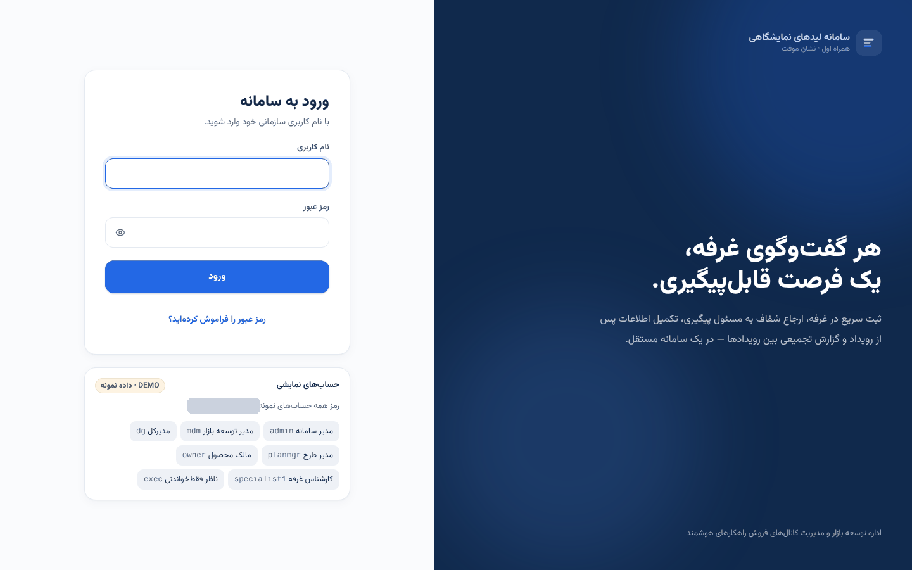

صفحه ورود دسکتاپ با پنل معرفی؛ رمز حساب‌های نمایشی در تصویر پوشانده شده است.

| ویژگی | مقدار |
|---|---|
| فایل | [`screenshots/desktop/desktop-01-login.png`](../screenshots/desktop/desktop-01-login.png) |
| Route | `/login` |
| نقش | — (بدون ورود) |
| Viewport / دستگاه | 1440×900 · desktop (`desktop-1440`) |
| تست | tools/capture-login.mjs (capture هدفمند؛ صفحه‌های بدون ورود در ماتریس QA نیستند) |
| Commit | d478da7 (کد محصول؛ HEAD شاخه QA ‎1d4fda6) |
| پایه/نهایی | final |
| دلیل انتخاب | نقطه ورود سامانه و پنل حساب‌های نمایشی حالت DEMO |
| منبع | `(capture هدفمند، در مخزن نگهداری نشده) desktop-1440__login.png` |
| ابعاد / حجم | 1440x900 · 67 KB |
| داده ساختگی / بررسی‌شده | بله / بله |
| ویرایش | رمز حساب‌های نمایشی با کادر خاکستری پوشانده شد |

### desktop-02-analytics-dashboard.png

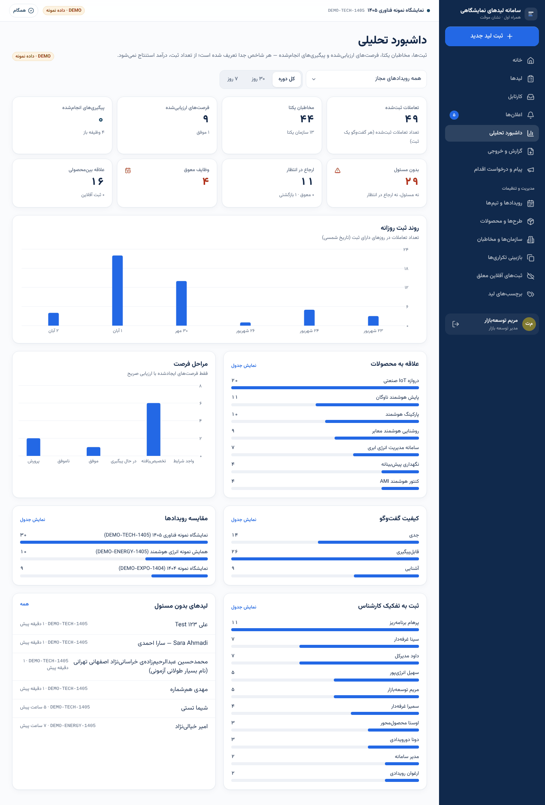

داشبورد تحلیلی مدیر توسعه بازار: کارت‌های شاخص، روند ثبت روزانه، مراحل فرصت و لیدهای بدون مسئول (داده نمونه).

| ویژگی | مقدار |
|---|---|
| فایل | [`screenshots/desktop/desktop-02-analytics-dashboard.png`](../screenshots/desktop/desktop-02-analytics-dashboard.png) |
| Route | `/dashboard` |
| نقش | mdm / MARKET_DEV_MANAGER |
| Viewport / دستگاه | 1440×900 · desktop (`desktop-1440`) |
| تست | frontend/qa-e2e/07-matrix-visual.spec.ts › TC-MTX-mdm |
| Commit | d478da7 (کد محصول؛ HEAD شاخه QA ‎1d4fda6) |
| پایه/نهایی | final |
| دلیل انتخاب | تنها داشبورد تحلیلی موجود در فاز ۱ |
| منبع | `qa/screenshots/pack-d478da7/mdm/desktop-1440/dashboard__ready.png  (re-capture هدفمند؛ در مخزن نگهداری نشده)` |
| ابعاد / حجم | 1440x2126 · 97 KB |
| داده ساختگی / بررسی‌شده | بله / بله |

### desktop-03-booth-home.png

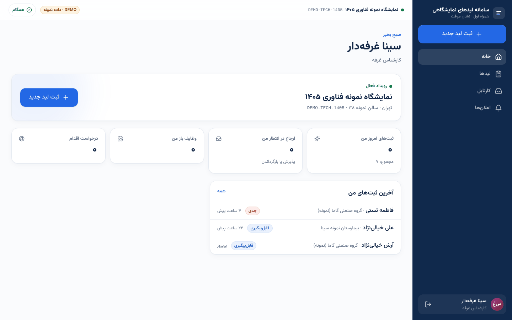

خانه کارشناس غرفه: رویداد فعال، دکمه ثبت لید جدید و آخرین ثبت‌های خود کاربر.

| ویژگی | مقدار |
|---|---|
| فایل | [`screenshots/desktop/desktop-03-booth-home.png`](../screenshots/desktop/desktop-03-booth-home.png) |
| Route | `/` |
| نقش | specialist1 / BOOTH_SPECIALIST |
| Viewport / دستگاه | 1440×900 · desktop (`desktop-1440`) |
| تست | frontend/qa-e2e/07-matrix-visual.spec.ts › TC-MTX-specialist1 |
| Commit | d478da7 (کد محصول؛ HEAD شاخه QA ‎1d4fda6) |
| پایه/نهایی | final |
| دلیل انتخاب | خانه نقش عملیاتی غرفه |
| منبع | `qa/screenshots/pack-d478da7/specialist1/desktop-1440/home__ready.png  (re-capture هدفمند؛ در مخزن نگهداری نشده)` |
| ابعاد / حجم | 1440x900 · 38 KB |
| داده ساختگی / بررسی‌شده | بله / بله |

### desktop-04-capture-form.png

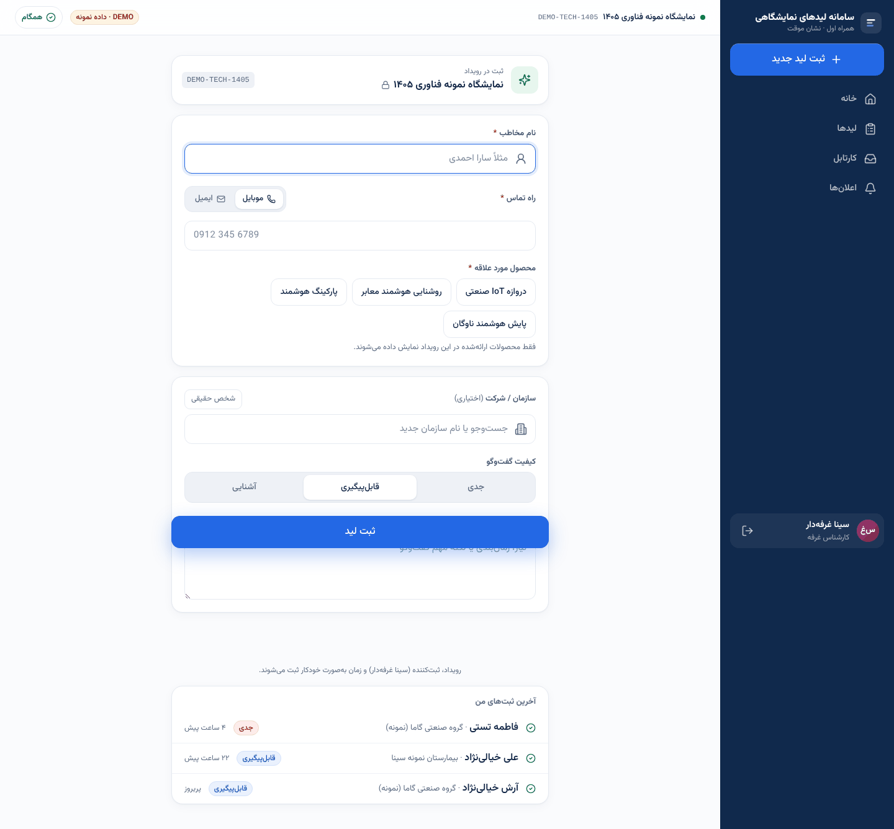

فرم ثبت لید در رویداد قفل‌شده: نام، راه تماس، محصول مورد علاقه، سازمان، کیفیت گفت‌وگو و یادداشت.

| ویژگی | مقدار |
|---|---|
| فایل | [`screenshots/desktop/desktop-04-capture-form.png`](../screenshots/desktop/desktop-04-capture-form.png) |
| Route | `/capture` |
| نقش | specialist1 / BOOTH_SPECIALIST |
| Viewport / دستگاه | 1440×900 · desktop (`desktop-1440`) |
| تست | frontend/qa-e2e/07-matrix-visual.spec.ts › TC-MTX-specialist1 |
| Commit | d478da7 (کد محصول؛ HEAD شاخه QA ‎1d4fda6) |
| پایه/نهایی | final |
| دلیل انتخاب | فرم اصلی ثبت سریع لید |
| منبع | `qa/screenshots/pack-d478da7/specialist1/desktop-1440/capture__ready.png  (re-capture هدفمند؛ در مخزن نگهداری نشده)` |
| ابعاد / حجم | 1440x1337 · 51 KB |
| داده ساختگی / بررسی‌شده | بله / بله |

### desktop-05-leads-list.png

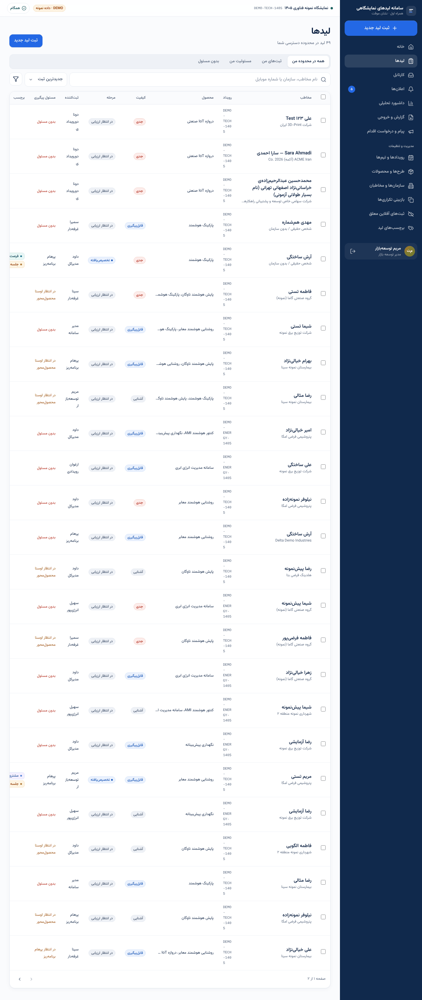

فهرست لیدها با تب‌های «همه در محدوده من/ثبت‌های من/مسئولیت من/بدون مسئول»، جست‌وجو و ستون‌های رویداد، محصول، کیفیت و وضعیت.

| ویژگی | مقدار |
|---|---|
| فایل | [`screenshots/desktop/desktop-05-leads-list.png`](../screenshots/desktop/desktop-05-leads-list.png) |
| Route | `/leads` |
| نقش | mdm / MARKET_DEV_MANAGER |
| Viewport / دستگاه | 1440×900 · desktop (`desktop-1440`) |
| تست | frontend/qa-e2e/07-matrix-visual.spec.ts › TC-MTX-mdm |
| Commit | d478da7 (کد محصول؛ HEAD شاخه QA ‎1d4fda6) |
| پایه/نهایی | final |
| دلیل انتخاب | فهرست لیدها با فیلتر و تب‌های دامنه |
| منبع | `qa/screenshots/pack-d478da7/mdm/desktop-1440/leads__ready.png  (re-capture هدفمند؛ در مخزن نگهداری نشده)` |
| ابعاد / حجم | 1440x3407 · 160 KB |
| داده ساختگی / بررسی‌شده | بله / بله |

### desktop-06-lead-detail.png

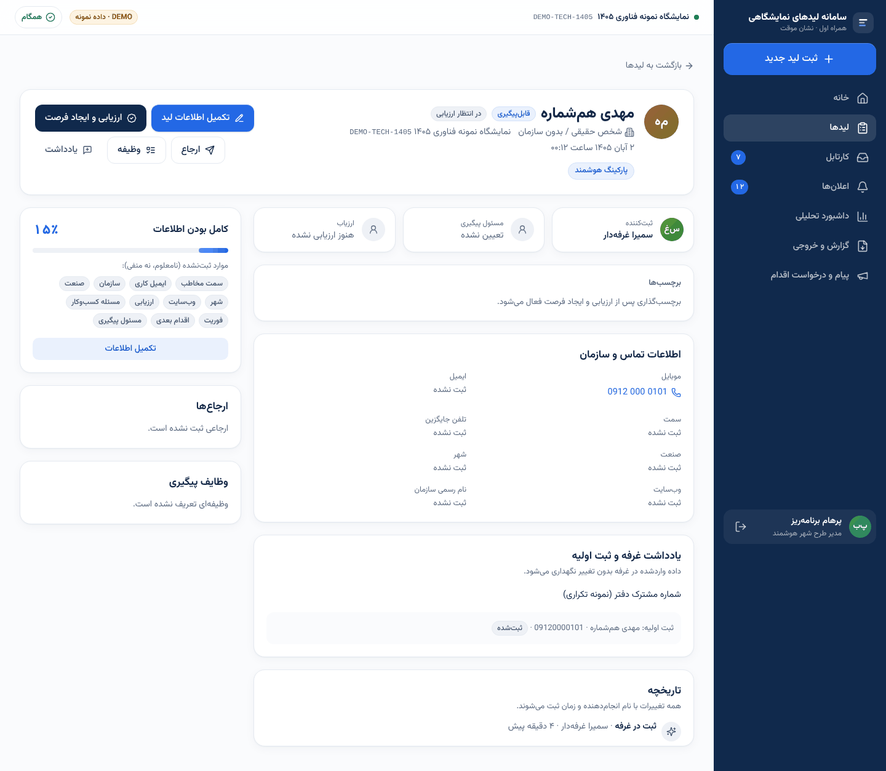

جزئیات لید: تکمیل اطلاعات، ارزیابی و ایجاد فرصت، ارجاع، وظیفه، یادداشت، اطلاعات تماس و تاریخچه.

| ویژگی | مقدار |
|---|---|
| فایل | [`screenshots/desktop/desktop-06-lead-detail.png`](../screenshots/desktop/desktop-06-lead-detail.png) |
| Route | `/leads/:id` |
| نقش | planmgr / PLAN_MANAGER |
| Viewport / دستگاه | 1440×900 · desktop (`desktop-1440`) |
| تست | frontend/qa-e2e/07-matrix-visual.spec.ts › TC-MTX-planmgr |
| Commit | d478da7 (کد محصول؛ HEAD شاخه QA ‎1d4fda6) |
| پایه/نهایی | final |
| دلیل انتخاب | پرونده لید و اقدام‌های اصلی |
| منبع | `qa/screenshots/pack-d478da7/planmgr/desktop-1440/leads_id__ready.png  (re-capture هدفمند؛ در مخزن نگهداری نشده)` |
| ابعاد / حجم | 1440x1253 · 68 KB |
| داده ساختگی / بررسی‌شده | بله / بله |

### desktop-07-inbox.png

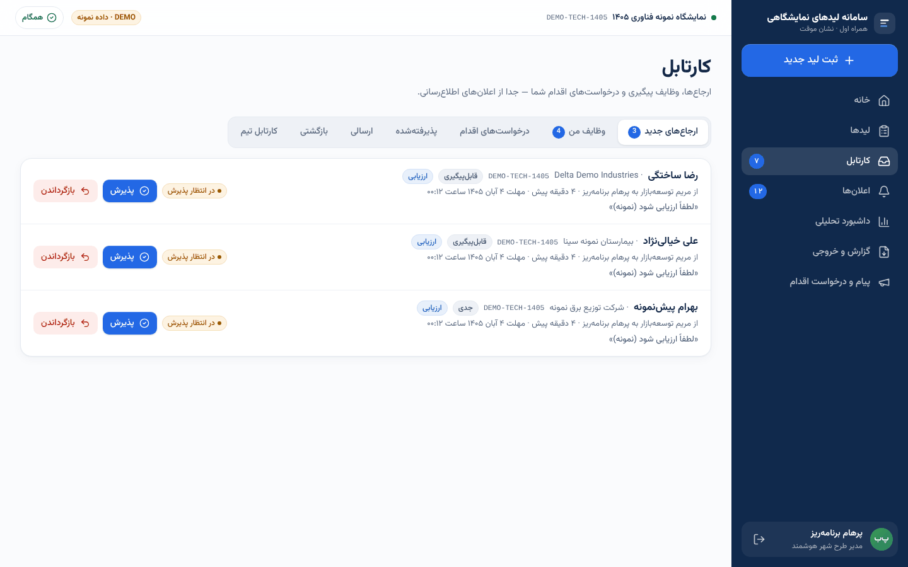

کارتابل مدیر طرح: ارجاع‌های دریافتی با مهلت و اقدام پذیرش/بازگرداندن.

| ویژگی | مقدار |
|---|---|
| فایل | [`screenshots/desktop/desktop-07-inbox.png`](../screenshots/desktop/desktop-07-inbox.png) |
| Route | `/inbox` |
| نقش | planmgr / PLAN_MANAGER |
| Viewport / دستگاه | 1440×900 · desktop (`desktop-1440`) |
| تست | frontend/qa-e2e/07-matrix-visual.spec.ts › TC-MTX-planmgr |
| Commit | d478da7 (کد محصول؛ HEAD شاخه QA ‎1d4fda6) |
| پایه/نهایی | final |
| دلیل انتخاب | کارتابل ارجاع‌ها و درخواست‌ها |
| منبع | `qa/screenshots/pack-d478da7/planmgr/desktop-1440/inbox__ready.png  (re-capture هدفمند؛ در مخزن نگهداری نشده)` |
| ابعاد / حجم | 1440x900 · 48 KB |
| داده ساختگی / بررسی‌شده | بله / بله |

## تبلت (۷۶۸×۱۰۲۴، چگالی ۲)

### tablet-01-analytics-dashboard.png

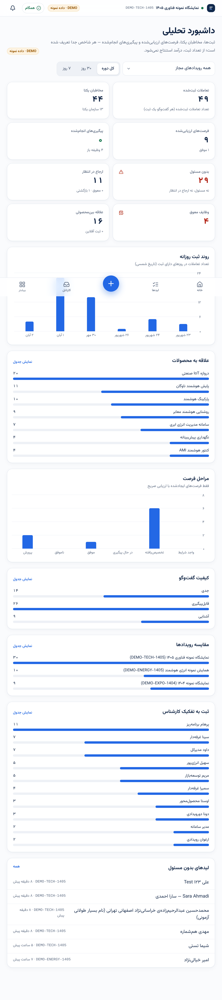

داشبورد تحلیلی در تبلت ۷۶۸ با نوار ناوبری پایین (در تصویر تمام‌صفحه، نوار ثابت در میانه دیده می‌شود).

| ویژگی | مقدار |
|---|---|
| فایل | [`screenshots/tablet/tablet-01-analytics-dashboard.png`](../screenshots/tablet/tablet-01-analytics-dashboard.png) |
| Route | `/dashboard` |
| نقش | mdm / MARKET_DEV_MANAGER |
| Viewport / دستگاه | 768×1024 @2x · tablet (`tablet-768`) |
| تست | frontend/qa-e2e/07-matrix-visual.spec.ts › TC-MTX-mdm |
| Commit | d478da7 (کد محصول؛ HEAD شاخه QA ‎1d4fda6) |
| پایه/نهایی | final |
| دلیل انتخاب | چیدمان یک‌ستونه داشبورد در تبلت |
| منبع | `qa/screenshots/pack-d478da7/mdm/tablet-768/dashboard__ready.png  (re-capture هدفمند؛ در مخزن نگهداری نشده)` |
| ابعاد / حجم | 1536x6912 · 225 KB |
| داده ساختگی / بررسی‌شده | بله / بله |

### tablet-02-leads-list.png

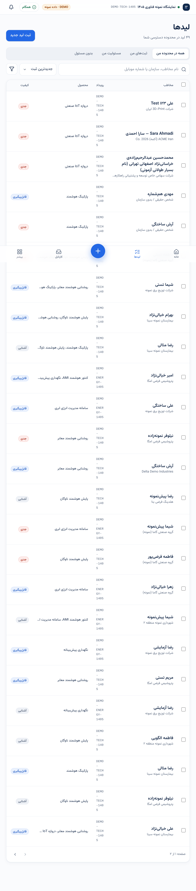

فهرست لیدها در تبلت با دکمه ثبت، تب‌های دامنه و مرتب‌سازی.

| ویژگی | مقدار |
|---|---|
| فایل | [`screenshots/tablet/tablet-02-leads-list.png`](../screenshots/tablet/tablet-02-leads-list.png) |
| Route | `/leads` |
| نقش | mdm / MARKET_DEV_MANAGER |
| Viewport / دستگاه | 768×1024 @2x · tablet (`tablet-768`) |
| تست | frontend/qa-e2e/07-matrix-visual.spec.ts › TC-MTX-mdm |
| Commit | d478da7 (کد محصول؛ HEAD شاخه QA ‎1d4fda6) |
| پایه/نهایی | final |
| دلیل انتخاب | فهرست لیدها در عرض میانی |
| منبع | `qa/screenshots/pack-d478da7/mdm/tablet-768/leads__ready.png  (re-capture هدفمند؛ در مخزن نگهداری نشده)` |
| ابعاد / حجم | 1536x6958 · 270 KB |
| داده ساختگی / بررسی‌شده | بله / بله |

### tablet-03-lead-detail.png

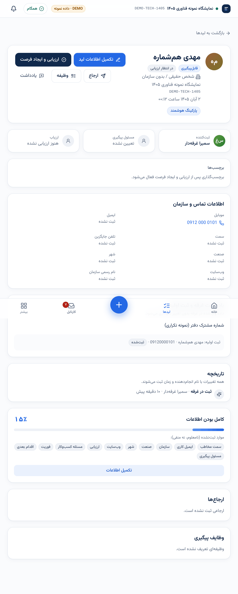

جزئیات لید در تبلت؛ نشان کارتابل روی نوار پایین تعداد موارد در انتظار را نشان می‌دهد.

| ویژگی | مقدار |
|---|---|
| فایل | [`screenshots/tablet/tablet-03-lead-detail.png`](../screenshots/tablet/tablet-03-lead-detail.png) |
| Route | `/leads/:id` |
| نقش | planmgr / PLAN_MANAGER |
| Viewport / دستگاه | 768×1024 @2x · tablet (`tablet-768`) |
| تست | frontend/qa-e2e/07-matrix-visual.spec.ts › TC-MTX-planmgr |
| Commit | d478da7 (کد محصول؛ HEAD شاخه QA ‎1d4fda6) |
| پایه/نهایی | final |
| دلیل انتخاب | پرونده لید در تبلت |
| منبع | `qa/screenshots/pack-d478da7/planmgr/tablet-768/leads_id__ready.png  (re-capture هدفمند؛ در مخزن نگهداری نشده)` |
| ابعاد / حجم | 1536x3820 · 152 KB |
| داده ساختگی / بررسی‌شده | بله / بله |

### tablet-04-capture-form.png

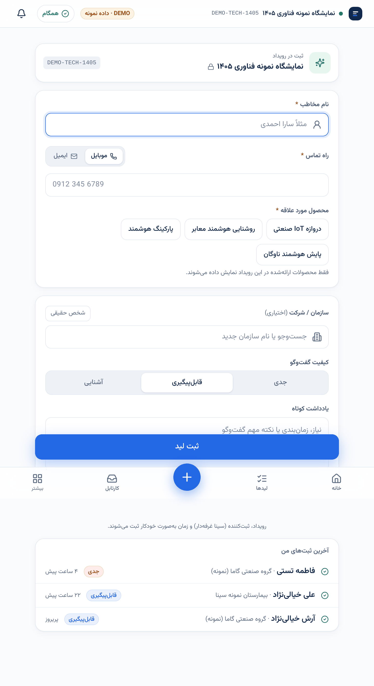

فرم ثبت لید در تبلت ۷۶۸ برای کارشناس غرفه.

| ویژگی | مقدار |
|---|---|
| فایل | [`screenshots/tablet/tablet-04-capture-form.png`](../screenshots/tablet/tablet-04-capture-form.png) |
| Route | `/capture` |
| نقش | specialist1 / BOOTH_SPECIALIST |
| Viewport / دستگاه | 768×1024 @2x · tablet (`tablet-768`) |
| تست | frontend/qa-e2e/07-matrix-visual.spec.ts › TC-MTX-specialist1 |
| Commit | d478da7 (کد محصول؛ HEAD شاخه QA ‎1d4fda6) |
| پایه/نهایی | final |
| دلیل انتخاب | ثبت لید در تبلت غرفه |
| منبع | `qa/screenshots/pack-d478da7/specialist1/tablet-768/capture__ready.png  (re-capture هدفمند؛ در مخزن نگهداری نشده)` |
| ابعاد / حجم | 1536x2818 · 114 KB |
| داده ساختگی / بررسی‌شده | بله / بله |

## موبایل (۳۹۰×۸۴۴، چگالی ۲)

### mobile-01-login.png

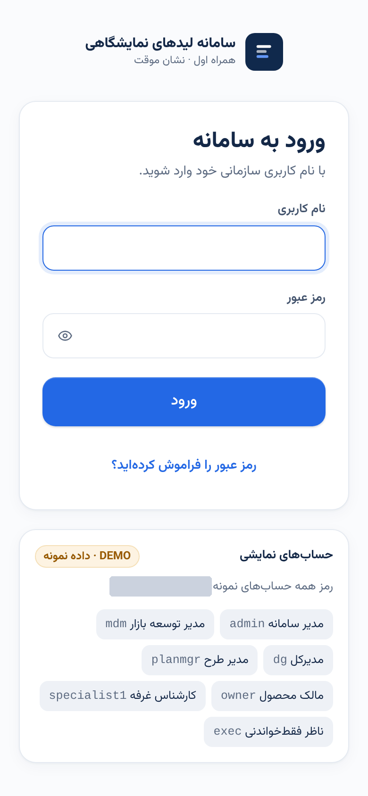

صفحه ورود موبایل؛ رمز حساب‌های نمایشی پوشانده شده است.

| ویژگی | مقدار |
|---|---|
| فایل | [`screenshots/mobile/mobile-01-login.png`](../screenshots/mobile/mobile-01-login.png) |
| Route | `/login` |
| نقش | — (بدون ورود) |
| Viewport / دستگاه | 390×844 @2x · mobile (`mobile-390`) |
| تست | tools/capture-login.mjs (capture هدفمند؛ صفحه‌های بدون ورود در ماتریس QA نیستند) |
| Commit | d478da7 (کد محصول؛ HEAD شاخه QA ‎1d4fda6) |
| پایه/نهایی | final |
| دلیل انتخاب | ورود در موبایل |
| منبع | `(capture هدفمند، در مخزن نگهداری نشده) mobile-390__login.png` |
| ابعاد / حجم | 780x1688 · 40 KB |
| داده ساختگی / بررسی‌شده | بله / بله |
| ویرایش | رمز حساب‌های نمایشی با کادر خاکستری پوشانده شد |

### mobile-02-booth-home.png

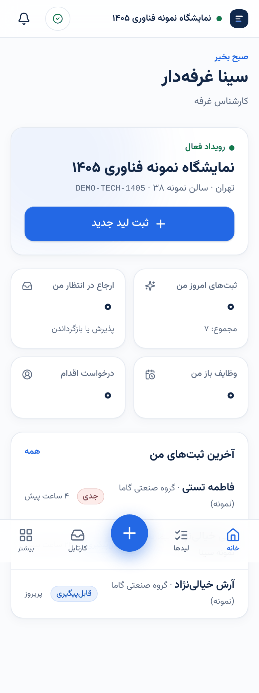

خانه موبایل با کارت رویداد فعال، دکمه ثبت لید و نوار ناوبری پایین.

| ویژگی | مقدار |
|---|---|
| فایل | [`screenshots/mobile/mobile-02-booth-home.png`](../screenshots/mobile/mobile-02-booth-home.png) |
| Route | `/` |
| نقش | specialist1 / BOOTH_SPECIALIST |
| Viewport / دستگاه | 390×844 @2x · mobile (`mobile-390`) |
| تست | frontend/qa-e2e/07-matrix-visual.spec.ts › TC-MTX-specialist1 |
| Commit | d478da7 (کد محصول؛ HEAD شاخه QA ‎1d4fda6) |
| پایه/نهایی | final |
| دلیل انتخاب | خانه موبایل کارشناس غرفه |
| منبع | `qa/screenshots/pack-d478da7/specialist1/mobile-390/home__ready.png  (re-capture هدفمند؛ در مخزن نگهداری نشده)` |
| ابعاد / حجم | 780x2080 · 80 KB |
| داده ساختگی / بررسی‌شده | بله / بله |

### mobile-03-capture-form.png

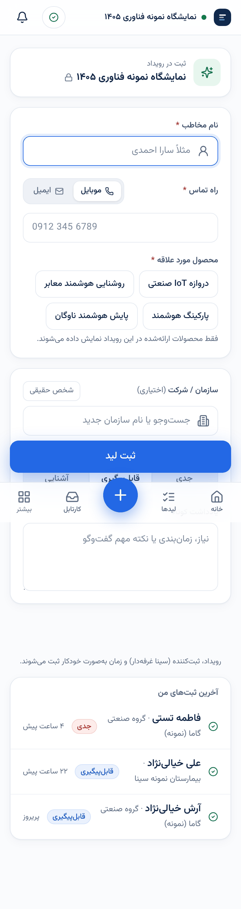

فرم ثبت لید موبایل با دکمه ثبت ثابت.

| ویژگی | مقدار |
|---|---|
| فایل | [`screenshots/mobile/mobile-03-capture-form.png`](../screenshots/mobile/mobile-03-capture-form.png) |
| Route | `/capture` |
| نقش | specialist1 / BOOTH_SPECIALIST |
| Viewport / دستگاه | 390×844 @2x · mobile (`mobile-390`) |
| تست | frontend/qa-e2e/07-matrix-visual.spec.ts › TC-MTX-specialist1 |
| Commit | d478da7 (کد محصول؛ HEAD شاخه QA ‎1d4fda6) |
| پایه/نهایی | final |
| دلیل انتخاب | سناریوی اصلی: ثبت لید با گوشی در غرفه |
| منبع | `qa/screenshots/pack-d478da7/specialist1/mobile-390/capture__ready.png  (re-capture هدفمند؛ در مخزن نگهداری نشده)` |
| ابعاد / حجم | 780x2938 · 100 KB |
| داده ساختگی / بررسی‌شده | بله / بله |

### mobile-04-capture-queue.png

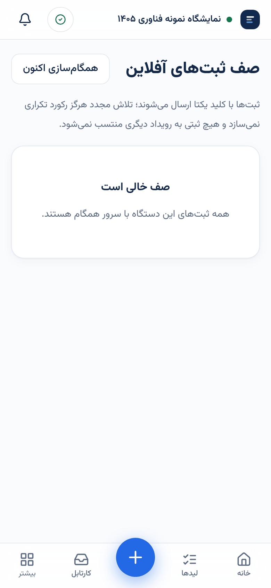

صفحه صف همگام‌سازی ثبت‌های آفلاین (در این تصویر صف خالی است).

| ویژگی | مقدار |
|---|---|
| فایل | [`screenshots/mobile/mobile-04-capture-queue.png`](../screenshots/mobile/mobile-04-capture-queue.png) |
| Route | `/capture/queue` |
| نقش | specialist1 / BOOTH_SPECIALIST |
| Viewport / دستگاه | 390×844 @2x · mobile (`mobile-390`) |
| تست | frontend/qa-e2e/07-matrix-visual.spec.ts › TC-MTX-specialist1 |
| Commit | d478da7 (کد محصول؛ HEAD شاخه QA ‎1d4fda6) |
| پایه/نهایی | final |
| دلیل انتخاب | صف همگام‌سازی آفلاین |
| منبع | `qa/screenshots/pack-d478da7/specialist1/mobile-390/capture_queue__ready.png  (re-capture هدفمند؛ در مخزن نگهداری نشده)` |
| ابعاد / حجم | 780x1688 · 42 KB |
| داده ساختگی / بررسی‌شده | بله / بله |

### mobile-05-leads-list.png

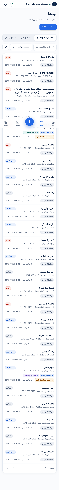

فهرست لیدها در موبایل به‌صورت کارت.

| ویژگی | مقدار |
|---|---|
| فایل | [`screenshots/mobile/mobile-05-leads-list.png`](../screenshots/mobile/mobile-05-leads-list.png) |
| Route | `/leads` |
| نقش | mdm / MARKET_DEV_MANAGER |
| Viewport / دستگاه | 390×844 @2x · mobile (`mobile-390`) |
| تست | frontend/qa-e2e/07-matrix-visual.spec.ts › TC-MTX-mdm |
| Commit | d478da7 (کد محصول؛ HEAD شاخه QA ‎1d4fda6) |
| پایه/نهایی | final |
| دلیل انتخاب | فهرست لید به شکل کارت در موبایل |
| منبع | `qa/screenshots/pack-d478da7/mdm/mobile-390/leads__ready.png  (re-capture هدفمند؛ در مخزن نگهداری نشده)` |
| ابعاد / حجم | 780x6440 · 274 KB |
| داده ساختگی / بررسی‌شده | بله / بله |

### mobile-06-lead-detail.png

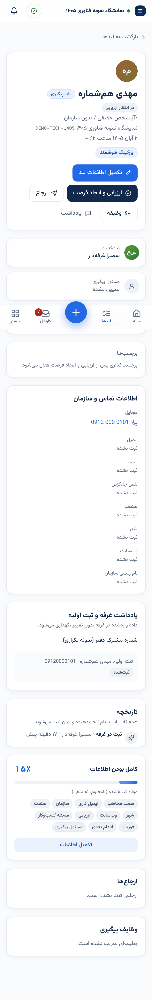

جزئیات لید در موبایل با اقدام‌های اصلی.

| ویژگی | مقدار |
|---|---|
| فایل | [`screenshots/mobile/mobile-06-lead-detail.png`](../screenshots/mobile/mobile-06-lead-detail.png) |
| Route | `/leads/:id` |
| نقش | planmgr / PLAN_MANAGER |
| Viewport / دستگاه | 390×844 @2x · mobile (`mobile-390`) |
| تست | frontend/qa-e2e/07-matrix-visual.spec.ts › TC-MTX-planmgr |
| Commit | d478da7 (کد محصول؛ HEAD شاخه QA ‎1d4fda6) |
| پایه/نهایی | final |
| دلیل انتخاب | پرونده لید در موبایل |
| منبع | `qa/screenshots/pack-d478da7/planmgr/mobile-390/leads_id__ready.png  (re-capture هدفمند؛ در مخزن نگهداری نشده)` |
| ابعاد / حجم | 780x5124 · 146 KB |
| داده ساختگی / بررسی‌شده | بله / بله |

### mobile-07-inbox.png

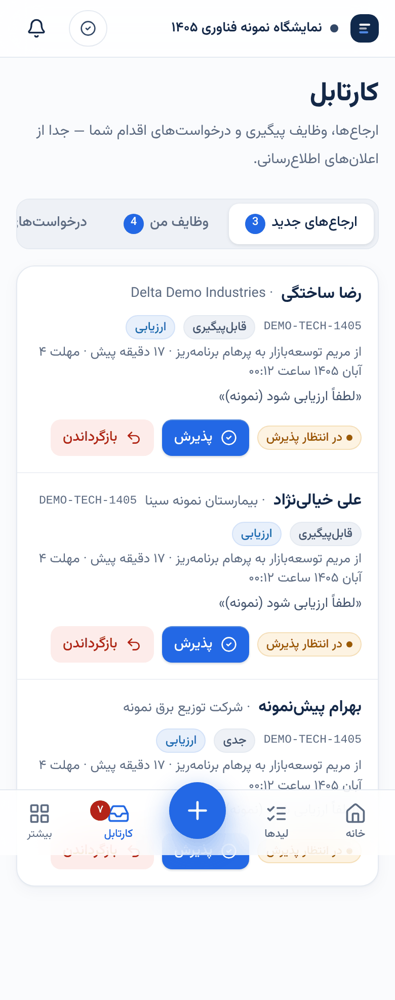

کارتابل ارجاع‌ها در موبایل.

| ویژگی | مقدار |
|---|---|
| فایل | [`screenshots/mobile/mobile-07-inbox.png`](../screenshots/mobile/mobile-07-inbox.png) |
| Route | `/inbox` |
| نقش | planmgr / PLAN_MANAGER |
| Viewport / دستگاه | 390×844 @2x · mobile (`mobile-390`) |
| تست | frontend/qa-e2e/07-matrix-visual.spec.ts › TC-MTX-planmgr |
| Commit | d478da7 (کد محصول؛ HEAD شاخه QA ‎1d4fda6) |
| پایه/نهایی | final |
| دلیل انتخاب | پاسخ به ارجاع از موبایل |
| منبع | `qa/screenshots/pack-d478da7/planmgr/mobile-390/inbox__ready.png  (re-capture هدفمند؛ در مخزن نگهداری نشده)` |
| ابعاد / حجم | 780x1974 · 91 KB |
| داده ساختگی / بررسی‌شده | بله / بله |

## نقش‌ها و مدیریت

### roles-01-admin-users.png

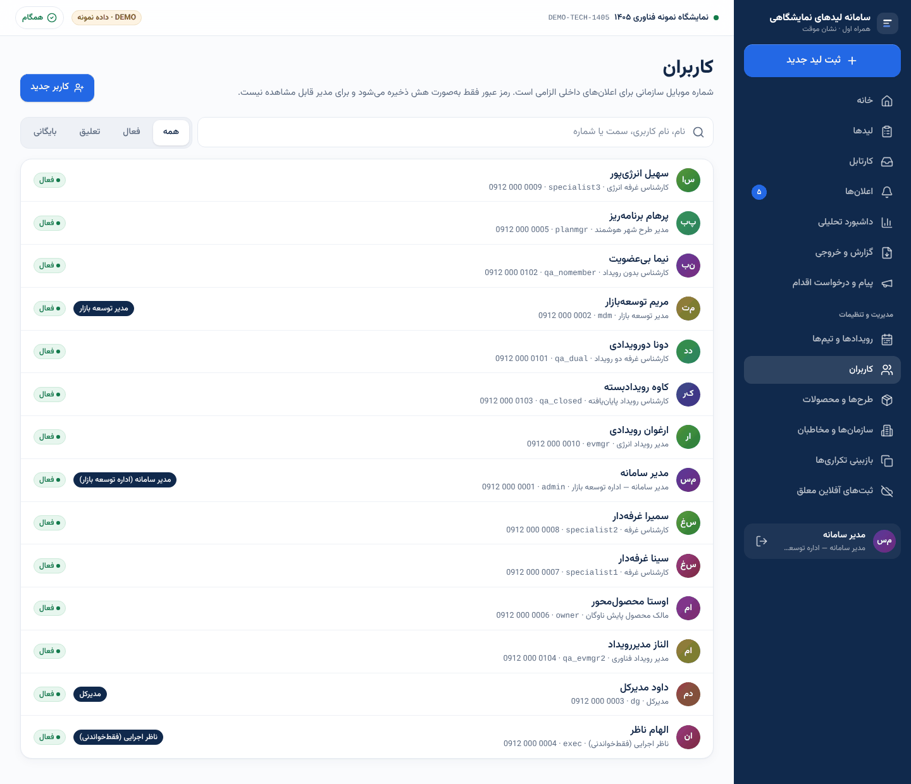

مدیریت کاربران: فهرست کاربران نمونه، وضعیت و نقش‌ها.

| ویژگی | مقدار |
|---|---|
| فایل | [`screenshots/roles/roles-01-admin-users.png`](../screenshots/roles/roles-01-admin-users.png) |
| Route | `/admin/users` |
| نقش | admin / SYSTEM_ADMIN |
| Viewport / دستگاه | 1440×900 · desktop (`desktop-1440`) |
| تست | frontend/qa-e2e/07-matrix-visual.spec.ts › TC-MTX-admin |
| Commit | d478da7 (کد محصول؛ HEAD شاخه QA ‎1d4fda6) |
| پایه/نهایی | final |
| دلیل انتخاب | مدیریت کاربران (فقط SYSTEM_ADMIN) |
| منبع | `qa/screenshots/pack-d478da7/admin/desktop-1440/admin_users__ready.png  (re-capture هدفمند؛ در مخزن نگهداری نشده)` |
| ابعاد / حجم | 1440x1240 · 73 KB |
| داده ساختگی / بررسی‌شده | بله / بله |

### roles-02-admin-roles.png

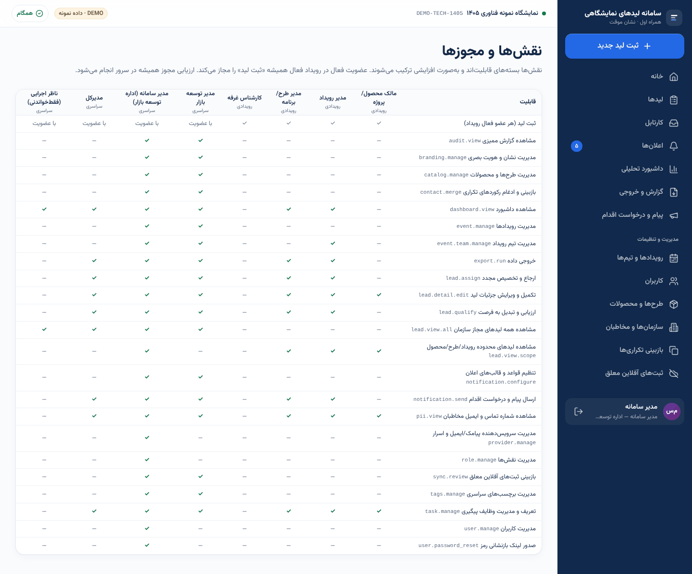

صفحه نقش‌ها و مجوزها: ۸ نقش سیستمی در برابر قابلیت‌ها.

| ویژگی | مقدار |
|---|---|
| فایل | [`screenshots/roles/roles-02-admin-roles.png`](../screenshots/roles/roles-02-admin-roles.png) |
| Route | `/admin/roles` |
| نقش | admin / SYSTEM_ADMIN |
| Viewport / دستگاه | 1440×900 · desktop (`desktop-1440`) |
| تست | frontend/qa-e2e/07-matrix-visual.spec.ts › TC-MTX-admin |
| Commit | d478da7 (کد محصول؛ HEAD شاخه QA ‎1d4fda6) |
| پایه/نهایی | final |
| دلیل انتخاب | ماتریس نقش × مجوز در خود محصول |
| منبع | `qa/screenshots/pack-d478da7/admin/desktop-1440/admin_roles__ready.png  (re-capture هدفمند؛ در مخزن نگهداری نشده)` |
| ابعاد / حجم | 1440x1194 · 68 KB |
| داده ساختگی / بررسی‌شده | بله / بله |

### roles-03-booth-dashboard-denied.png

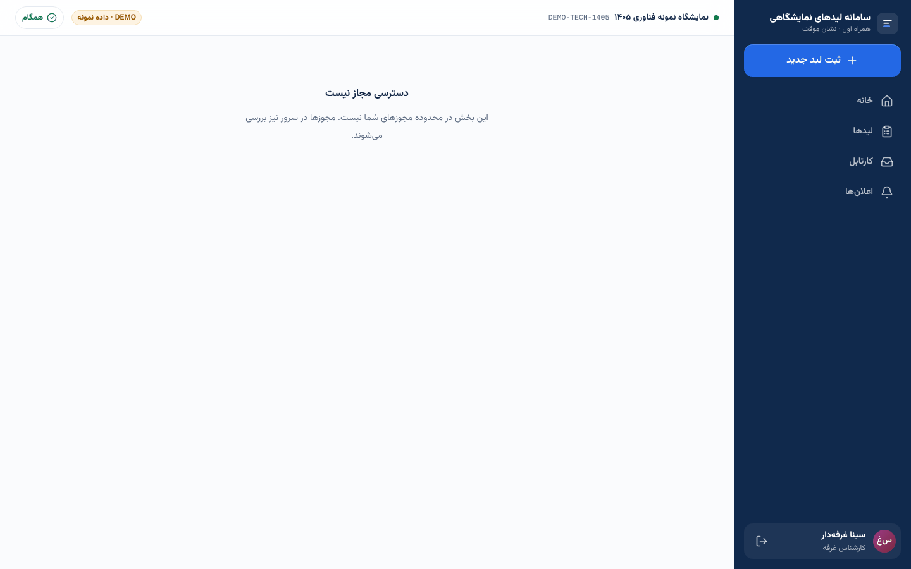

کارشناس غرفه مجوز analytics.view ندارد و پیام «دسترسی مجاز نیست» می‌بیند؛ منو نیز این گزینه را ندارد.

| ویژگی | مقدار |
|---|---|
| فایل | [`screenshots/roles/roles-03-booth-dashboard-denied.png`](../screenshots/roles/roles-03-booth-dashboard-denied.png) |
| Route | `/dashboard` |
| نقش | specialist1 / BOOTH_SPECIALIST |
| Viewport / دستگاه | 1440×900 · desktop (`desktop-1440`) |
| تست | frontend/qa-e2e/07-matrix-visual.spec.ts › TC-MTX-specialist1 |
| Commit | d478da7 (کد محصول؛ HEAD شاخه QA ‎1d4fda6) |
| پایه/نهایی | final |
| دلیل انتخاب | اثبات بصری کنترل دسترسی |
| منبع | `qa/screenshots/pack-d478da7/specialist1/desktop-1440/dashboard__denied.png  (re-capture هدفمند؛ در مخزن نگهداری نشده)` |
| ابعاد / حجم | 1440x900 · 17 KB |
| داده ساختگی / بررسی‌شده | بله / بله |

### roles-04-executive-readonly-masked.png

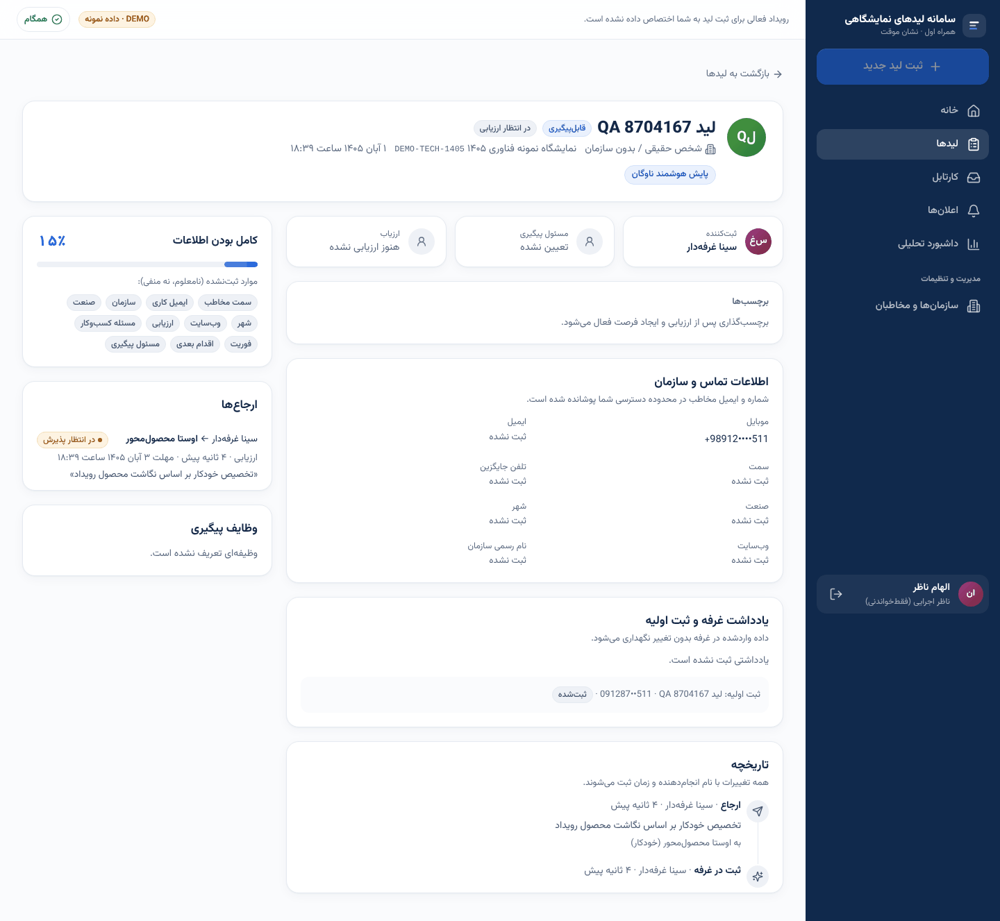

ناظر فقط‌خواندنی: اقدام‌های ویرایشی پنهان و شماره موبایل ماسک‌شده (بدون مجوز pii.view).

| ویژگی | مقدار |
|---|---|
| فایل | [`screenshots/roles/roles-04-executive-readonly-masked.png`](../screenshots/roles/roles-04-executive-readonly-masked.png) |
| Route | `/leads/:id` |
| نقش | exec / EXECUTIVE_READONLY |
| Viewport / دستگاه | 1440×900 · desktop (`desktop-1440`) |
| تست | frontend/qa-e2e › TC-ENR-02 |
| Commit | e661188 |
| پایه/نهایی | final |
| دلیل انتخاب | نقش فقط‌خواندنی و ماسک PII |
| منبع | [`qa/screenshots/e661188/exec/desktop-1440/leads_id__readonly-masked.png`](../../../qa/screenshots/e661188/exec/desktop-1440/leads_id__readonly-masked.png) |
| ابعاد / حجم | 1440x1327 · 71 KB |
| داده ساختگی / بررسی‌شده | بله / بله |

## حالت‌های سیستم

### states-01-offline-queued.png

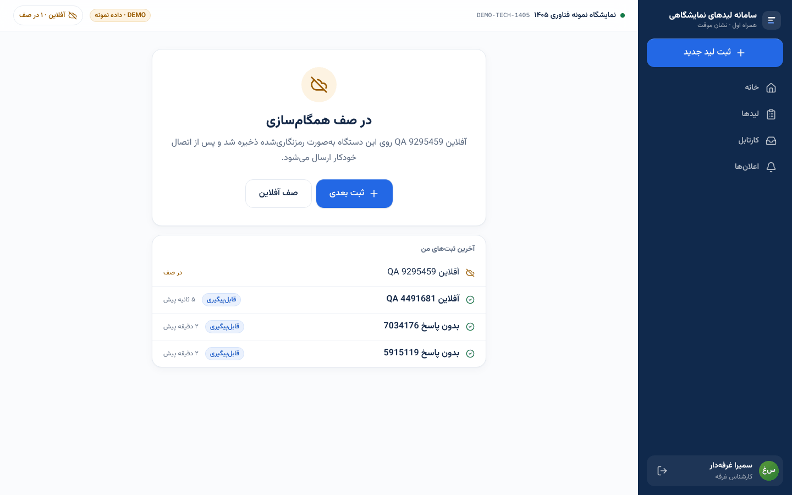

ثبت در حالت آفلاین: پیام «در صف همگام‌سازی» و فهرست ثبت‌های اخیر با برچسب آفلاین.

| ویژگی | مقدار |
|---|---|
| فایل | [`screenshots/states/states-01-offline-queued.png`](../screenshots/states/states-01-offline-queued.png) |
| Route | `/capture` |
| نقش | specialist2 / BOOTH_SPECIALIST |
| Viewport / دستگاه | 1440×900 · desktop (`desktop-1440`) |
| تست | frontend/qa-e2e › TC-OFF-01 |
| Commit | e661188 |
| پایه/نهایی | final |
| دلیل انتخاب | ثبت آفلاین و صف رمزنگاری‌شده |
| منبع | [`qa/screenshots/e661188/specialist2/desktop-1440/capture__offline-queued.png`](../../../qa/screenshots/e661188/specialist2/desktop-1440/capture__offline-queued.png) |
| ابعاد / حجم | 1440x900 · 33 KB |
| داده ساختگی / بررسی‌شده | بله / بله |

### states-02-server-error.png

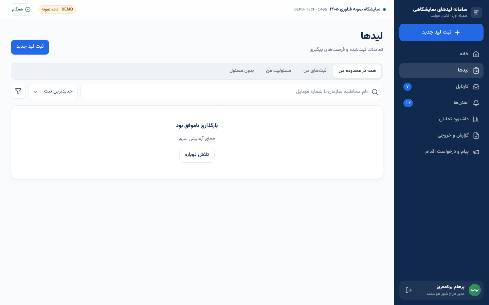

خطای ۵۰۰ شبیه‌سازی‌شده در فهرست لیدها: پیام «بارگذاری ناموفق بود» و دکمه تلاش دوباره.

| ویژگی | مقدار |
|---|---|
| فایل | [`screenshots/states/states-02-server-error.png`](../screenshots/states/states-02-server-error.png) |
| Route | `/leads` |
| نقش | planmgr / PLAN_MANAGER |
| Viewport / دستگاه | 1440×900 · desktop (`desktop-1440`) |
| تست | frontend/qa-e2e/07-matrix-visual.spec.ts › TC-VIS-STATES |
| Commit | d478da7 (کد محصول؛ HEAD شاخه QA ‎1d4fda6) |
| پایه/نهایی | final |
| دلیل انتخاب | حالت خطای سرور با امکان تلاش مجدد |
| منبع | `qa/screenshots/pack-d478da7/planmgr/desktop-1440/leads__server-error.png  (re-capture هدفمند؛ در مخزن نگهداری نشده)` |
| ابعاد / حجم | 1440x900 · 29 KB |
| داده ساختگی / بررسی‌شده | بله / بله |

### states-03-edit-conflict-409.png

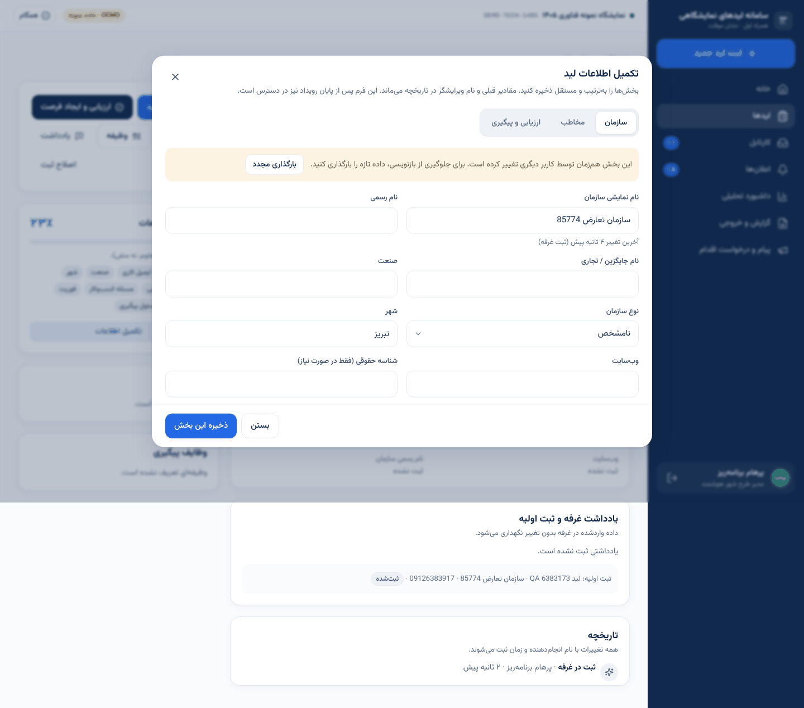

تعارض ویرایش هم‌زمان: پیام تغییر رکورد توسط کاربر دیگر و دکمه بارگذاری مجدد در فرم تکمیل اطلاعات.

| ویژگی | مقدار |
|---|---|
| فایل | [`screenshots/states/states-03-edit-conflict-409.png`](../screenshots/states/states-03-edit-conflict-409.png) |
| Route | `/leads/:id` |
| نقش | planmgr / PLAN_MANAGER |
| Viewport / دستگاه | 1440×900 · desktop (`desktop-1440`) |
| تست | frontend/qa-e2e › TC-ENR-03 |
| Commit | e661188 |
| پایه/نهایی | final |
| دلیل انتخاب | قفل خوش‌بینانه (version/409) |
| منبع | [`qa/screenshots/e661188/planmgr/desktop-1440/leads_id__conflict.png`](../../../qa/screenshots/e661188/planmgr/desktop-1440/leads_id__conflict.png) |
| ابعاد / حجم | 1440x1268 · 85 KB |
| داده ساختگی / بررسی‌شده | بله / بله |

### states-04-referral-modal.png

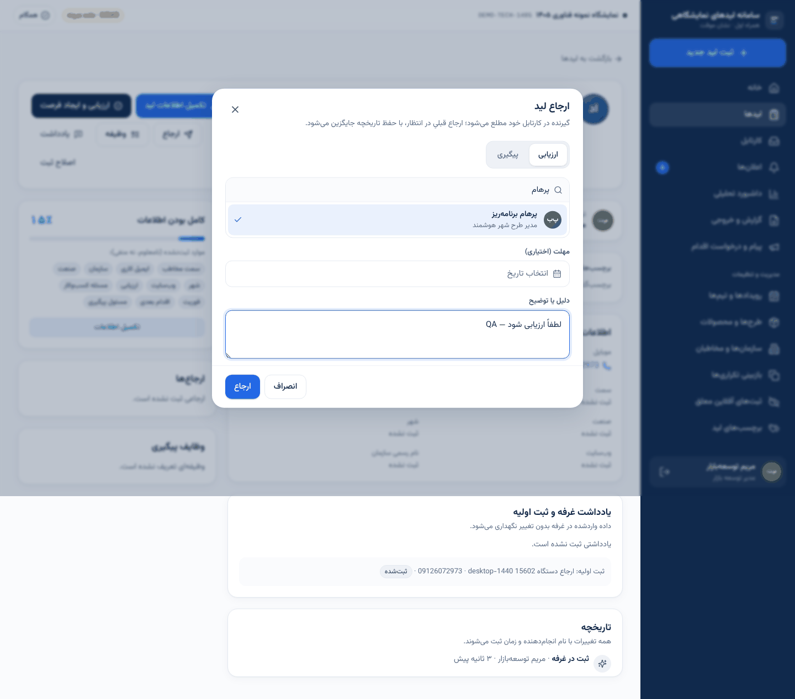

پنجره ارجاع: انتخاب گیرنده از اعضای رویداد، مهلت و توضیح.

| ویژگی | مقدار |
|---|---|
| فایل | [`screenshots/states/states-04-referral-modal.png`](../screenshots/states/states-04-referral-modal.png) |
| Route | `/leads/:id` |
| نقش | mdm / MARKET_DEV_MANAGER |
| Viewport / دستگاه | 1440×900 · desktop (`desktop-1440`) |
| تست | frontend/qa-e2e › TC-REF-01 |
| Commit | e661188 |
| پایه/نهایی | final |
| دلیل انتخاب | جریان ارجاع لید |
| منبع | [`qa/screenshots/e661188/mdm/desktop-1440/leads_id__refer-modal.png`](../../../qa/screenshots/e661188/mdm/desktop-1440/leads_id__refer-modal.png) |
| ابعاد / حجم | 1440x1268 · 109 KB |
| داده ساختگی / بررسی‌شده | بله / بله |

## قبل و بعد از رفع نقص

### before-after-01-capture-mobile-overflow-before.png

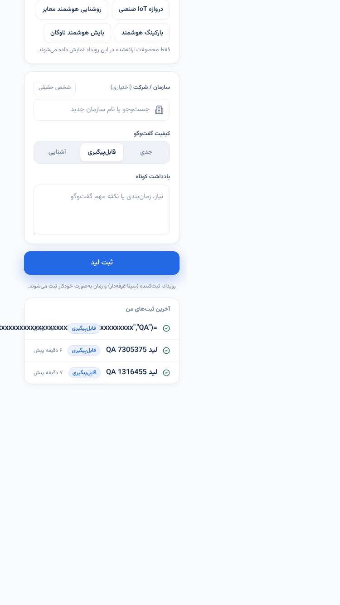

قبل: در ۳۷۵ پیکسل صفحه ثبت به‌خاطر یک نام طولانی آزمونی در «آخرین ثبت‌های من» دوبرابر عریض شد و دکمه‌ها از دید خارج شدند (رشته طولانی، ورودی ساختگی آزمون تزریق CSV است).

| ویژگی | مقدار |
|---|---|
| فایل | [`screenshots/before-after/before-after-01-capture-mobile-overflow-before.png`](../screenshots/before-after/before-after-01-capture-mobile-overflow-before.png) |
| Route | `/capture` |
| نقش | specialist1 / BOOTH_SPECIALIST |
| Viewport / دستگاه | 375×667 @2x · mobile (`mobile-375`) |
| تست | TC-CAP-01 / TC-CAP-06 |
| Commit | c6a1c88 |
| پایه/نهایی | baseline |
| دلیل انتخاب | شاهد نقص QA-D-20 (P1) |
| منبع | [`qa/traces/baseline-mobile-375/02-capture-TC-CAP-01-exist-28390-osen-from-search-suggestion-mobile-375/test-failed-1.png`](../../../qa/traces/baseline-mobile-375/02-capture-TC-CAP-01-exist-28390-osen-from-search-suggestion-mobile-375/test-failed-1.png) |
| ابعاد / حجم | 750x1334 · 30 KB |
| داده ساختگی / بررسی‌شده | بله / بله |

### before-after-01-capture-mobile-overflow-after.png

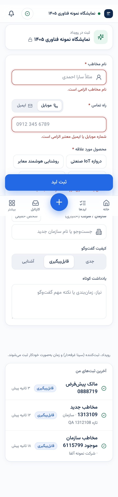

بعد (e661188): همان صفحه در ۳۷۵ پیکسل بدون اسکرول افقی؛ اعتبارسنجی فیلدها نمایش داده می‌شود.

| ویژگی | مقدار |
|---|---|
| فایل | [`screenshots/before-after/before-after-01-capture-mobile-overflow-after.png`](../screenshots/before-after/before-after-01-capture-mobile-overflow-after.png) |
| Route | `/capture` |
| نقش | specialist1 / BOOTH_SPECIALIST |
| Viewport / دستگاه | 375×667 @2x · mobile (`mobile-375`) |
| تست | TC-CAP-01 / TC-CAP-06 |
| Commit | e661188 |
| پایه/نهایی | final |
| دلیل انتخاب | تأیید رفع QA-D-20 (P1) |
| منبع | [`qa/screenshots/e661188/specialist1/mobile-375/capture__validation-errors.png`](../../../qa/screenshots/e661188/specialist1/mobile-375/capture__validation-errors.png) |
| ابعاد / حجم | 750x3138 · 100 KB |
| داده ساختگی / بررسی‌شده | بله / بله |

### before-after-02-offline-first-open-before.png

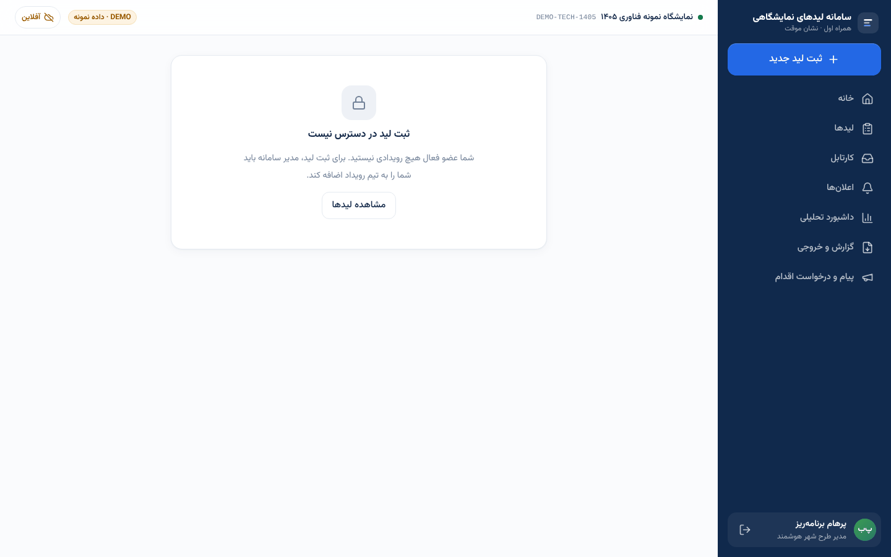

قبل: با قطع شبکه، کاربر عضو پیام «شما عضو فعال هیچ رویدادی نیستید» می‌دید و ثبت مسدود بود.

| ویژگی | مقدار |
|---|---|
| فایل | [`screenshots/before-after/before-after-02-offline-first-open-before.png`](../screenshots/before-after/before-after-02-offline-first-open-before.png) |
| Route | `/capture` |
| نقش | planmgr / PLAN_MANAGER |
| Viewport / دستگاه | 1440×900 · desktop (`desktop-1440`) |
| تست | TC-VIS-STATES / TC-OFF-06 |
| Commit | c6a1c88 |
| پایه/نهایی | baseline |
| دلیل انتخاب | شاهد نقص QA-D-19 (P2) |
| منبع | [`qa/traces/baseline-desktop-1440/07-matrix-visual-TC-VIS-ST-056b2--banner-popovers-and-toasts-desktop-1440/test-failed-1.png`](../../../qa/traces/baseline-desktop-1440/07-matrix-visual-TC-VIS-ST-056b2--banner-popovers-and-toasts-desktop-1440/test-failed-1.png) |
| ابعاد / حجم | 1440x900 · 23 KB |
| داده ساختگی / بررسی‌شده | بله / بله |

### before-after-02-offline-first-open-after.png

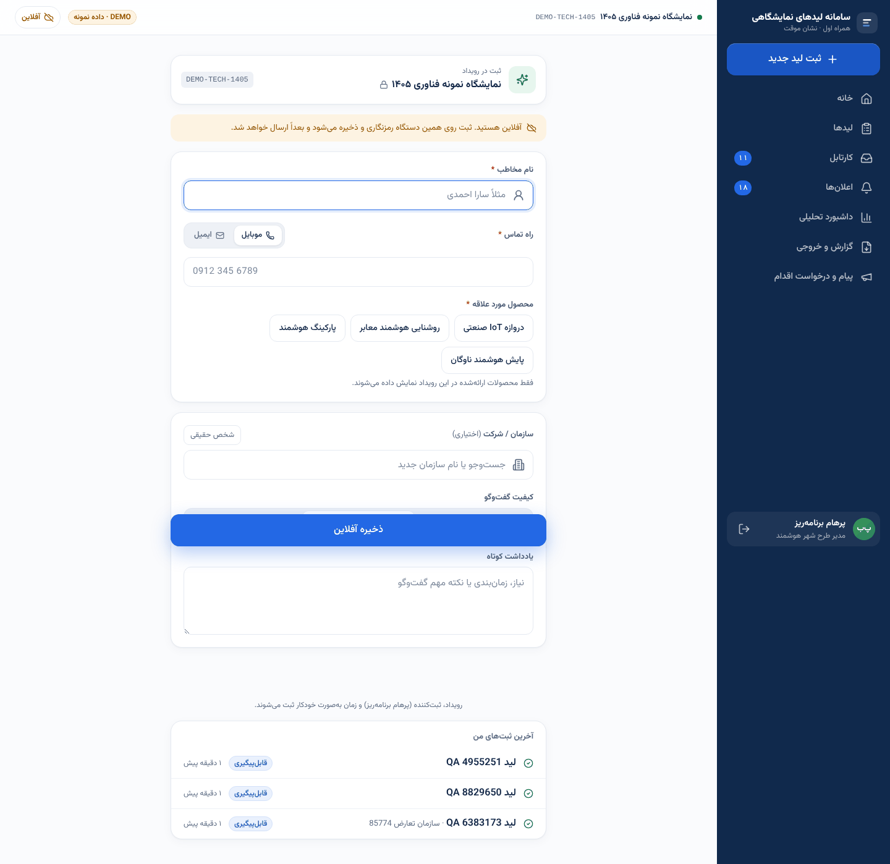

بعد (e661188): زمینه رویداد از حافظه رمزنگاری‌شده خوانده می‌شود، بنر آفلاین نمایش داده می‌شود و فرم ثبت فعال است.

| ویژگی | مقدار |
|---|---|
| فایل | [`screenshots/before-after/before-after-02-offline-first-open-after.png`](../screenshots/before-after/before-after-02-offline-first-open-after.png) |
| Route | `/capture` |
| نقش | planmgr / PLAN_MANAGER |
| Viewport / دستگاه | 1440×900 · desktop (`desktop-1440`) |
| تست | TC-VIS-STATES / TC-OFF-06 |
| Commit | e661188 |
| پایه/نهایی | final |
| دلیل انتخاب | تأیید رفع QA-D-19 (P2) |
| منبع | [`qa/screenshots/e661188/planmgr/desktop-1440/capture__offline-first-open.png`](../../../qa/screenshots/e661188/planmgr/desktop-1440/capture__offline-first-open.png) |
| ابعاد / حجم | 1440x1398 · 56 KB |
| داده ساختگی / بررسی‌شده | بله / بله |

### before-after-03-reports-mobile-overflow-before.png

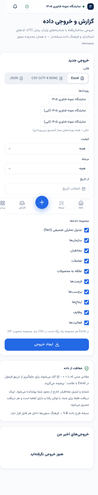

قبل (c6a1c88): کارت خروجی ۳۱ پیکسل از عرض صفحه بیشتر بود (عرض تصویر ۸۴۲ به‌جای ۷۸۰) و کل صفحه افقی اسکرول می‌شد.

| ویژگی | مقدار |
|---|---|
| فایل | [`screenshots/before-after/before-after-03-reports-mobile-overflow-before.png`](../screenshots/before-after/before-after-03-reports-mobile-overflow-before.png) |
| Route | `/reports` |
| نقش | admin / SYSTEM_ADMIN |
| Viewport / دستگاه | 390×844 @2x · mobile (`mobile-390`) |
| تست | TC-MTX-admin |
| Commit | c6a1c88 |
| پایه/نهایی | baseline |
| دلیل انتخاب | شاهد نقص QA-D-18 (P2) |
| منبع | [`qa/screenshots/c6a1c88/admin/mobile-390/reports__ready.png`](../../../qa/screenshots/c6a1c88/admin/mobile-390/reports__ready.png) |
| ابعاد / حجم | 842x4232 · 117 KB |
| داده ساختگی / بررسی‌شده | بله / بله |

### before-after-03-reports-mobile-overflow-after.png

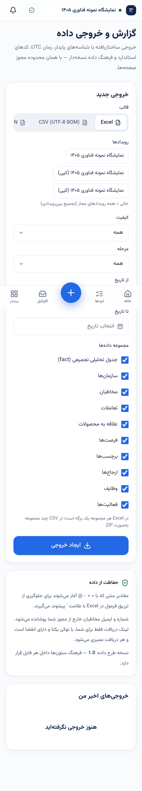

بعد (e661188): عرض تصویر برابر ۷۸۰ (۳۹۰×۲) و صفحه سرریز افقی ندارد؛ کلید انتخاب قالب در عرض کم درون خودش اسکرول می‌شود (گزینه JSON نیمه‌پنهان است).

| ویژگی | مقدار |
|---|---|
| فایل | [`screenshots/before-after/before-after-03-reports-mobile-overflow-after.png`](../screenshots/before-after/before-after-03-reports-mobile-overflow-after.png) |
| Route | `/reports` |
| نقش | admin / SYSTEM_ADMIN |
| Viewport / دستگاه | 390×844 @2x · mobile (`mobile-390`) |
| تست | TC-MTX-admin |
| Commit | e661188 |
| پایه/نهایی | final |
| دلیل انتخاب | تأیید رفع QA-D-18 (P2) |
| منبع | [`qa/screenshots/e661188/admin/mobile-390/reports__ready.png`](../../../qa/screenshots/e661188/admin/mobile-390/reports__ready.png) |
| ابعاد / حجم | 780x4324 · 121 KB |
| داده ساختگی / بررسی‌شده | بله / بله |

## مشاهدات از روی تصاویر (ثبت‌نشده در فهرست نقص‌ها)

- در `tablet-02-leads-list.png` ستون «رویداد» در عرض ۷۶۸ باریک است و کد `DEMO-TECH-1405` در چند سطر شکسته می‌شود. این مورد در گزارش QA به‌عنوان نقص ثبت نشده و فقط از روی تصویر دیده می‌شود؛ برای فاز ۲ پیشنهاد بازبینی چیدمان جدول در تبلت است.
- در تصاویر تمام‌صفحه تبلت و موبایل، نوار ناوبری پایین (ثابت) در محل viewport اول دیده می‌شود، نه انتهای تصویر؛ این رفتار طبیعی screenshot تمام‌صفحه با عنصر `position: fixed` است و نقص نیست.
- در `before-after-03-…-after.png` کلید انتخاب قالب خروجی در عرض ۳۹۰ درون خودش اسکرول می‌شود و گزینه JSON نیمه‌پنهان است؛ صفحه دیگر سرریز افقی ندارد.

